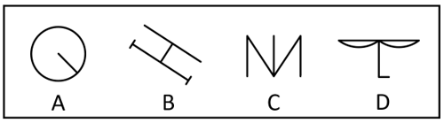

# 属性规律-对称性（轴对称）

考点：[[20-考点/判断推理/图形推理/属性规律-对称性（轴对称）|图形推理 / 属性规律-对称性（轴对称）]]

**问法模型**：“四个图形中与众不同的是”为求异（选非）问法 → 先找三个图形共有的属性（对称/曲直/开闭），不具备该属性者即为答案

## 推理链
1. 第1步：四图元素组成不同（A为圆内一条半径线，B为斜置‘H’形，C为折线组合，D为双弧线+竖线+左下小钩），优先考虑属性规律（对称性、曲直性、开闭性）
2. 第2步：逐一检验对称性：A沿半径所在直线对折可重合；B沿横杠方向及垂直于横杠方向对折均可重合；C沿左右（竖直）方向对折可重合
3. 第3步：D上方两段弧线与竖线看似左右呼应，但左下方多出的L形小钩使图形无论沿哪个方向对折均无法完全重合，故D不是轴对称图形
4. 第4步：三同一定，A、B、C均为轴对称图形，D不是，与众不同者为D
5. 第5步：辅助验证数量规律：B、C、D线条数均为5，A仅2条（直曲线合并计数），若按线数量应选A；但元素组成不同时属性规律优先，且本题对称特征明显，锁定D

**最快解法**：⚡ 属性规律优先口诀‘元素不同看属性，对称曲直开闭先’——一眼找对称轴：A（圆+半径）、B（斜H）、C（折线）均有明显对称轴，D因左下小钩找不到任何对称轴，直接选D

## 易错点
- ⚠ 被线数量干扰：A仅2条线而B、C、D均为5条，误选A；应牢记元素组成不同时属性规律优先于数量规律
- ⚠ 忽略D项左下小钩这一破坏对称的细节，误以为D关于中间竖线轴对称
- ⚠ B项斜置且端点带短刻线，可能误判其不对称，或在数线时漏数端点刻线

## 母题抽象
> 🧩 当四个图形元素组成不同且问‘与众不同’时，先查对称性：若三个图形有对称轴、一个图形被小细节（钩、缺口、附加点线）破坏对称，则该图形即为答案；对称性无差异时，再退而比较线数量等数量规律

**同类特征**：元素组成不同、求异/选非问法、轴对称特征明显、D项含破坏对称的小钩细节、存在线数量干扰（A为2条，其余为5条）

## 相关题
- [[10-真题/判断推理/图形推理/2730696 属性规律-对称性（轴对称）|2730696]]（深圳市考 2020，相关度2）
- [[10-真题/判断推理/图形推理/10204454 数量规律-部分数（黑白球连通区域数做和）|10204454]]（甘肃 2024，相关度1）
- [[10-真题/判断推理/图形推理/10204604 数量规律-线数量（汉字横线数）|10204604]]（辽宁 2024，相关度1）
- [[10-真题/判断推理/图形推理/10297050 数量规律-特殊计数（线条穿过小白球的数量）|10297050]]（天津 2025，相关度1）
- [[10-真题/判断推理/图形推理/10297127 图形间关系-相交图形中不相交边数量（黑白图形相交）|10297127]]（天津 2025，相关度1）

---

### 题干

下列四个图形中与众不同的是<u>        </u>。

### 选项
- A. A
- B. B
- C. C
- D. D　✅

### 官方解析
解法一：图形元素组成不同，优先考虑属性规律。观察发现，A、B、C三项均为轴对称图形，D项不是轴对称图形。
本题为选非题，故正确答案为D。
解法二：图形元素组成不同，线条数量明显，考虑线数量。观察发现，B、C、D三项的线条数均为5，A项线条数为2。
本题为选非题，故正确答案为A。
由于当元素组成不同时，优先考虑属性规律，且本题对称特征明显，故优先考虑对称性；同时，在历年线数量题目中，将直线与曲线合并数的题目并不多，因此综合本题目特征，粉笔倾向选择D项为正确答案。

### 给定材料
（无）

> [!note] 复核版本状态
> 原题不可计分（genuine_multi_answer；来源记录的答案键/竞争项：D、A）；仅当前明确标注的编辑版按答案D计分。
> 详细原题疑点、修订题面、解析和证据见下方独立复核记录。

<!-- CODEX-ANSWER-REVIEW:BEGIN -->
### 本次独立复核

**复核结论：** `resolved`（答案与解析已核定）

**原题计分状态：** 不计分（`genuine_multi_answer`：多个答案均成立）。来源中记录的答案键/竞争项：D、A；这些记录不代表原题已核准答案。

**原题疑点与处理：**

上海 2018 〔20-考点/判断推理/图形推理/属性规律-对称性（轴对称）〕 — 官方解析解法二按线数量（B、C、D均为5条、A为2条）指向A，与解法一对称性指向D存在内部张力；官方以‘属性规律优先、对称特征明显、直曲线合并计数较少见’说明倾…

**当前计分版本：** 明确标注的编辑版；未列出的题干、材料或选项沿用固定题源。答案不回填为原题答案。

**计分答案：** D（可计分）

**复核解析：**

固定图中A、B、C均存在对称轴，D不存在轴对称性，故选D。原题“与众不同”还可按线段数量作求异解释，本修订直接写明比较属性，使答案唯一。

**修订题干：**

【编辑修订】下列四个图形中，哪一个不具备轴对称性？

**相关信息：**

图形推理—轴对称；必须对整个封闭及组合图形检查反射后是否重合。

**核对依据与来源边界：**

- 固定题源：[原题文件](https://github.com/Mentat-Uran/kaogongzhentizhengliu/blob/84ab93d4b64b61d897bece8a1c0a5bab06b4feb2/10-%E7%9C%9F%E9%A2%98/%E5%88%A4%E6%96%AD%E6%8E%A8%E7%90%86/%E5%9B%BE%E5%BD%A2%E6%8E%A8%E7%90%86/19889498%20%E5%B1%9E%E6%80%A7%E8%A7%84%E5%BE%8B-%E5%AF%B9%E7%A7%B0%E6%80%A7%EF%BC%88%E8%BD%B4%E5%AF%B9%E7%A7%B0%EF%BC%89.md)；内容版本 `84ab93d4b64b61d897bece8a1c0a5bab06b4feb2`，源 Markdown blob `629ce47d6dfe97ece8f9a899dac8e1786f164cff`.
- **核心依据：** 固定图逐项检验轴对称性，A/B/C有轴，D无轴；原问法可能允许其他数量规律。
- 固定题图/公式图：`90-图片/题目图/198e054d87c94d5.png`.

<!-- CODEX-ANSWER-REVIEW:END -->
