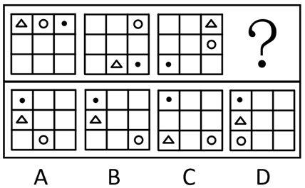

# 位置规律-平移（网格外圈循环移动）

考点：[[20-考点/判断推理/图形推理/位置规律-平移（网格外圈循环移动）|图形推理 / 位置规律-平移（网格外圈循环移动）]]

**问法模型**：元素组成相同、问'填入问号处使之呈现规律性' → 优先考虑位置规律，将外圈8格编号后逐元素追踪平移方向与步数，推出第四图位置再对照选项

## 推理链
1. 第1步：三幅图形元素完全相同（三角形、圆、黑点各一个），且都只出现在3×3网格的外圈8格中，中心格始终为空，优先考虑位置规律。
2. 第2步：将外圈8格按顺时针编号：1=(1行1列)、2=(1行2列)、3=(1行3列)、4=(2行3列)、5=(3行3列)、6=(3行2列)、7=(3行1列)、8=(2行1列)，逐元素定位：三角形1→6→3，圆2→3→4，黑点3→5→7。
3. 第3步：归纳各元素规律：三角形每次沿外圈逆时针平移3步（1→6→3），圆每次顺时针平移1步（2→3→4），黑点每次顺时针平移2步（3→5→7）。
4. 第4步：按规律推问号处：三角形由3号逆时针3步到8号（2行1列）；圆由4号顺时针1步到5号（3行3列）；黑点由7号顺时针2步到1号（1行1列）。
5. 第5步：对照选项：A项圆在(3行2列)不符，C项三角形在(3行1列)不符，D项圆在(3行1列)不符，只有B项黑点(1行1列)、三角形(2行1列)、圆(3行3列)三项全符。

**最快解法**：⚡ 外圈编号+逐元素追踪法：给外圈8格顺时针编号，先锁定黑点规律（顺时针2步：3→5→7→1，落左上角），再用三角形（逆时针3步：3→8，即2行1列）排除C项，最后用圆（顺时针1步：4→5，即3行3列）排除A、D项，秒选B。

## 易错点
- ⚠ 忽略3×3网格的'外圈8格循环'路径，误按行列直线移动数步数，导致步数判断全错
- ⚠ 黑点从7号顺时针2步应越过8号回到1号（左上角），易误停在8号位或与三角形位置混淆
- ⚠ 只验证两个元素就下结论：A项与B项仅差圆的位置（(3行2列)与(3行3列)），三元素必须全部验证才能锁定答案

## 母题抽象
> 🧩 当题干图形元素组成相同、小元素在3×3网格外圈逐图变位时，给外圈顺时针编号，逐元素追踪平移方向与步数（超出边界循环回绕），推出问号处位置后与选项逐项比对。

**同类特征**：元素组成相同、3×3网格小元素、元素仅在外圈8格中移动、逐图位置递变、问号处求第四幅图、多元素各有独立移动规律

## 相关题
- [[10-真题/判断推理/图形推理/2172768 位置规律（旋转-翻转）|2172768]]（海南 2021，相关度1）
- [[10-真题/判断推理/图形推理/10204458 位置规律-平移（特征交点沿内圈循环平移）|10204458]]（甘肃 2024，相关度1）
- [[10-真题/判断推理/图形推理/10204614 图形推理-位置规律（旋转+翻转交替循环）|10204614]]（黑龙江 2024，相关度1）
- [[10-真题/判断推理/图形推理/10297399 位置规律—平移（多黑块分组循环平移）|10297399]]（四川 2025，相关度1）
- [[10-真题/判断推理/图形推理/11226892 位置规律-九宫格小元素沿固定循环链移动|11226892]]（上海 2025，相关度1）

---

### 题干

从所给的四个选项中，选择最合适的一个填入问号处，使之呈现一定的规律性：

### 选项
- A. A
- B. B　✅
- C. C
- D. D

### 官方解析
元素组成相同，优先考虑位置规律。观察发现，三角形沿外圈每次逆时针平移3步，圆形沿外圈每次顺时针平移1步，黑点沿外圈每次顺时针平移2步，只有B项满足全部规律。
故正确答案为B。

### 给定材料
（无）
