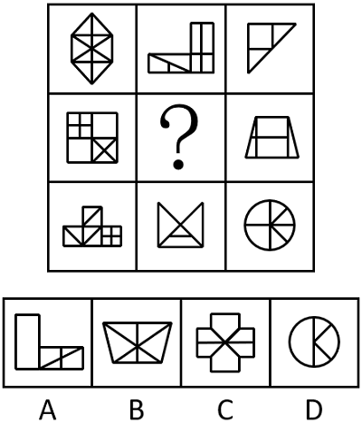

# 数量规律-数面（封闭区域数）及行内加减运算

考点：[[20-考点/判断推理/图形推理/数量规律-数面（封闭区域数）及行内加减运算|图形推理 / 数量规律-数面（封闭区域数）及行内加减运算]]

**问法模型**：九宫格问'符合图形变化规律'→ 先看属性、属性不通则数面/线/点，按横行找数量运算规律

## 推理链
1. 第1步：九宫格中八幅图元素组成不同，对称、曲直等属性无明显统一规律，题干图形封闭区域明显，优先考虑数面（数封闭区域）
2. 第2步：九宫格优先按横行观察，数出第一行三图面数量依次为10、7、3，发现7+3=10，即'图2+图3=图1'的面数量运算规律
3. 第3步：用第三行验证：面数量为10、4、6，4+6=10，规律成立，确认本题考'图2+图3=图1'
4. 第4步：第二行图1面数量为10，图3（梯形分割图）面数量为5，故？处图形面数量应为10-5=5
5. 第5步：逐项数面对照：A项面数量为5，B、C、D项面数量均不为5

**最快解法**：⚡ 数面法+行内运算口诀：第一行10、7、3发现图2+图3=图1，第三行4+6=10验证成立，直接算？=10-5=5，扫一眼选项只有A为5个面，秒选A

## 易错点
- ⚠ 只找面数量常数或等差规律，未想到行内做加减运算而卡壳
- ⚠ 数面时漏数被内部线条分割出的小封闭区域，或将大外框重复多算
- ⚠ 九宫格未优先按横行看，先试列规律或对角线规律浪费时间

## 母题抽象
> 🧩 当九宫格图形封闭区域明显但面数量不呈常数/等差时，按横行检验'图2+图3=图1'型数量运算，用另一行验证后再求缺项对应选项

**同类特征**：九宫格、元素组成不同、无明显属性规律、封闭区域明显、面数量行内运算、图2+图3=图1

## 相关题
- [[10-真题/判断推理/图形推理/2139602 数量规律-面数量（封闭区域计数）|2139602]]（天津 2017，相关度4）
- [[10-真题/判断推理/图形推理/14993416 数量规律-点数量（黑点个数按行求和恒值）|14993416]]（选调 2024，相关度3）
- [[10-真题/判断推理/图形推理/17058596 图形推理-数量规律-面数量（封闭区域数·常数规律）|17058596]]（选调 2023，相关度3）
- [[10-真题/判断推理/图形推理/17467550 数量规律-交点数（九宫格按行等差递增）|17467550]]（湖北 2026，相关度3）
- [[10-真题/判断推理/图形推理/2172865 数量规律-角（每图含两个相同的角）|2172865]]（广州市考 2018，相关度3）

---

### 题干

下列选项中，符合所给图形的变化规律的是<u>        </u>。

### 选项
- A. A　✅
- B. B
- C. C
- D. D

### 官方解析
元素组成不同，且无明显属性规律，考虑数量规律。题干图形封闭区域明显，优先考虑数面。九宫格优先看横行，第一行图形的面数量依次为10、7、3，第三行图形的面数量依次为10、4、6，面数量的规律均为图2+图3=图1，第二行图一的面数量为10，图三的面数量为5，因此，？处图形的面数量应为5，只有A项符合。
故正确答案为A。

### 给定材料
（无）
