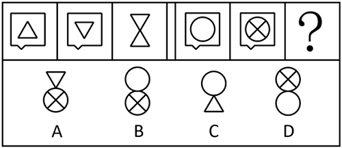

# 样式规律-加减同异（去相同外框+内部图形上下叠加）

考点：[[20-考点/判断推理/图形推理/样式规律-加减同异（去相同外框+内部图形上下叠加）|图形推理 / 样式规律-加减同异（去相同外框+内部图形上下叠加）]]

**问法模型**：两组图类比求问号图形 → 先从第一组归纳'去相同外框后内部图形上下叠加'的位置规律，再套用到第二组

## 推理链
1. 第1步：第一组图一、图二外框完全相同（带小尾巴的方框），内部图形不同：图一内部为正立三角形，图二内部为倒立三角形；图三为无外框的沙漏形
2. 第2步：元素组成相似且相同线条（外框）重复出现→考虑样式规律中的加减同异：去掉相同外框，保留两个内部图形并按上下位置组合
3. 第3步：验证第一组位置规则——图三沙漏中，倒立三角形（来自图二）在上、正立三角形（来自图一）在下，即'图一内部在下、图二内部在上'
4. 第4步：第二组图一内部为空白圆，图二内部为带'×'的圆，按同一规则去框组合：带×的圆在上、空白圆在下
5. 第5步：对照选项——A含倒三角元素不符排除；B为空白圆在上、带×圆在下，上下位置颠倒排除；C含三角形且无×排除；D为带×圆在上、空白圆在下，完全符合
6. 第6步：故问号处应选D

**最快解法**：⚡ 去框叠加法：外框相同→去框；以第一组沙漏校准顺序'图一内部在下、图二内部在上'；第二组直接把带×的圆放上、空白圆放下，排除位置颠倒的B，秒选D

## 易错点
- ⚠ 只做'去框'而忽略内部图形的上下位置规则，误选上下颠倒的B项
- ⚠ 混淆图一、图二内部图形与上下位置的对应关系（须用第一组沙漏的上下来校准，不能想当然）
- ⚠ 忽略内部图形细节差异（空白圆 vs 带×的圆），误认为两图内部相同而无法确定叠加结果

## 母题抽象
> 🧩 当两组类比图中前两幅含相同外框、第三幅无外框时，用'去相同外框+按第一组已验证的上下顺序叠加内部图形'的方法，即可组合出问号图

**同类特征**：两组三图式类比、相同外框重复出现、元素组成相似、内部图形上下叠加、样式规律-加减同异、问号求第三幅图

## 相关题
- [[10-真题/判断推理/图形推理/2051116 样式规律-加减同异（按列叠加：图2+图3=图1）|2051116]]（黑龙江 2017，相关度2）
- [[10-真题/判断推理/图形推理/5676968 样式规律-遍历（外框与内部图形交叉换位）|5676968]]（上海 2018，相关度2）
- [[10-真题/判断推理/图形推理/5702215 样式规律-加减同异（去异求同）|5702215]]（上海 2016，相关度2）
- [[10-真题/判断推理/图形推理/10204610 样式规律-加减同异（去同存异），九宫格列规律|10204610]]（辽宁 2024，相关度1）
- [[10-真题/判断推理/图形推理/10297349 样式规律-黑白运算|10297349]]（浙江 2025，相关度1）

---

### 题干

下列选项中，符合所给图形的变化规律的是<u>        </u>。

### 选项
- A. A
- B. B
- C. C
- D. D　✅

### 官方解析
元素组成相似，且相同线条重复出现，优先考虑样式规律中的加减同异。观察发现，第一组图中的前两幅图去掉相同的外框，经过组合后得到图三，其中，图一的内部图形在下方，图二的内部图形在上方。第二组图遵循相同的规律，只有D项符合。
故正确答案为D。

### 给定材料
（无）
