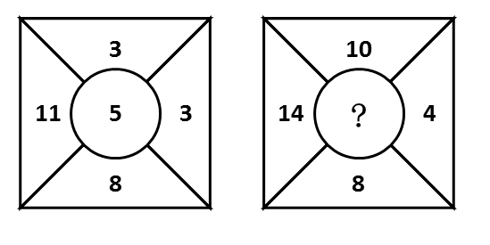
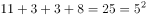
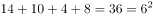

# 数量规律-数字运算（外圈之和=中心数的平方）

考点：[[20-考点/判断推理/图形推理/数量规律-数字运算（外圈之和=中心数的平方）|图形推理 / 数量规律-数字运算（外圈之和=中心数的平方）]]

**问法模型**：问号处填入数字使两幅图呈现同一规律 → 对'中心数+外圈数'图阵做求和/幂运算试探，找外圈与中心数的固定运算关系

## 推理链
1. 第1步：第一幅图中正方形被对角线分为四个区域，外圈数字为上3、左11、右3、下8，中心圆内为5
2. 第2步：试探外圈数字的整体运算关系：3+11+3+8=25，恰好等于中心数5的平方（5²=25），即'外圈数字之和=中间数字的平方'
3. 第3步：将同一规律套用到第二幅图：外圈数字为上10、左14、右4、下8，求和10+14+4+8=36
4. 第4步：由规律，中心数字应为36的平方根，即?=6
5. 第5步：对照选项，B项为6，与推理一致

**最快解法**：⚡ 数字求和验证法：先算图一外圈和3+11+3+8=25=5²，锁定'外圈和=中心平方'规律；再算图二外圈和10+14+4+8=36，开方即得6，选B

## 易错点
- ⚠ 只沿对角线或上下/左右配对找加减关系，漏掉'平方'这一幂运算关系
- ⚠ 误以为中心数只与外圈某一个数字存在运算关系，忽视四个外圈数的整体求和
- ⚠ 第二幅图求和算错（正确为36=6²，勿误算为其他值导致误选A/C/D）

## 母题抽象
> 🧩 当题干出现'中心圆数字+外圈四周数字'的图阵且两图结构相同时，先求图一外圈数字之和并与中心数比对（平方、倍数等幂运算），确认固定规律后用同一运算求问号处数值

**同类特征**：中心圆+外圈四个数字的方阵结构、两幅图布局完全相同、外圈数字之和、中心数与外圈和呈平方关系、数字型图形推理求问号

## 相关题
（暂无）

---

### 题干

从所给的四个选项中，选择最合适的一个填入问号处，使之呈现一定的规律性：

### 选项
- A. 2
- B. 6　✅
- C. 4
- D. 3

### 官方解析

观察发现第一幅图中外圈数字之和等于中间数字的平方，即；那么第二幅图也满足此规律，外圈数字之和为，那么中间数字应填入6。

故正确答案为B。

### 给定材料
（无）
