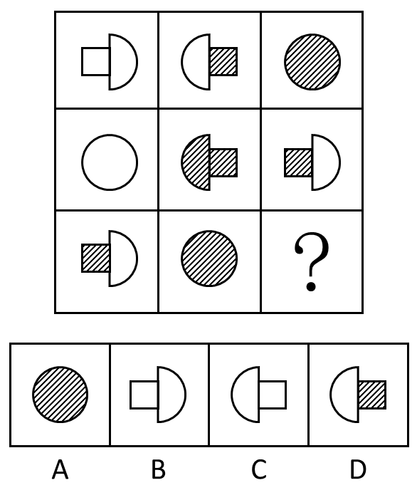

# 样式规律-遍历（阴影状态遍历＋图形朝向遍历，缺啥补啥）

考点：[[20-考点/判断推理/图形推理/样式规律-遍历（阴影状态遍历＋图形朝向遍历，缺啥补啥）|图形推理 / 样式规律-遍历（阴影状态遍历＋图形朝向遍历，缺啥补啥）]]

**问法模型**：九宫格且元素组成相似 → 优先按行做样式遍历：先补齐'全白/半阴影/全阴影'三种阴影状态，再补齐'蘑菇'朝向，两级筛选锁定答案

## 推理链
1. 第1步：题干为九宫格，图形均由'矩形+半圆'的蘑菇形或圆形构成，元素组成相似，优先考虑样式规律
2. 第2步：按行观察阴影状态：第一行为全白蘑菇、半阴影（白半圆+阴影矩形）、全阴影圆；第二行为全白圆、全阴影（阴影半圆+阴影矩形）、半阴影（阴影矩形+白半圆）
3. 第3步：归纳出按行遍历规律——每行'全白、半阴影、全阴影'三种状态各出现一次；第三行已有半阴影（图1）和全阴影（图2），故问号处应为全白图形，排除A、D
4. 第4步：进行二级辨析，观察每行蘑菇形朝向：第一行图1半圆凸朝右、图2半圆凸朝左，两个蘑菇朝向不同；第二行图2半圆凸朝左、图3半圆凸朝右，朝向也不同
5. 第5步：第三行图1蘑菇头（半圆）朝右（矩形在左、半圆凸朝右），依规律问号处应选与同行已有蘑菇朝向相反者，即头朝左的全白蘑菇
6. 第6步：对照B、C项：B项半圆凸朝右（头朝右），C项半圆凸朝左（头朝左），只有C项符合，故正确答案为C

**最快解法**：⚡ 遍历排除法：第一步按行补阴影状态（半阴影、全阴影已有→缺全白），秒杀排除A、D；第二步看朝向，第三行图1蘑菇头朝右→选头朝左的，排除B锁定C

## 易错点
- ⚠ 只做一级辨析（阴影遍历）就匆忙选B，忽略B、C同为全白蘑菇还需二级辨析朝向
- ⚠ 把蘑菇'头'（半圆凸出方向）看反，误以为第三行图1头朝左而错选B
- ⚠ 九宫格惯性按列或整体找规律，漏掉本题'按行遍历'的正确路径

## 母题抽象
> 🧩 当九宫格图形元素组成相似、由带阴影的复合图形（矩形+半圆/圆）构成时，按行做双重遍历：先补齐阴影状态（全白/半阴影/全阴影），再补齐图形朝向（与同行已有图形相反），缺啥补啥

**同类特征**：九宫格、元素组成相似、全白/半阴影/全阴影三种阴影状态、蘑菇形（矩形+半圆）及圆形、蘑菇朝向左右交替、按行遍历缺啥补啥

## 相关题
- [[10-真题/判断推理/图形推理/10204610 样式规律-加减同异（去同存异），九宫格列规律|10204610]]（辽宁 2024，相关度2）
- [[10-真题/判断推理/图形推理/10297349 样式规律-黑白运算|10297349]]（浙江 2025，相关度2）
- [[10-真题/判断推理/图形推理/10297407 样式规律-黑白运算（定义叠加）|10297407]]（四川 2025，相关度2）
- [[10-真题/判断推理/图形推理/12019768 样式规律-加减同异（求同）与位置旋转的复合规律|12019768]]（浙江 2026，相关度2）
- [[10-真题/判断推理/图形推理/12101004 样式规律-黑白运算（九宫格逐位置叠加）|12101004]]（江苏 2025，相关度2）

---

### 题干

从所给四个选项中，选择最合适的一个填入问号处，使之呈现一定的规律性：

### 选项
- A. A
- B. B
- C. C　✅
- D. D

### 官方解析
九宫格题目。元素组成相似，优先考虑样式。观察发现第一行中，全白面、半阴影、全阴影的图形都出现，第二行图形中也是全白面、全阴影、半阴影的图形出现，第三行中半阴影、全阴影，问号处应为全白面的图形，排除A、D两项。比较B、C项的不同之处，“蘑菇”图形的方向不同，题干中第一行图形和第二行图形中的两个“蘑菇”朝向都是不同的，因此问号处应选一个和第三行图1中朝向不同的“蘑菇”，第三行图中的“蘑菇”是头朝右的，问号处应选择一个“蘑菇”头朝左的，只有C项符合，排除B项。
故正确答案为C。

### 给定材料
（无）
