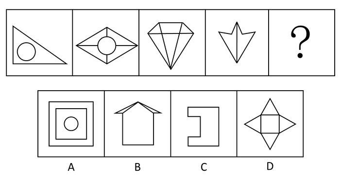

# 数量规律-数线（外轮廓边数等差递增）

考点：[[20-考点/判断推理/图形推理/数量规律-数线（外轮廓边数等差递增）|图形推理 / 数量规律-数线（外轮廓边数等差递增）]]

**问法模型**：题干要求'选择最合适的一个填入问号处呈现规律性'→元素组成不同且属性无规律时走数量规律：先整体数线，无规律则分层只数外轮廓边数，验证等差递增

## 推理链
1. 第1步：题干四图元素组成不同（三角形内含圆、菱形内含圆与交叉线、钻石形、燕尾形），对称、曲直等属性无统一规律，转入数量规律。
2. 第2步：图形均含多边形，先整体数线数量：依次为4、9、8、7，无规律，需拆分内外层次再找规律。
3. 第3步：只描每幅图最外圈轮廓数边：三角形外轮廓3条边、菱形外轮廓4条边、钻石形外轮廓5条边、燕尾形外轮廓6条边，呈3、4、5、6的等差递增。
4. 第4步：依此外推，'？'处图形的外轮廓边数应为7。
5. 第5步：逐项数选项外轮廓：A外层正方形为4条、B房形（含屋檐折边）为7条、C凹形为8条、D四角星形为8条。
6. 第6步：只有B项外轮廓边数为7，满足3、4、5、6、7的递增规律，故选B。

**最快解法**：⚡ 描外圈法（数外框边数）：不受内部线条和圆干扰，只沿图形最外圈描边计数，得3、4、5、6的等差数列，问号处直接找外轮廓7条边的图形，锁定B（房形：底边+两侧墙+两侧屋檐底边+两段屋顶斜边=7）。

## 易错点
- ⚠ 上来把内部线条连同圆一起数，得整体线数4、9、8、7无规律就放弃，漏掉'分层数线'这一步——只数外轮廓边数。
- ⚠ 数外轮廓时把圆的曲线误计入轮廓，或在燕尾形凹角、房形屋檐拐角处漏数或多数边。
- ⚠ 被官方解析'解法二'（线数量与点数量之差恒为1，指向A项）带偏而误选A；官方备注已声明该题不严谨、更倾向外轮廓等差规律选B，作答应以外轮廓边数规律为准。

## 母题抽象
> 🧩 当图形元素组成不同、属性无规律且整体线数量杂乱无章时，改用'描外圈'只数外轮廓边数，若呈等差递增（如3、4、5、6），则问号处选外轮廓边数等于下一项（7）的选项。

**同类特征**：元素组成不同、外框多边形+内部线条/圆的分层结构、整体线数量无规律、线条交叉明显、外轮廓边数递增、曲线（圆）作干扰项

## 相关题
- [[10-真题/判断推理/图形推理/12100996 图形推理-对称性（单条对称轴方向交替）+数量规律（交点数等差递增）|12100996]]（江苏 2025，相关度2）
- [[10-真题/判断推理/图形推理/12561847 数量规律-交点数（等差数列）|12561847]]（浙江 2024，相关度2）
- [[10-真题/判断推理/图形推理/16593132 数量规律-点数量（切点数）|16593132]]（甘肃 2024，相关度2）
- [[10-真题/判断推理/图形推理/17097256 数量规律-交点数（交点数相同再比交点分布位置）|17097256]]（山西 2024，相关度2）
- [[10-真题/判断推理/图形推理/17467550 数量规律-交点数（九宫格按行等差递增）|17467550]]（湖北 2026，相关度2）

---

### 题干

从所给四个选项中，选择最合适的一个填入问号处，使之呈现一定的规律性：

### 选项
- A. A
- B. B　✅
- C. C
- D. D

### 官方解析
解法一：元素组成不同，无明显属性规律，考虑数量规律。观察发现，图形出现多边形，考虑数线，线数量依次为：4、9、8、7，无规律，但是外轮廓的线条数依次为：3、4、5、6，呈递增规律，所以“？”处图形外轮廓的线条数应该为7。四个选项的外轮廓线条数分别为4、7、8、8，只有B选项符合规律。
故正确答案为B。
解法二：元素组成不同，无明显属性规律，考虑数量规律。观察发现，图形出现多边形，考虑数线，线数量依次为：4、9、8、7，无规律。同时发现，图形多次出现线条交叉的情况，考虑数点，点数量依次为：3、8、7、6，因此发现题干每幅图的线数量与点数量的差都是1。四个选项线数量与点数量的差分别为：1、2、0、4，只有A选项符合规律。
故正确答案为A。
备注：本题不严谨，但是外轮廓的线条数3、4、5、6，呈等差数列的规律，不太可能是巧合，且这个规律更加直观明确，应该是出题人精心设计过的，所以我们粉笔更倾向通过外框边数选到B项。

### 给定材料
（无）

> [!warning] 疑点（官方解析可能有误，待人工复核）
> 官方解析内部存在矛盾：解法二按'线数量-点数量=1'推出A项，与正确答案B冲突；官方备注自认'本题不严谨'，并以3、4、5、6等差数列更直观、更似命题人设计为由倾向选B。该矛盾官方已自行说明并给出取舍理由，不影响以B为唯一正确答案。
