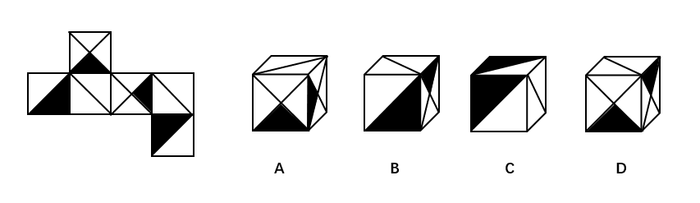
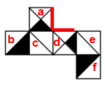

# 空间重构-六面体折叠（公共边法-画边法）

考点：[[20-考点/判断推理/图形推理/空间重构-六面体折叠（公共边法-画边法）|图形推理 / 空间重构-六面体折叠（公共边法/画边法）]]

**问法模型**：给出正方体外表面展开图，问'哪一项能由它折叠而成' → 空间重构题，用公共边特征与相邻面位置关系（画边法）逐项排除

## 推理链
1. 第1步：给展开图六面标号：面a、面d为'双对角线且含一个黑色三角形'的面，面b、面f为'黑色直角三角形'面，面c、面e为'单对角线'白面
2. 第2步：调用规则——展开图中构成直角的两条边折叠后是同一条边（公共边），可用公共边的颜色/线型特征与相邻关系排除选项
3. 第3步：A项——题干面a与面d的公共边是白色三角形的斜边，而A项中两个面的公共边是黑色直角三角形的斜边，特征不符，排除
4. 第4步：B项——右侧双对角线面只能是面a或面d，其黑色三角形的'黑色底边'是唯一确定边；从该底边起点顺时针画边，无论按面a还是面d两种情况，第4条边对应的面均与B项不符，排除
5. 第5步：C项——右侧单对角线面只能是面c或面e，二者在展开图中均与黑色直角三角形的直角边相邻（面c邻面b、面e邻面f的直角边），而C项中对角线与两个黑色直角三角形的直角边均不相邻，排除
6. 第6步：A、B、C均被排除，故答案选D

**最快解法**：⚡ 公共边法（画边法）：先锁定唯一确定边——双对角线面黑色三角形的'黑色底边'；A项直接比对公共边斜边颜色（白色斜边≠黑色斜边）；B项从黑色底边顺时针画边，验证'面a或面d'两种可能均不符；C项比对'单对角线是否与黑色直角三角形的直角边相邻'；三步排除锁定D

## 易错点
- ⚠ 忘记'展开图中构成直角的两条边折叠后是同一条边'，错判面a与面d公共边的位置特征
- ⚠ B项双对角线面有'面a或面d'两种可能，只验证一种就下结论导致误判
- ⚠ 混淆黑色三角形的'斜边/直角边/底边'作公共边，忽略黑色底边的唯一确定性以及C项'直角边相邻'这一限定条件

## 母题抽象
> 🧩 当六面体展开图中出现'含黑色三角形的双对角线面、黑色直角三角形面、单对角线面'等特征面时，用公共边法（画边法）：以黑色底边、斜边颜色、直角边相邻关系等唯一确定特征为起点顺时针画边，逐项比对排除

**同类特征**：正方体外表面展开图折叠、双对角线面且含一个黑色小三角形、黑色直角三角形面（半黑半白）、单对角线白面、公共边/相邻面位置判断、顺时针画边验证

## 相关题
（暂无）

---

### 题干

左边给定的是正方体的外表面展开图，下面哪一项能由它折叠而成？

### 选项
- A. A
- B. B
- C. C
- D. D　✅

### 官方解析

本题属于空间重构类，逐一分析选项，将六个面按顺序标上序号。

A项：六面体展开图中，构成直角的两条边是同一条边。题干面a和面d的公共边（图中红色线）是白色三角形的斜边，A选项两个面的公共边有一条黑色直角三角形斜边，与题干不对应，排除；

B项：选项中右侧双斜对角线形成的面要么是面a，要么是面d,而双对角线形成的黑色三角形的黑色底边是唯一确定的边，故可以分别对面a或面d这两种情况进行画边。第一种情况，假设B选项的双对角线的面是面a，从黑色底边为起点，顺时针画边，如图3所示，发现与B选项（如图2所示）边4对应的面错了，故不符合；第二种情况，假设B选项的双对角线的面是面d，同样从面d的黑色三角形底边顺时针画边，如图4所示，发现与B选项（图2所示）的边4对应的面错了，故也不符合。所以B选项两种情况都不符合，则一定错误，排除；

C项：选项中右侧的对角线面，要么是面c，要么是面e，在题干展开图形中，这两个面都与两个黑色直角三角形的直角边相邻（其中面c与面b中的黑色直角三角形的直角边相邻，面e也与另一个直角三角形面f的直角边相邻），而在C选项中，斜对角线与两个黑色的直角三角形的直角边都是不相邻的，故排除；

A、B、C排除，答案选D。

故正确答案为D。

### 给定材料
（无）
