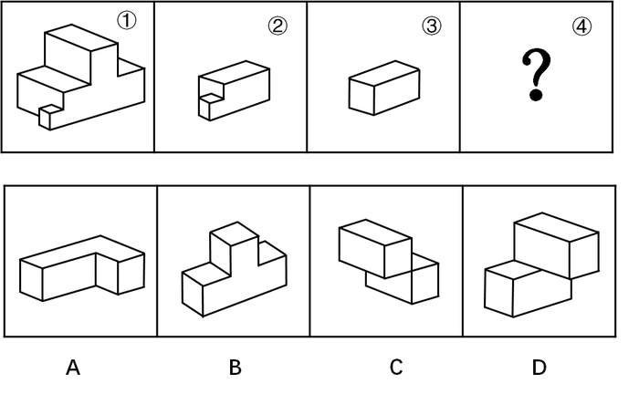

# 立体拼合（组合还原-凹凸互补）

考点：[[20-考点/判断推理/图形推理/立体拼合（组合还原-凹凸互补）|图形推理 / 立体拼合（组合还原-凹凸互补）]]

**问法模型**：整体①由②③④组合而成、选'不能填入问号处'的一项（选非）→ 立体拼合试拼法：将已知件②③按凹凸特征嵌入①，求出剩余空腔，与各选项（允许旋转）逐一比对体积与凹凸朝向

## 推理链
1. 第1步：明确选非问法——①为整体，②③④组合后构成①，要找'不能'充当④的选项。
2. 第2步：拆解整体①的结构：上部为横置大长方体，中部有一级台阶面，底前部另凸出一小块，该小凸块与②前端下方自带的小正方体同款，故②在①中的位置与朝向被唯一锁定。
3. 第3步：将②按前端小正方体对准①底前部凸块嵌入，③为规则长方体，可嵌入①中部台阶处的体块空缺，剩余空腔的形状与体积即为④应满足的条件。
4. 第4步：验证A：L形板件恰好补出①的L形底层轮廓，与②③拼合后无重叠、无空缺，能构成①。
5. 第5步：验证C、D：两者均为两长方体错位叠放的台阶体，经旋转调整方向后可分别充当①上部大块与台阶处的补块，与②③拼合可还原①。
6. 第6步：验证B：其底层为完整长方体、上部凸块朝向固定，与②③试拼时凸凹方向与剩余空腔错位，出现重叠或空缺，无法无重叠地填满①的阶梯轮廓。
7. 第7步：A、C、D均能与②③组合构成①，B不能，本题为选非题，故正确答案为B。

**最快解法**：⚡ 凹凸互补试拼法：先把②前端自带的小正方体对准①底前部凸块以锁定②的位置，再用规则长方体③嵌入中部台阶空缺，剩余空腔与四个选项（允许旋转）逐一比对——仅B的体块朝向与空腔错位、无法无重叠填满，直接选B（注意选非题问'不能'）

## 易错点
- ⚠ 选非题看反：把'不能填入问号处'当成找'能填入'的一项，误选可拼合的A、C或D
- ⚠ 忽略②前端自带的小正方体凸块，误以为该凸块需由④提供，导致剩余空腔判断错误
- ⚠ 试拼时未考虑组件可旋转/翻转，把本可拼合的C、D误判为不能拼合

## 母题抽象
> 🧩 当题干出现'整体①由②③④组合而成、问哪项能/不能填入'时，用立体拼合凹凸互补法：先安放特征件（如自带小凸块的②）定位，再求剩余空腔，将选项（允许旋转）逐一比对体积与凹凸朝向，选非题注意反向作答

**同类特征**：立体拼合、整体与部分（①=②+③+④）、选非题：不能填入问号处、②自带小正方体凸块、③为规则长方体、整体呈阶梯状+L形轮廓

## 相关题
- [[10-真题/判断推理/图形推理/2776149 图形推理-立体拼合（小方块计数守恒+分层形状咬合）|2776149]]（浙江 2021，相关度1）
- [[10-真题/判断推理/图形推理/10204640 立体拼合（多面体组合：数量守恒+凹凸互补+旋转）|10204640]]（河南 2024，相关度1）
- [[10-真题/判断推理/图形推理/12019797 立体拼合-由两视图及全等小块反推小立体（数小立方体+旋转试装）|12019797]]（浙江 2026，相关度1）
- [[10-真题/判断推理/图形推理/12536475 图形推理-立体拼合（正方体堆叠多面体组合）|12536475]]（四川 2024，相关度1）
- [[10-真题/判断推理/图形推理/12881949 立体拼合-多块拼合正方体（凹凸互补+旋转）|12881949]]（广东 2025，相关度1）

---

### 题干

下图中的立体图形①是由立体图形②，③和④组合而成，下列哪一项不能填入问号处？

### 选项
- A. A
- B. B　✅
- C. C
- D. D

### 官方解析

本题考查立体拼合。题干中①为整体，②③④组合后构成①，其中A、C、D选项均能与②③组合构成①，具体组合方式如下所示：

本题为选非题，故正确答案为B。

### 给定材料
（无）
