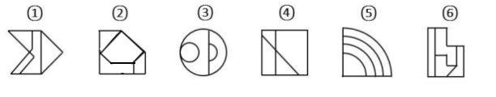

# 面相关规律-内部面形状与外轮廓形状的同异

考点：[[20-考点/判断推理/图形推理/面相关规律-内部面形状与外轮廓形状的同异|图形推理 / 面相关规律-内部面形状与外轮廓形状的同异]]

**问法模型**：六个图形分为两类使每类各有共同规律 → 逐图提取'面的形状特征'，寻找能将六图二分的面属性（此处为内部面与外轮廓是否同形）

## 推理链
1. 第1步：六图均为多面图形，外轮廓形状各不相同：①箭头形、②切角五边形、③圆形、④正方形、⑤扇形、⑥L形
2. 第2步：由于面个数难以二分，转向观察'每个图形内部面中是否存在与外轮廓形状相同的面'这一特征
3. 第3步：图②内部存在与外轮廓同形的五边形面；图③内部小圆与外轮廓圆形同形；图⑤最内层面与外轮廓同为扇形（四分之一圆）
4. 第4步：图①内部为三角形等面、图④内部为三角形面、图⑥内部为矩形/折线面，均与各自外轮廓形状不同
5. 第5步：按'内部面与外轮廓同形与否'二分：②③⑤一组，①④⑥一组
6. 第6步：对照选项，①④⑥、②③⑤对应D，与官方答案一致

**最快解法**：⚡ 特征面扫描法（口诀：分类先看面，同形分两派）：快速比较每图内部面与外轮廓形状，②③⑤含与外轮廓同形的面，①④⑥不含，直接锁定D

## 易错点
- ⚠ 只数面的总数或交点数，发现无法二分后卡壳，忽略'面的形状'这一维度
- ⚠ 把'形状相同'误判为'大小相同'——同形面可以是缩放后的（图③小圆、图⑤内层扇形）
- ⚠ 图③中的半圆面与外轮廓圆并不同形，须找到小圆才符合同形特征；图⑤的弧形带易误看成环形而非扇形面

## 母题抽象
> 🧩 当分组题各图均由多个面组成且外轮廓形状差异明显时，优先验证'是否存在与外轮廓形状相同的内部面'，据此将六图二分

**同类特征**：六图分组分类、均为多面图形、外轮廓形状各异、内部面与外轮廓同形、面的形状而非数量作规律

## 相关题
- [[10-真题/判断推理/图形推理/16070180 样式规律-相同元素遍历之位置关系（圆位于主体图形内部-外部）|16070180]]（湖北 2026，相关度1）
- [[10-真题/判断推理/图形推理/18643670 数量规律-点数量（圆与直线的切点数）|18643670]]（天津 2026，相关度1）
- [[10-真题/判断推理/图形推理/19283874 数量规律-一笔画（笔画数-奇点计数）|19283874]]（国考 2025，相关度1）
- [[10-真题/判断推理/图形推理/2049850 属性规律-对称性（对称轴与图形线条的 重合-不重合）|2049850]]（山东 2017，相关度1）
- [[10-真题/判断推理/图形推理/4675394 数量规律-面数量（汉字封闭区域数，奇偶分组）|4675394]]（选调 2021，相关度1）

---

### 题干

把下面的六个图形分为两类，使每一类图形都有各自的共同特征或规律，分类正确的一项是：

### 选项
- A. ①②③，④⑤⑥
- B. ①③④，②⑤⑥
- C. ①④⑤，②③⑥
- D. ①④⑥，②③⑤　✅

### 官方解析
题干给出的每幅图形都是由不同形状的面组成，图2、图3、图5图形内部都有和外轮廓形状相同的面，图1、图4、图6图形内部面的形状都与外轮廓不同。
故正确答案为D。

### 给定材料
（无）
