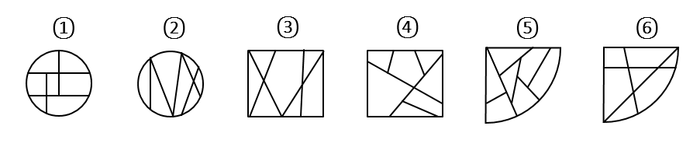

# 数量规律-交点数（外轮廓与内部线条的交点）

考点：[[20-考点/判断推理/图形推理/数量规律-交点数（外轮廓与内部线条的交点）|图形推理 / 数量规律-交点数（外轮廓与内部线条的交点）]]

**问法模型**：六个图形两两分类并说明共同规律 → 先看外轮廓是否两两相同，相同则对比内部差异并数'外框与内部线条交点数'分组

## 推理链
1. 第1步：观察外轮廓，图①②同为圆形、图③④同为正方形、图⑤⑥同为扇形，即外轮廓两两相同，差异在内部引出线条的数量与走向
2. 第2步：图形组成凌乱且属性（对称、曲直、开闭）无规律，转向数量规律，锁定'外轮廓与内部线条的交点数'这一细分考点
3. 第3步：逐图数外框交点：图①⑤⑥外轮廓与内部线条的交点均为6个
4. 第4步：逐图数外框交点：图②③④外轮廓与内部线条的交点均为7个
5. 第5步：辅助验证（官方方法二）：图①⑤⑥中部各存在一个不与外框相接的面，图②③④的所有面均与外框相接，两种规律指向同一分组
6. 第6步：①⑤⑥一组、②③④一组，对照选项只有D符合，故选D

**最快解法**：⚡ 交点计数法+配对排除：先按外轮廓配成三对（①②圆、③④方、⑤⑥扇形），每对中数外框与内部线条交点，6个交点的归为①⑤⑥、7个的归为②③④，直接锁定D；若计数拿不准，可用'是否存在不与外框相接的面'快速二次验证

## 易错点
- ⚠ 忽略'外轮廓两两相同'这一配对提示，被圆、方、扇形混杂的凌乱外观吓退，误判为无规律
- ⚠ 数错交点对象：数了内部线条之间的交点或面数，而非'外框与内部线条的交点'这一常考细分考点
- ⚠ 使用'面与外框相接'规律时看错位置，如把①中部的矩形面或⑥内部分割出的小面误判为与外框相接

## 母题抽象
> 🧩 当六个分类图形外轮廓两两相同而内部线条凌乱时，优先数'外轮廓与内部线条的交点数'分成两类；若交点分不出，再验证'是否存在不与外框相接的面'这一面的位置规律

**同类特征**：六图外轮廓两两相同（圆/方/扇形各一对）、图形组成凌乱、属性无规律、均为内部线条与外框相交构成的图形、外框交点数呈6与7两个数量、是否存在不与外框相接的面、分类分组型图形推理

## 相关题
（暂无）

---

### 题干

把下面的六个图形分为两类，使每一类图形都有各自的共同特征或规律，分类正确的一项是：

### 选项
- A. ①②③，④⑤⑥
- B. ①②⑤，③④⑥
- C. ①③⑤，②④⑥
- D. ①⑤⑥，②③④　✅

### 官方解析
方法一：图形组成凌乱，属性没有规律，考虑数量规律，观察题干给出的6个图形，图①和图②、图③和图④、图⑤和图⑥的外轮廓相同，区别在于这个外轮廓内部引出了不同数量的线条，可以考虑外轮廓与内部线条的交点，图①⑤⑥外轮廓与内部线条的交点数为6个，图②③④外轮廓与内部线条的交点数为7个。
方法二：观察图形发现，题干均为内部线条与外框相交构成的图形，其中图①⑤⑥中间有一个面不和外框相接，图②③④的面都和外框相接，即图①⑤⑥为一组，图②③④为一组。
故正确答案为D。
说明：如果这两种思路不是同一个选项，建议同学们选外框交点的选项，因为这个是常考考点。

### 给定材料
（无）
