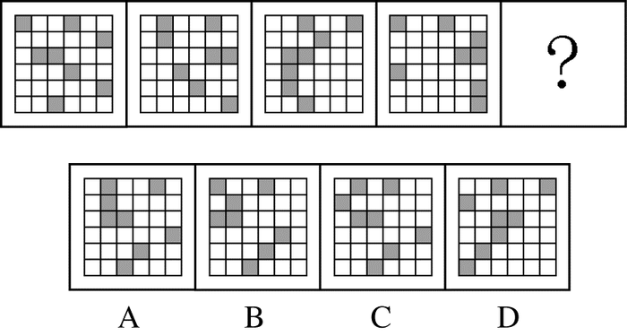

# 位置规律-平移（宫格黑块按行循环移动）

考点：[[20-考点/判断推理/图形推理/位置规律-平移（宫格黑块按行循环移动）|图形推理 / 位置规律-平移（宫格黑块按行循环移动）]]

**问法模型**：四图连续排列且每图黑块数量相同（元素组成相同）问'填入问号使之呈现规律性'→采用位置规律-平移模型，按行拆分找各行的固定移动步长

## 推理链
1. 第1步：题干四幅图均为36宫格（6×6），每幅图都恰好包含8个黑块，元素组成相同→优先考虑位置规律（平移/旋转/翻转）而非数量或样式规律
2. 第2步：逐行清点发现每幅图中同一行的黑格数目保持一致，说明黑块只在各自行内水平移动，于是按行比较相邻两图黑格所在的列位置
3. 第3步：对比得出各行步长——第一行黑格每次向右移动1个单位，第二行每次向右移2个单位，第三行每次移3个单位（6列中左移与右移结果相同），第四行每次向左移1个单位，第五行每次向左移2个单位，第六行每次移3个单位（左移右移均可）
4. 第4步：由第四图第一行黑格位置按'右移1格'推出问号处第一行黑格应在第2、5列，B、C、D三项第一行位置均不符，予以排除
5. 第5步：在A选项中逐行验证其余规律：第二行右移2、第四行左移1、第五行左移2、第三/六行移3，均与题干图形衔接吻合
6. 第6步：所有行均满足'按行定步长、循环平移'规律，故问号处选A

**最快解法**：⚡ 分行排除法（一行定位）：只盯第一行黑块——每次向右移1格，由第四图直接算出问号处第一行黑格列位置，一眼排除B、C、D，再用其余行验证A即可锁定答案

## 易错点
- ⚠ 把整幅图当整体看，忽略'黑块只在本行内水平平移'的分行规律而找不到移动线索
- ⚠ 黑块平移出边界后需按6列一循环从另一侧补回，不按循环计算会误判黑格'消失/新增'或位置算错
- ⚠ 第三、六行移3格时左移与右移结果完全相同，死磕单一方向易误判为'无规律'而放弃正确思路

## 母题抽象
> 🧩 当题干出现'宫格图形+每图黑块数量相同+位置逐图变化'的特征时，用按行（或按列）拆分法找各行恒定步长的循环平移，先用规律最明显的一行快速排除选项，再用其余行全图验证

**同类特征**：36宫格（6×6）、每图8个黑块、元素组成相同、问号处填入使之呈现规律性、同行黑格数目保持不变、平移出边界循环补位

## 相关题
- [[10-真题/判断推理/图形推理/2172768 位置规律（旋转-翻转）|2172768]]（海南 2021，相关度1）
- [[10-真题/判断推理/图形推理/10204458 位置规律-平移（特征交点沿内圈循环平移）|10204458]]（甘肃 2024，相关度1）
- [[10-真题/判断推理/图形推理/10204614 图形推理-位置规律（旋转+翻转交替循环）|10204614]]（黑龙江 2024，相关度1）
- [[10-真题/判断推理/图形推理/10297399 位置规律—平移（多黑块分组循环平移）|10297399]]（四川 2025，相关度1）
- [[10-真题/判断推理/图形推理/11226892 位置规律-九宫格小元素沿固定循环链移动|11226892]]（上海 2025，相关度1）

---

### 题干

从所给的四个选项中，选择最合适的一个填入问号处，使之呈现一定的规律性：

### 选项
- A. A　✅
- B. B
- C. C
- D. D

### 官方解析
题干所有图形均为36宫格，其中每个图形均包含8个黑块，元素组成相同，考虑位置规律。观察发现，每幅图每行黑格的数目一致，考虑黑格在同行中的位置移动。第一行黑格每次向右移动一个单位，第二行黑格每次向右移动两个单位，第三行黑格每次移动三个单位（向左向右均可），第四行黑格每次向左移动一个单位，第五行图形黑格每次向左移动两个单位，第六行图形黑格每次移动三个单位（向左向右均可）。
根据第一行移动规律排除B、C、D三项，在A选项中验证其余行的移动规律，发现均符合上述规律，当选。
故正确答案为A。

### 给定材料
（无）
