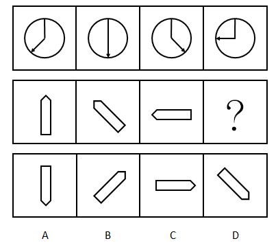
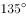

# 位置规律（旋转）

考点：[[20-考点/判断推理/图形推理/位置规律（旋转）|图形推理 / 位置规律（旋转）]]

**问法模型**：两组各四图的'两段式'问'？'处填什么 → 先在第一组归纳旋转的方向与角度，再原样套用到第二组推出第四个图形

## 推理链
1. 第1步：题干为两组各四图的'两段式'：第一组是圆内带箭头的指针，第二组是带尖头的笔状图形，两组元素组成相同、只有指向变化，优先考虑位置规律（旋转）
2. 第2步：看第一组箭头指向：图1指向左下（约7点半方向）→图2竖直向下（6点）→图3指向右下（4点半方向），即依次逆时针旋转45°
3. 第3步：第一组图3（4点半方向）到图4（水平向左，9点方向）改为顺时针旋转135°，规律确定为'逆45°、逆45°、顺135°'
4. 第4步：把规律套用到第二组验证：图1笔尖向上（12点）→图2笔尖左上（10点半）→图3笔尖水平向左（9点），同样是依次逆时针旋转45°，规律成立
5. 第5步：问号处应由第二组图3（笔尖9点方向）顺时针旋转135°，笔尖落到右上（1点半方向），图形为左低右高的斜向笔状
6. 第6步：逐项对照：A笔尖向下（6点）、B笔尖右上（1点半）、C笔尖向右（3点）、D笔尖右下（4点半），只有B符合'顺时针135°'的结果，故选B

**最快解法**：⚡ 指针法（把尖头当表针）：盯住箭头/笔尖的指向，第一组读出'逆45°、逆45°、顺135°'；第二组图3笔尖在9点位置，顺时针转135°落到1点半（右上），直接锁定B

## 易错点
- ⚠ 只归纳前三图'依次逆时针旋转45°'就惯性外推，漏看图3到图4旋转方向反向（改为顺时针135°）而误选D等
- ⚠ 钟面方向看反：指针从6点走到4点半是逆时针（倒着走），从4点半走到9点才是顺时针，方向一判反则全盘皆错
- ⚠ 笔状图形两端不对称，盯错特征端（把平头端当指向），方向差180°可能误选C

## 母题抽象
> 🧩 当两组图形元素组成相同、仅指向/角度变化时，把图形的特征端点（箭头、尖角）当作表针，先在第一组读出每步旋转的方向与角度，再原样套用到第二组推最后一图

**同类特征**：两组（两段式）各四图、元素组成相同、图形带箭头/尖头、指向逐图变化、旋转方向中途反向（先逆后顺）、45°倍数旋转

## 相关题
- [[10-真题/判断推理/图形推理/2184666 位置规律（旋转）|2184666]]（选调 2018，相关度3）
- [[10-真题/判断推理/图形推理/2172768 位置规律（旋转-翻转）|2172768]]（海南 2021，相关度1）
- [[10-真题/判断推理/图形推理/10204458 位置规律-平移（特征交点沿内圈循环平移）|10204458]]（甘肃 2024，相关度1）
- [[10-真题/判断推理/图形推理/10204614 图形推理-位置规律（旋转+翻转交替循环）|10204614]]（黑龙江 2024，相关度1）
- [[10-真题/判断推理/图形推理/10297399 位置规律—平移（多黑块分组循环平移）|10297399]]（四川 2025，相关度1）

---

### 题干

从所给的四个选项中，选择最合适的一个填入问号处，使之呈现出一定的规律性：

### 选项
- A. A
- B. B　✅
- C. C
- D. D

### 官方解析

元素组成相同，考虑位置规律。

优先看第一组，第一个图形到第三个图形箭头依次逆时针旋转了，第三个图形顺时针旋转得到第四个图形。

应用到第二组找规律，第一个图形到第三个图形依次逆时针旋转了，故“？”处图形应由第三个图形顺时针旋转，只有B项符合。

故正确答案为B。

### 给定材料
（无）
