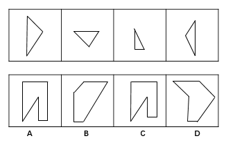
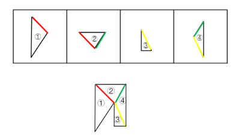

# 图形拼合-平行等长相消

考点：[[20-考点/判断推理/图形推理/图形拼合-平行等长相消|图形推理 / 图形拼合-平行等长相消]]

**问法模型**：四个碎片（只能平移）拼合出哪一个 → 以相对面积较大的碎片为基准，做平行等长相消，剩余轮廓与选项逐边对照

## 推理链
1. 第1步：题干为平面拼合题，上排四个碎片（不同大小、朝向的三角形碎片）只能上、下、左、右平移，不能旋转或翻转，因此碎片每条边的方向在拼合前后保持不变
2. 第2步：采用官方'平行等长相消'法：先锁定相对面积较大的碎片作为基准图形，其余碎片的边若与基准的某条边平行且等长，即可重合拼入，重合线段成为内部线条被抵消
3. 第3步：按平行且等长的对应关系，依次将其余三个碎片拼到基准图形上，每完成一次拼合就抵消一组平行等长的公共边
4. 第4步：全部抵消后，未被抵消的边构成整体外部轮廓，应为一个带内部凹口的凹多边形（形似方框被挖去一角/一带凹口轮廓）
5. 第5步：逐项对照：A、B、D 的轮廓中出现了碎片中不对应的边方向或凹口形态不符（如A的凹口位置与剩余边不匹配、B为无凹口斜边轮廓、D轮廓边数方向均对不上）；C 的每条轮廓边的方向与长度均能对应抵消后剩余的边
6. 第6步：故只有C能由四个碎片仅通过平移拼合而成，与官方答案一致

**最快解法**：⚡ 平行等长相消法：以面积最大的碎片为基准，把其余碎片中平行且等长的边两两重合抵消，剩余外部轮廓与四个选项直接对照，秒选C

## 易错点
- ⚠ 忽略'只能平移'限制，脑中自行旋转/翻转碎片，导致边方向错位而拼错
- ⚠ 不找基准图形，随意两两试拼，效率低且容易漏掉可抵消的公共边
- ⚠ 只看整体轮廓相似就下结论，未逐边核对方向与长度（如A与C凹口形态相近易误选A）

## 母题抽象
> 🧩 当题干出现'若干碎片只能通过平移拼合成一个图形'的特征时，以最大碎片为基准，用平行等长相消法抵消内部公共边，再将剩余轮廓与选项逐边对照验证

**同类特征**：平面拼合、只能平移（不旋转不翻转）、碎片为不同朝向三角形、平行等长相消、凹多边形轮廓、找基准图形

## 相关题
- [[10-真题/判断推理/图形推理/2042110 图形推理-平面拼合（平行等长相消法）|2042110]]（江苏 2017，相关度2）
- [[10-真题/判断推理/图形推理/2042112 图形推理-平面拼合（平行等长相消）|2042112]]（江苏 2017，相关度2）
- [[10-真题/判断推理/图形推理/2172317 图形推理-平面拼合（只能平移的拼合重组）|2172317]]（江苏 2018，相关度2）
- [[10-真题/判断推理/图形推理/2187608 图形推理-平面拼合（旋转拼合·平行等长相消）|2187608]]（选调 2018，相关度2）
- [[10-真题/判断推理/图形推理/5697920 图形推理-平面拼合（平移拼合·平行且等长相消）|5697920]]（江苏 2023，相关度2）

---

### 题干

下边的四个图形中，只有一个是由上边的四个图形拼合（只能通过上、下、左、右平移）而成的，请把它找出来。

### 选项
- A. A
- B. B
- C. C　✅
- D. D

### 官方解析

本题为平面拼合，可以采用平行等长相消的方法（找到相对面积较大的图形作为基准图形，找到平行且等长的边进行拼合，拼合之后等长线条抵消）。

平行等长相消的方式如下图所示：

故正确答案为C。

### 给定材料
（无）
