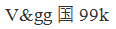
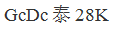

# 字符规律（相同字符的位置关系）

考点：[[20-考点/判断推理/图形推理/字符规律（相同字符的位置关系）|图形推理 / 字符规律（相同字符的位置关系）]]

**问法模型**：给出一个字符序列，要求选出符号位置规律完全一致的一项 → 提取'相同字符出现的位置序号+其余位置是否互异'作为指纹，逐项比对

## 推理链
1. 第1步：数题干'WTgg我28K'共8个字符，逐位观察：位置3、4均为'g'，其余位置（W、T、我、2、8、K）字符两两不同
2. 第2步：归纳规律指纹：仅有且恰有位置3、4的符号相同，其余位置符号各不相同
3. 第3步：A项：位置3、4相同，但位置6、7也相同，出现第二对重复，不符合，排除
4. 第4步：C项：位置3、4的符号不相同，指纹首位即断裂，排除
5. 第5步：D项：位置3、4相同，但位置6、7也相同，与A同错，排除
6. 第6步：B项：位置3、4相同且其余位置各不相同，指纹与题干完全一致，当选

**最快解法**：⚡ 位置指纹法：先在题干中标注相同字符所在位置（题干：仅第3、4位同），再逐项核对——凡'第3、4位不同'或'除3、4外还有别处相同（如6、7位同）'的直接排除，唯一全吻合者为答案

## 易错点
- ⚠ 只验证'位置3、4相同'就匆忙作答，漏掉'其余位置各不相同'的隐含条件（A、D正是设此陷阱）
- ⚠ 忽略位置序号必须逐位对应，错把'含有相同字符'当作规律而非'相同字符的位置'
- ⚠ 形近字符（如2/8、W/T）看混，导致相同位置的判断出错

## 母题抽象
> 🧩 当题干给出一串字符并要求选'规律一致'项时，以'相同字符所在的位置序号集合'为指纹，验证选项该集合与题干完全一致且无多余的重复位置

**同类特征**：字符序列找规律、相同符号的位置、仅第3、4位相同、其余位置各不相同、逐位比对选项、排除多对重复项

## 相关题
（暂无）

---

### 题干
WTgg我28K

### 选项
- A. 

- B. 

　✅
- C. 

- D. 

### 官方解析
第一步：分析题干符号间关系。
从相同符号的位置入手：位置3、4的符号相同；其他位置的符号各不相同。 
第二步：判断选项符号间关系。
A项：位置3、4的符号相同，位置6、7的符号也相同，与题干不一致，排除；
B项：位置3、4的符号相同，其他位置的符号各不相同，与题干保持一致，当选；
C项：位置3、4的符号不相同，与题干不一致，排除；
D项：位置3、4的符号相同，位置6、7的符号也相同，与题干不一致，排除。
故正确答案为B。

### 给定材料
（无）
