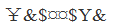
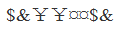
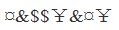

# 样式规律-符号同位关系（相同符号位置对应）

考点：[[20-考点/判断推理/图形推理/样式规律-符号同位关系（相同符号位置对应）|图形推理 / 样式规律-符号同位关系（相同符号位置对应）]]

**问法模型**：题干给出一串符号、问'哪一项符号间关系与题干一致'→ 采用编号标位法：只记录'相同符号出现在哪些位置'的组合，逐项核对，不看符号具体形状

## 推理链
1. 第1步：将题干8个符号按序编号：1=&、2=$、3=¤、4=¤、5=￥、6=$、7=&、8=￥
2. 第2步：提取规律——每种符号恰好出现两次，相同符号的位置对为：位置1、7相同；位置2、6相同；位置3、4相同；位置5、8相同
3. 第3步：逐项核对位置组合：A项位置1、7符号不同且位置2、6不同，排除；B项位置1、7相同但位置2、6不同，排除；C项位置1、7符号不同，排除
4. 第4步：D项位置1=7、2=6、3=4、5=8四组同位关系均与题干一致，当选

**最快解法**：⚡ 编号标位法（位置对齐法）：给题干和选项的8个符号逐一标号，先核对'位置1、7是否同符'这一最快排除点（直接排除A、C），再核对'位置2、6'（排除B），最后确认D项四组位置对完全一致

## 易错点
- ⚠ 只数符号种类数量（都是4种符号各出现2次）而不核对相同符号的位置组合，误判其他选项也符合
- ⚠ 符号形状近似（¤与￥、&与$形近）导致同异误判
- ⚠ 未按同一顺序对选项标号，位置错位后误选B（只核对1、7就匆忙作答）

## 母题抽象
> 🧩 当题干给出一串符号/字符且问'哪项符号间关系一致'时，按序编号后只记录相同符号出现的位置对，与选项逐位核对位置组合是否完全一致

**同类特征**：8个符号组成的字符序列、每种符号恰好出现两次、相同符号位置呈对称分布（1-7、2-6、3-4、5-8）、问法为'与题干符号关系一致'、选项为四串等长符号序列

## 相关题
（暂无）

---

### 题干
（空）

### 选项
- A. 

- B. 

- C. 

- D. 

　✅

### 官方解析
第一步：分析题干符号间关系。
从相同符号的位置入手：位置1、7的符号相同；位置2、6的符号相同；位置3、4的符号相同；位置5、8的符号相同。
第二步：判断选项符号间关系。
A项：位置1、7的符号不相同，位置2、6的符号不相同，与题干不一致，排除；
B项：位置1、7的符号相同，位置2、6的符号不相同，与题干不一致，排除；
C项：位置1、7的符号不相同，与题干不一致，排除；
D项：位置1、7的符号相同；位置2、6的符号相同；位置3、4的符号相同；位置5、8的符号相同，与题干一致，当选。
故正确答案为D。

### 给定材料
（无）
