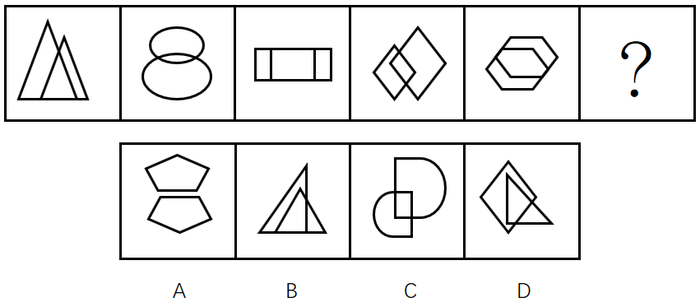

# 样式规律-两元素关系（相似元素+相交位置）

考点：[[20-考点/判断推理/图形推理/样式规律-两元素关系（相似元素+相交位置）|图形推理 / 样式规律-两元素关系（相似元素+相交位置）]]

**问法模型**：前五图呈现规律、选第六图延续规律 → 先归纳五图共同特征（两个相似元素且相交），再用排除法逐项筛选

## 推理链
1. 第1步：逐一观察题干五图：图1双三角形、图2双椭圆、图3（大矩形内两竖线实为两个矩形相交）、图4双菱形、图5双六边形，每图均由两个形状相似的元素组成
2. 第2步：再观察两元素的相对位置：五个图中两个元素均'相交'（存在重合区域），而非相离、相切或单纯嵌套
3. 第3步：先用'两个相似元素'这一标准筛选选项：B项内部线条结构不构成两个相似元素，D项为菱形与三角形、形状不同，排除B、D
4. 第4步：再用'两元素相交'这一标准对比A、C：A项两个五边形虽相似但彼此相离、不相交，排除A
5. 第5步：C项两个相似元素（其中之一旋转后）部分重合、位置相交，同时满足'相似'与'相交'两条规律，故为第六图

**最快解法**：⚡ 两步排除法：第一步看元素数量与形状——每图须为'两个相似元素'，排除B、D；第二步看位置关系——两元素须'相交'，排除A（A为相离），锁定C

## 易错点
- ⚠ 只验证'两个相似元素'而忽略位置关系，看到A项两个相似五边形就误选A
- ⚠ 把图3误读为'一个矩形加两条线段'，未识别出它也是'两个相似矩形相交'，导致规律归纳错误
- ⚠ 对C项中其中一个元素经过旋转的相似图形缺乏识别（旋转后的相似元素仍算相似），误以为C是两个不同形状

## 母题抽象
> 🧩 当题干各图元素组成不同、但每图都由两个同形状元素构成时，核心考点是两元素的相对位置（相交/相离/嵌套），先按'相似元素'排一批，再按'位置关系'排一批

**同类特征**：元素组成不同、每个图形两个元素、两元素形状相似、两元素相交（有重合）、呈现规律选第六图、位置关系为隐蔽考点

## 相关题
- [[10-真题/判断推理/图形推理/10204454 数量规律-部分数（黑白球连通区域数做和）|10204454]]（甘肃 2024，相关度1）
- [[10-真题/判断推理/图形推理/10204604 数量规律-线数量（汉字横线数）|10204604]]（辽宁 2024，相关度1）
- [[10-真题/判断推理/图形推理/10297050 数量规律-特殊计数（线条穿过小白球的数量）|10297050]]（天津 2025，相关度1）
- [[10-真题/判断推理/图形推理/10297127 图形间关系-相交图形中不相交边数量（黑白图形相交）|10297127]]（天津 2025，相关度1）
- [[10-真题/判断推理/图形推理/10297148 数量规律-线的细化（端点连线穿过线条数；备选：平行线组数）|10297148]]（天津 2025，相关度1）

---

### 题干

上边的题干中给出一套图形，其中有五个图，这五个图呈现一定的规律性。在下边给出一套图形，从中选出唯一的一项作为保持上边五个图规律性的第六个图。

### 选项
- A. A
- B. B
- C. C　✅
- D. D

### 官方解析
元素组成不同，但每个图形都是由两个相似的元素组成，排除B、D，题干中每个图形的两个元素都相交，排除A。
故正确答案为C。

### 给定材料
（无）
