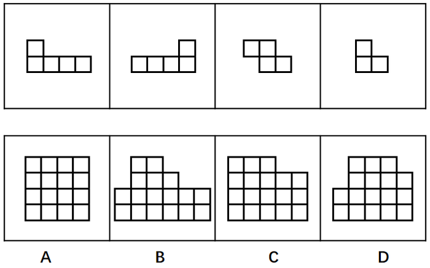
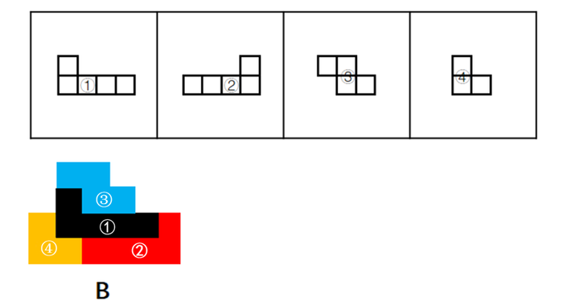

# 平面拼合（仅平移·平行等长相消）

考点：[[20-考点/判断推理/图形推理/平面拼合（仅平移·平行等长相消）|图形推理 / 平面拼合（仅平移·平行等长相消）]]

**问法模型**：'四个图形只能通过上、下、左、右平移拼合成一个'→ 先数单位小格总数做排除，再以大拼块为基准用平行等长相消法试拼验证

## 推理链
1. 第1步：数格定总量：题干四块图形的小正方形数依次为5（1上+4下长条）、5（4下+1右上长条）、4（Z形）、3（L形），合计17格，拼合结果必须恰好为17个单位正方形
2. 第2步：数选项：A为4×4=16格，C为3+4+4+4=15格，均不等于17，排除A、C；B（上2+中3+下两行各6=17格）与D（上3+中4+下两行各5=17格）待进一步验证
3. 第3步：对B用平行等长相消试拼：4格Z形块置顶（上边占第2~3列、下边右移占第3~4列）；5格左凸长条以4格底边放第三行第2~5列、单独顶格补第二行第2列
4. 第4步：5格右凸长条以4格底边放第四行第3~6列、单独顶格补第三行第6列；3格L形补第三行第1列及第四行第1~2列；核对B全部17格无遗漏、无重叠，长条底边与网格边线平行等长拼合后线条抵消，B严丝合缝
5. 第5步：对D同样试拼：D呈3-4-5-5阶梯形，两个5格长条的4格底边在下半部（每行仅5格宽）无法并排放置而不重叠或越界，且顶部台阶走向与两块L形的凹凸方向冲突，无法仅凭平移完整放入四块
6. 第6步：结论：只有B能由题干四个图形仅通过平移拼合而成，与官方答案B一致

**最快解法**：⚡ 数格排除法+平行等长相消：先算四块小格总数5+5+4+3=17，排除16格的A、15格的C；再对B、D试拼——把两块5格长条沿4格等长底边并排接在大图6格宽的下半部，用4格Z形块补顶部台阶、3格L形补左下缺口，B恰好完整拼出，选B

## 易错点
- ⚠ 不数小正方形总数，仅凭轮廓相似目测，易误选结构相近的A或C
- ⚠ 忽略题干'只能通过上、下、左、右平移'的限定，误以为拼块可旋转或翻转，导致在B、D间判断失误
- ⚠ 看到B、D都是17格就纠结，未实际用平行等长相消检验两个5格长条的摆放位置

## 母题抽象
> 🧩 当题干出现'若干小方格图形仅通过平移拼合成一个整体'时，先数各拼块单位小格之和排除数量不符的选项，再以面积最大的拼块为基准，找平行且等长的边进行拼合消线，验证剩余选项

**同类特征**：平面拼合、只能上、下、左、右平移（不可旋转）、四个图形拼成一个图形、小正方形网格拼块、平行等长相消法、选项外轮廓呈阶梯状

## 相关题
- [[10-真题/判断推理/图形推理/3019154 平面拼合（不旋转平移拼合-边线匹配）|3019154]]（广东 2021，相关度1）
- [[10-真题/判断推理/图形推理/10975247 图形推理-平面拼合（平行且等长相消法）|10975247]]（江苏 2024，相关度1）
- [[10-真题/判断推理/图形推理/10975248 平面拼合（分割重组-三角形拼合）|10975248]]（江苏 2024，相关度1）
- [[10-真题/判断推理/图形推理/11367796 平面拼合-平行且等长相消|11367796]]（江苏 2025，相关度1）
- [[10-真题/判断推理/图形推理/12304870 图形推理-平面拼合（平行且等长相消法）|12304870]]（江苏 2024，相关度1）

---

### 题干

下边的四个图形中，只有一个是由上边的四个图形拼合（只能通过上、下、左、右平移）而成的，请把它找出来。

### 选项
- A. A
- B. B　✅
- C. C
- D. D

### 官方解析

本题为平面拼合，可以采用平行等长相消的方法（找到相对面积较大的图形作为基准图形，找到平行且等长的边进行拼合，拼合之后等长线条抵消）。

 如下图所示：

故正确答案为B。

### 给定材料
（无）
