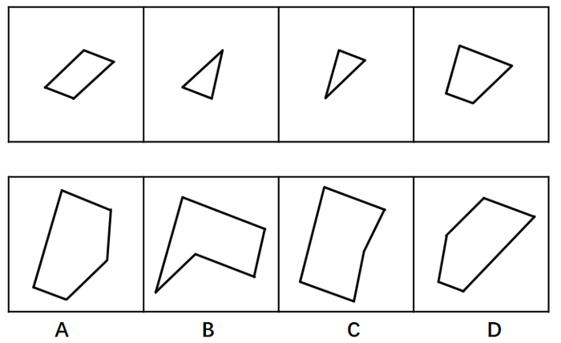
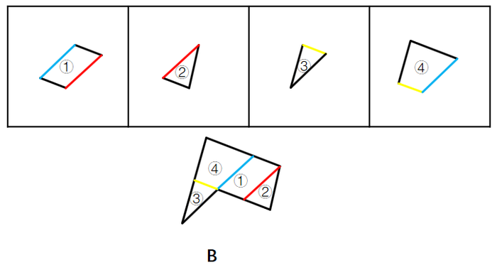

# 图形拼合-平面拼合（平行等长相消）

考点：[[20-考点/判断推理/图形推理/图形拼合-平面拼合（平行等长相消）|图形推理 / 图形拼合-平面拼合（平行等长相消）]]

**问法模型**：四个图形只能平移拼合成一个 → 采用平行等长相消法，以最大图形为基准逐块贴合抵消拼合边

## 推理链
1. 第1步：观察四个拼块——图1为斜置平行四边形，图2为斜置大三角形，图3为小三角形，图4为带凹角的四边形，各块斜边方向各不相同
2. 第2步：规则是只能上、下、左、右平移，不能旋转，因此可拼合的边必须'平行且等长'，拼合后该边在内部抵消，只剩外轮廓
3. 第3步：选取相对面积较大的图形作为基准（对应选项中面积最大的凹多边形轮廓），先将其较长斜边与平行四边形的平行等长斜边贴合，内部线条抵消
4. 第4步：再把大三角形、小三角形依次拼入剩余缺口，贴合边同样满足平行且等长，逐段抵消
5. 第5步：全部拼合后外轮廓为'上宽下尖、左侧内凹'的箭头状凹多边形，与B选项轮廓一致
6. 第6步：对照选项——A、C、D的凹凸位置或斜边方向无法由四个拼块的平行等长边完全抵消得到，排除，故选B

**最快解法**：⚡ 平行等长相消法：先锁定面积最大的拼块作基准，把其余三块中与基准'平行且等长'的边逐一贴合抵消，剩余外轮廓即为答案（本题验证得B的凹口箭头形轮廓）

## 易错点
- ⚠ 忽略'只能平移、不能旋转'的限制，把斜边方向不一致的边强行拼合
- ⚠ 只凭整体形状相似或面积相加选答案，未逐一验证拼合边是否平行且等长
- ⚠ 凹口方向看错：B为左下侧内凹的箭头形，易与外凸轮廓相近的C、D混淆

## 母题抽象
> 🧩 当题干出现'若干小图形只能平移拼合成一个图形'时，用平行等长相消法：以最大块为基准，逐一贴合平行且等长的边使其抵消，最后验证剩余外轮廓与选项一致

**同类特征**：平面拼合、只能上、下、左、右平移、拼块含平行四边形与三角形、带凹角拼块、答案为凹多边形轮廓

## 相关题
- [[10-真题/判断推理/图形推理/10975247 图形推理-平面拼合（平行且等长相消法）|10975247]]（江苏 2024，相关度2）
- [[10-真题/判断推理/图形推理/16095258 图形推理-平面拼合（平行且等长相消）|16095258]]（江苏 2024，相关度2）
- [[10-真题/判断推理/图形推理/16095267 图形推理-平面拼合（平移拼合·平行且等长相消）|16095267]]（江苏 2024，相关度2）
- [[10-真题/判断推理/图形推理/2172313 平面拼合-平行且等长相消（三角形拼合轮廓）|2172313]]（江苏 2018，相关度2）
- [[10-真题/判断推理/图形推理/2367807 图形推理-平面拼合（平行且等长相消）|2367807]]（江苏 2019，相关度2）

---

### 题干

下边的四个图形中，只有一个是由上边的四个图形拼合（只能通过上、下、左、右平移）而成的，请把它找出来。

### 选项
- A. A
- B. B　✅
- C. C
- D. D

### 官方解析

本题为平面拼合，可以采用平行等长相消的方法（找到相对面积较大的图形作为基准图形，找到平行且等长的边进行拼合，拼合之后等长线条抵消）。

平行等长相消的方式如下图所示：

故正确答案为B。

### 给定材料
（无）
