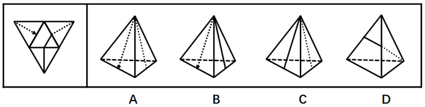
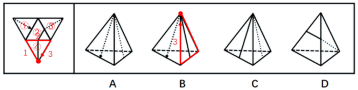
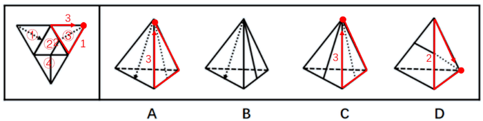

# 空间重构-四面体展开图折叠（画边法-标边排除）

考点：[[20-考点/判断推理/图形推理/空间重构-四面体展开图折叠（画边法-标边排除）|图形推理 / 空间重构-四面体展开图折叠（画边法/标边排除）]]

**问法模型**：‘左边给定纸盒外表面的展开图，右边哪一项能由它折叠而成’ → 四面体重构题，采用画边法：在展开图与立体图上同步给公共边编号，比对‘边—面相邻关系’和‘面内图案靠近哪条边’，逐项排除

## 推理链
1. 第1步：展开图为倒置大三角形内接中央小三角形的四面体展开图，共4个面（面①~④），面内图案为虚线段、实线竖直线、小实线三角形三类，且图案与所在面的边存在明确位置关系（如面②的三角形靠近边1）。
2. 第2步：四面体中任意两面必以一条公共棱相邻，故用画边法：从同一起点沿同一时针方向在展开图上给边1、边2、边3编号，并在各选项立体图上对应标边，比对相邻关系与图案指向。
3. 第3步：A项由面①和面③构成，边与面的相邻关系及图案位置与题干展开图一致，当选。
4. 第4步：B项由面①和面④构成，题干中边3应与面③相邻，而B项中边3与面①相邻，相邻关系不符，排除。
5. 第5步：C项由面③和面④构成，题干中边3应与面①相邻，而C项中边3与面④相邻，相邻关系不符，排除。
6. 第6步：D项由面②和面③构成，虽然边2与面②的相邻关系吻合，但题干中面②的三角形靠近边1，而D项中面②的三角形靠近边3，图案指向不符，排除。
7. 第7步：只有A项的边—面关系和图案位置均与展开图一致，故正确答案为A。

**最快解法**：⚡ 画边法+排除法：沿两可见面的公共棱在展开图与选项上同步标边号，先查‘某条边应与哪个面相邻’排除B、C，再查‘面内三角形靠近哪条边’排除D，仅A全吻合，秒选A。

## 易错点
- ⚠ 只核对面上‘有无’某图案，漏查图案与边的位置关系（D项即三角形靠近边1还是边3之差）
- ⚠ 画边法标号时起点或时针方向不统一，导致展开图与立体图的边号错位、误判相邻面
- ⚠ 把立体图中表示遮挡棱的虚线与展开图面上印刷的虚线/点线图案混淆，误判图案归属

## 母题抽象
> 🧩 当题干给出四面体展开图且面内图案与边有位置关系时，用画边法：在展开图与选项上同步给公共边编号，依次验证‘边与面的相邻关系’和‘图案靠近哪条边’，全部吻合者即为可折叠项。

**同类特征**：四面体重构、展开图为大三角形内含4个小三角形面、面内图案为线段与小三角形、图案与边有明确位置关系、问哪一项能由展开图折叠而成、选项为三维视角线框四面体

## 相关题
（暂无）

---

### 题干

左边给定的是纸盒外表面的展开图，右边哪一项能由它折叠而成？请把它找出来。

### 选项
- A. A　✅
- B. B
- C. C
- D. D

### 官方解析

本题属于四面体重构，可采用画边法排除选项。

A项：由面①和面③构成，与题干一致，当选；

B项：由面①和面④构成，如下图画边，题干边3与面③相邻，B选项边3与面①相邻，与题干不一致，排除；

C项：由面③和面④构成，如下图画边，题干边3与面①相邻，C选项边3与面④相邻，与题干不一致，排除；

D项：由面②和面③构成，如下图画边，题干边2与面②相邻，且面②的三角形靠近边1，而D选项边2与面②相邻，且面②的三角形靠近边3，与题干不一致，排除。

故正确答案为A。

### 给定材料
（无）
