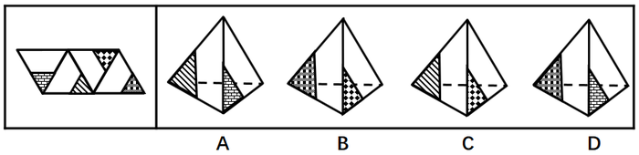
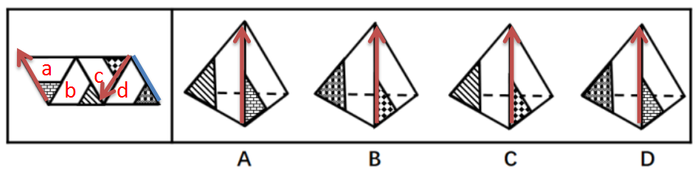

# 空间重构-四面体折叠（画边法-公共边验证）

考点：[[20-考点/判断推理/图形推理/空间重构-四面体折叠（画边法-公共边验证）|图形推理 / 空间重构-四面体折叠（画边法/公共边验证）]]

**问法模型**：‘哪一项能由展开图折叠而成’的四面体重构问法 → 以特征图案顶点为起点画边，比对选项与展开图中各边的相邻面及公共边，逐一排除

## 推理链
1. 第1步：展开图为平行四边形，含四个三角形面——面a（最左，含砖块纹与小黑三角形顶点）、面b（中部白面）、面c（上部含斑点纹三角形）、面d（最右，底部含网格纹三角形），四个选项均为相邻两面的立体呈现
2. 第2步：采用画边法——从面上特征图案（小黑三角形）的顶点出发，沿该面顺时针给三条边依次编号，再比较展开图与选项中‘第一条边’所贴邻的面是否一致
3. 第3步：A项由面a和面b构成，选项中从面a小黑三角形顶点出发顺时针第一条边挨着面b，而展开图中同一起点的第一条边挨着面d，平面与立体不对应，排除
4. 第4步：B项由面c和面d构成，选项中从面c小黑三角形顶点出发顺时针第一条边挨着面d，展开图中该第一条边也挨着面d，对应一致，暂定当选
5. 第5步：C项由面c和面b构成，选项中第一条边挨着面b，而展开图中从面c顶点出发的第一条边挨着面d，不对应，排除
6. 第6步：D项由面a和面d构成，第一条边虽同样挨着面d，但二者公共边不一致——选项中公共边为该箭头边，展开图中面a与面d的公共边为另一条线段，排除
7. 第7步：仅B项的相邻面、首边邻面与公共边均与展开图对应，故正确答案为B

**最快解法**：⚡ 画边法：先认面（A=面a+b，B=面c+d，C=面c+b，D=面a+d），再从特征小三角顶点顺时针画边比对‘第一条边贴谁’——B项首边同贴面d直接锁定，A/C首边贴错面排除，D公共边不一致排除

## 易错点
- ⚠ D项陷阱：首边所贴面相同不代表折叠正确，必须进一步核对两面的公共边是否为同一条边
- ⚠ 画边起点必须选特征图案（小黑三角形）的顶点，起点选错则整圈边的相邻关系全部错位
- ⚠ 面a的砖块纹与面c的斑点纹、面b与面d的白底图案易混淆，认错面会导致直接误选A或C

## 母题抽象
> 🧩 当四面体展开图各面带有不同特征图案时，从特征图案顶点出发顺时针画边，先比‘第一条边所贴邻的面’，再比‘两面公共边’，两项均一致者才为正确折叠项

**同类特征**：平行四边形四面体展开图、各面含互异阴影/特征小三角图案、选项呈现相邻两面及中间公共棱、问‘哪一项能折叠而成’、需逐项验证首边邻面与公共边

## 相关题
（暂无）

---

### 题干

左边给定的是纸盒外表面的展开图，右边哪一项能由它折叠而成？请把它找出来。

### 选项
- A. A
- B. B　✅
- C. C
- D. D

### 官方解析

本题属于四面体重构，可采用画边法逐一分析，排除错误选项。 

A项：由面a和面b构成，如上图所示，从面a中小黑三角形的顶点出发顺时针画边，第一条边（A项中红色箭头）挨着b面，可是展开图中从面a中小黑三角形的顶点出发顺时针画边第一条边（展开图最左侧红色箭头）挨着d面，平面图与立体图不对应，排除；

B项：由面c和面d构成，如上图所示，从面c中小黑三角形的顶点出发顺时针画边，第一条边（B项中红色箭头）挨着d面，可是展开图中从面c中小黑三角形的顶点出发顺时针画边第一条边（展开图右侧红色箭头）挨着d面，平面图与立体图对应，当选；

C项：由面c和面b构成，如上图所示，从面c中小黑三角形的顶点出发顺时针画边，第一条边（C项中红色箭头）挨着b面，可是展开图中从面c中小黑三角形的顶点出发顺时针画边第一条边（展开图右侧红色箭头）挨着d面，平面图与立体图不对应，排除；

D项：由面a和面d构成，如上图所示，从面a中小黑三角形的顶点出发顺时针画边，第一条边（A项中红色箭头）挨着d面，虽然展开图中从面a中小黑三角形的顶点出发顺时针画边第一条边（展开图最左侧红色箭头）也挨着面d，但是二者的公共边并不一致，选项D中的面a和面d的公共边为红色箭头，展开图中二者公共边为蓝色线段，二者不一致，平面图与立体图不对应，排除；

故正确答案为B。

### 给定材料
（无）
