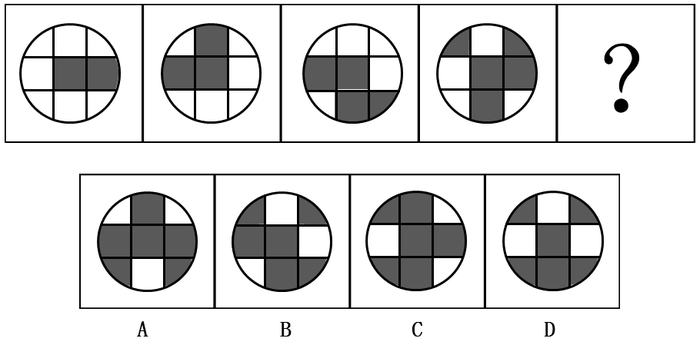
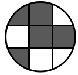

# 数量规律＋位置规律复合（黑块数量递增＋图形逆时针旋转叠加新增元素）

考点：[[20-考点/判断推理/图形推理/数量规律＋位置规律复合（黑块数量递增＋图形逆时针旋转叠加新增元素）|图形推理 / 数量规律＋位置规律复合（黑块数量递增＋图形逆时针旋转叠加新增元素）]]

**问法模型**：问号处填入符合前四个图形变化规律的图形 → 先找数量规律（黑块数递增），数量排除不了再叠加位置规律（旋转＋新增）定位选项

## 推理链
1. 第1步：题干四幅图均由黑块（阴影）和白块组成，黑块数量依次为2、3、4、5，呈等差递增，故？处图形应含6个黑块
2. 第2步：单凭黑块数量无法排除选项，转而观察黑块位置：发现第二幅图是在第一幅图逆时针旋转90°的基础上新增一个黑块
3. 第3步：逐图验证规律：第三幅图＝第二幅图逆时针旋转90°＋新增一个黑块（黑块由3个变为4个），第四幅图＝第三幅图逆时针旋转90°＋新增一个黑块（由4个变为5个），规律稳定成立
4. 第4步：按此复合规律，？处图形应为第四幅图逆时针旋转90°后再新增一个黑块，黑块总数为6且分布位置唯一确定
5. 第5步：逐项对照：A、B、D的黑块分布位置与'第四幅图逆时针旋转后加一块'均不吻合，只有C项黑块数量为6且位置完全吻合

**最快解法**：⚡ 数量＋位置复合法：先数黑块数得2、3、4、5→6，排除不了再用口诀'前图逆时针转90°＋添一块'逐图套用，直接锁定C

## 易错点
- ⚠ 只盯黑块数量递增规律，发现各选项数量无法排除后陷入僵局，漏掉位置变化这一复合规律
- ⚠ 旋转方向看反：若按顺时针90°去验证黑块位置，会误判成其他选项
- ⚠ 忽略'每幅图是在前一图基础上新增一个黑块'的叠加条件，只按纯旋转对位导致错配

## 母题抽象
> 🧩 当一组黑白块图形数量呈递增（如2、3、4、5）且单靠数量无法排除选项时，应叠加考虑'前一图旋转/翻转＋新增一个元素'的复合规律，用黑块相对位置逐一验证。

**同类特征**：黑白（阴影）块填充图形、黑块数量依次为2、3、4、5递增、数量规律无法排除选项、黑块位置呈规律性旋转、每图在前图基础上新增一个黑块、数量＋位置复合规律

## 相关题
- [[10-真题/判断推理/图形推理/2274549 位置规律-平移（横线与竖线分开追踪、逐幅移动1格）|2274549]]（北京 2019，相关度1）

---

### 题干

请选择最适合的一项填入问号处，使之符合之前四个图形的变化规律。（    ）

### 选项
- A. A
- B. B
- C. C　✅
- D. D

### 官方解析

元素组成不同，且无明显属性规律，考虑数量规律。每幅图都由黑块和白块组成，每幅图的黑块数量依次为2、3、4、5、？。？处应填入一个黑块数量为6的选项，发现无法排除选项。比较选项，发现选项的黑块分布位置不同，观察题干的黑块位置，发现第二幅图是在第一幅图逆时针旋转的基础上增加一个黑块，第三幅图是在第二幅图逆时针旋转的基础上增加一个黑块，以此类推，第四幅图是在第三幅图逆时针旋转的基础上增加一个黑块，？处应填入的图形是在第四幅图逆时针旋转（如下图）的基础上增加一个黑块，只有C项符合。

故正确答案为C。

### 给定材料
（无）
