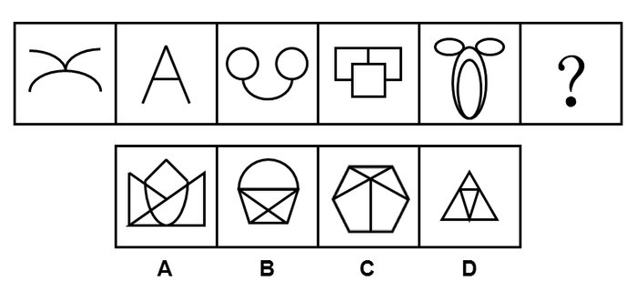

# 属性规律（轴对称、曲直性）+数量规律（面数量等差递增）综合

考点：[[20-考点/判断推理/图形推理/属性规律（轴对称、曲直性）+数量规律（面数量等差递增）综合|图形推理 / 属性规律（轴对称、曲直性）+数量规律（面数量等差递增）综合]]

**问法模型**：给出五个图形问第六个 → 元素组成不同时先查属性规律（对称、曲直）排除，再查数量规律（面数）锁定答案

## 推理链
1. 第1步：题干五图元素组成不同，图1（交叉弧线）、图2（字母A）、图3（双圆加弧）、图4（方形组合）、图5（椭圆组合）均较规整，先看属性：五图都是轴对称图形
2. 第2步：A项由直线、曲线交叉构成且左右不对称，不满足轴对称属性，排除A
3. 第3步：继续看曲直性：图1曲线、图2直线、图3曲线、图4直线、图5曲线，呈'曲、直'交替规律，问号处应为纯直线图形；B项上方为半圆弧（含曲线），排除B
4. 第4步：属性再无规律，转数量规律：题干图形封闭区域（窟窿）特征明显，依次数面：0、1、2、3、4，构成公差为1的等差数列，问号处应为5个面
5. 第5步：C项为六边形被内部直线分割，面数为5；D项三角形内部分割后面数不足5，只有C项符合

**最快解法**：⚡ 排除法+数面口诀：'规整图形先看对称，曲直交替排一半，窟窿多就数面找等差'——轴对称排A，曲直交替排B，面数0/1/2/3/4→5锁定C

## 易错点
- ⚠ 图5为椭圆嵌套加两个'耳朵'椭圆，面数易误数成3，需按封闭白色区域逐个清点（内椭圆、外圈、两耳共4个面）
- ⚠ 只验证轴对称和面数两条规律，漏掉'曲直图形交替'这一排除B项的关键属性
- ⚠ C、D都是内部含线的多面图形，不精确数面易误选面数不是5的D项

## 母题抽象
> 🧩 当题干图形元素组成不同且整体较规整时，按'对称性→曲直性→数量规律（面数）'的顺序逐层验证，用可排除的属性先删项，再用等差数列规律锁定答案

**同类特征**：元素组成不同、均为轴对称图形、曲线图形与直线图形交替出现、封闭区域（窟窿）特征明显、面数量0/1/2/3/4等差递增、问号处求规律延续

## 相关题
- [[10-真题/判断推理/图形推理/16095265 属性规律-对称性（轴对称+对称轴方向旋转）|16095265]]（江苏 2024，相关度2）
- [[10-真题/判断推理/图形推理/2031008 属性规律（轴对称+对称轴旋转）与数量规律（直线数）综合考查|2031008]]（北京 2017，相关度2）
- [[10-真题/判断推理/图形推理/2049850 属性规律-对称性（对称轴与图形线条的 重合-不重合）|2049850]]（山东 2017，相关度2）
- [[10-真题/判断推理/图形推理/2136980 属性规律-轴对称（对称轴数量+对称轴与图形中线条重合的二级辨析）|2136980]]（北京 2018，相关度2）
- [[10-真题/判断推理/图形推理/2188222 属性规律-对称性（轴对称及对称轴方向为竖直）|2188222]]（江西 2018，相关度2）

---

### 题干

请选择最适合的一项填入问号处，使之符合之前五个图形的变化规律：

### 选项
- A. A
- B. B
- C. C　✅
- D. D

### 官方解析
元素组成不同，考虑属性规律和数量规律。观察题干发现，图形都比较规整，都是轴对称图形，排除A项；再观察发现，题干图形都是曲线图形、直线图形交替出现，因此？处应填入一个直线图形，排除B项；属性再无规律，考虑数量规律，题干图形特征比较明显，窟窿很多，考虑数面，依次为0、1、2、3、4、？。因此？处应填入一个面数量为5的图形，只有C项符合。
故正确答案为C。

### 给定材料
（无）
