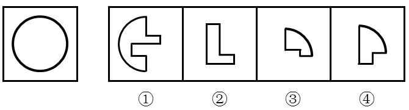

# 平面拼合（图形组成-弧边匹配）

考点：[[20-考点/判断推理/图形推理/平面拼合（图形组成-弧边匹配）|图形推理 / 平面拼合（图形组成-弧边匹配）]]

**问法模型**：“左侧图形由右侧哪几项组成” → 平面拼合模型：以目标外轮廓（全曲线圆形）为约束，用弧长守恒与直边内贴逐项排除。

## 推理链
1. 第1步：左侧目标图形为标准圆形，外轮廓是360°连续曲线，不含任何直线段。
2. 第2步：规则提取——拼合后各块暴露在外的边界必须恰好构成圆形轮廓，故参与外轮廓的部分只能是圆弧且弧长合计守恒（360°），所有直边必须两两内部贴合。
3. 第3步：数弧——①含一段大圆弧（约半圆，约180°），③、④各含一段约90°小圆弧，①+③+④弧长合计约360°，恰好覆盖圆周；②是由纯直线构成的L形，无任何圆弧。
4. 第4步：逐项排除——凡含②的组合（A.①②③、B.①②④、D.②③④）中，②无弧无法形成圆轮廓，且②③④的弧量不足360°，均可排除。
5. 第5步：验证①③④——①的凹凸直边缺口与③④的直边两两贴合，全部直边内配后外轮廓仅剩三段圆弧，合成完整圆形，与官方拼合图一致，故选C。

**最快解法**：⚡ 弧边守恒法（排除法）：目标圆外轮廓全为曲线，直接数各块圆弧——①约180°、③约90°、④约90°，合计360°恰好成圆；②为纯直边L形无弧，含②的A/B/D一律排除，锁定C。

## 易错点
- ⚠ 忽视②没有任何圆弧、其直边不可能暴露为圆轮廓，误把L形当作内部填充块而误选含②的选项
- ⚠ 只比较各块面积大小相近，不验证弧长合计是否等于圆周360°
- ⚠ 忽略①③④的直边凹凸缺口必须两两贴合，误以为含大弧的①可单独近似成圆而错选单项思路

## 母题抽象
> 🧩 当目标图形为全曲线轮廓（圆/椭圆）且候选块中混有纯直边块时，用“外轮廓弧长守恒”排除无弧或弧长合计不足的组合，再用直边两两内贴验证剩余组合。

**同类特征**：平面拼合、目标为圆形（全曲线外轮廓）、候选项含纯直边L形块②、①大圆弧约180°、③④各含约90°小弧、弧长合计360°守恒

## 相关题
- [[10-真题/判断推理/图形推理/3019154 平面拼合（不旋转平移拼合-边线匹配）|3019154]]（广东 2021，相关度1）
- [[10-真题/判断推理/图形推理/10975247 图形推理-平面拼合（平行且等长相消法）|10975247]]（江苏 2024，相关度1）
- [[10-真题/判断推理/图形推理/10975248 平面拼合（分割重组-三角形拼合）|10975248]]（江苏 2024，相关度1）
- [[10-真题/判断推理/图形推理/11367796 平面拼合-平行且等长相消|11367796]]（江苏 2025，相关度1）
- [[10-真题/判断推理/图形推理/12304870 图形推理-平面拼合（平行且等长相消法）|12304870]]（江苏 2024，相关度1）

---

### 题干

左侧图形是由右侧图形中的（    ）项组成。

### 选项
- A. ①②③
- B. ①②④
- C. ①③④　✅
- D. ②③④

### 官方解析

本题考查平面拼合。左侧图形为圆形，可以由图①③④组合得到，具体拼合如下图：

故正确答案为C。

### 给定材料
（无）
