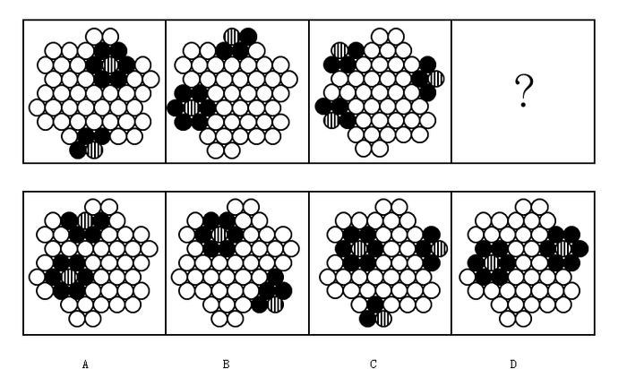

# 位置规律-元素邻接关系（多种填充元素间的相邻规则）

考点：[[20-考点/判断推理/图形推理/位置规律-元素邻接关系（多种填充元素间的相邻规则）|图形推理 / 位置规律-元素邻接关系（多种填充元素间的相邻规则）]]

**问法模型**：题干各图由相同数量的白圆、黑圆、条形圆散布于蜂窝网格 → 优先考查元素之间的相邻/接触关系，归纳邻接规则后逐项排除

## 推理链
1. 第1步：题干三幅图元素种类和数量基本一致（白圆、黑圆、条形圆），仅位置不同，故规律不在数量而在相对位置
2. 第2步：逐幅观察非白元素的接触情况，发现每个条形圆的相邻圆全部是黑圆，条形圆从不与白圆相邻（如第一图右上、下方的条形圆均被黑圆包围）
3. 第3步：继续观察黑圆，发现每个黑圆至少与一个条形圆相邻，即黑圆与条形圆总是成簇共存，不存在孤立的黑圆簇
4. 第4步：用规则一'条形圆只邻黑圆'检验选项：A、C项中均有条形圆与白圆相邻（如C项右侧边缘条形圆紧贴白圆），排除A、C
5. 第5步：用规则二'每个黑圆必邻条形圆'检验剩余项：B项右下簇中有一个黑圆周围没有条形圆相邻，排除B
6. 第6步：D项两簇中条形圆只与黑圆相邻，且每个黑圆都有条形圆为邻，两条规则同时满足，故选D

**最快解法**：⚡ 邻接规则排除法：先用最强规则'条形圆不与白圆相邻'排除A、C，再用'黑圆必与条形圆相邻'排除B，两步锁定D

## 易错点
- ⚠ 只数元素种类和数量相同就认为无规律，忽略元素间邻接关系这一位置规律
- ⚠ 只验证'条形圆不邻白圆'一条规则就作答，漏验'黑圆必邻条形圆'，恰好落入B项陷阱
- ⚠ 蜂窝交错排列中判断相邻圆时看错相切关系，把斜向不相切的圆误判为相邻

## 母题抽象
> 🧩 当题干图形由多种填充元素散布在规则网格上且各图元素数量一致时，优先归纳'某元素只与某元素相邻'的配对规则，再用多重规则逐层排除选项

**同类特征**：蜂窝网格排布圆圈、白圆/黑圆/条形圆三种填充元素、各图元素数量基本相同仅位置变化、黑圆与条形圆成簇分布、问号处补第四幅图

## 相关题
（暂无）

---

### 题干

从所给四个选项中，选择最合适的一个填入问号处，使之呈现一定规律性：

### 选项
- A. A
- B. B
- C. C
- D. D　✅

### 官方解析
观察图形，题干出现黑圆、条形圆、白圆三种元素，题干图形中的每一个条形圆只与黑圆相邻，不与白圆相邻，排除A、C项。题干图形中的每一个黑圆都与条形圆相邻，B项中有一个黑圆没有与条形圆相邻，排除B项，对应D选项。
故正确答案为D。

### 给定材料
（无）
