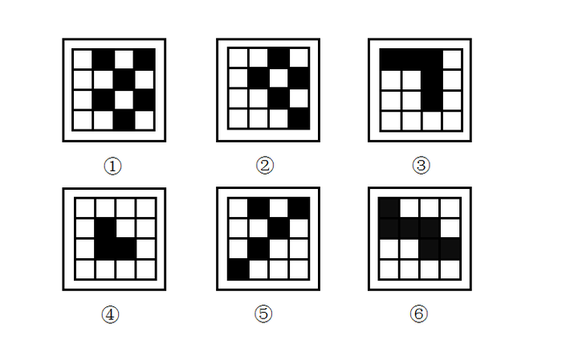

# 图形分类-黑白块连接方式（点接-边接）

考点：[[20-考点/判断推理/图形推理/图形分类-黑白块连接方式（点接-边接）|图形推理 / 图形分类-黑白块连接方式（点接/边接）]]

**问法模型**：六个图形两两分类、各自有共同规律 → 先数黑白块数量，无规律则改看黑块间的连接关系（点接/边接）分类

## 推理链
1. 第1步：六个图形均为4×4黑白网格，先整体数黑块个数，各图数量不一且无明显的数量二分规律
2. 第2步：转换观察视角，考察黑块与黑块之间的相对位置关系，区分'仅以顶点（角）相触的点接'与'共享一条边的边接'两种连接方式
3. 第3步：图①中黑块呈对角状散布、图②中黑块零散分布在不同行列、图⑤中黑块同样彼此分离，相邻黑块仅角顶点相触，均为点接
4. 第4步：图③黑块连成倒L形整片、图④黑块连成L形、图⑥黑块连成横向整片，相邻黑块共享一条边，均为边接，视觉上拼接整齐、紧密相连
5. 第5步：据此分组为①②⑤（点接）一组、③④⑥（边接）一组，与选项B完全吻合

**最快解法**：⚡ 黑白块分类口诀'先数数量、再看连接'：数量无规律后直接扫黑块形态——①②⑤黑块凌乱分散、仅以角相触为点接，③④⑥黑块连片、共边紧贴为边接，秒选B

## 易错点
- ⚠ 先入为主死磕黑块个数、行列占比等数量规律，落入命题人设置的'整体数无规律'陷阱，浪费时间
- ⚠ 点接图形在视觉上看似'挨着'，易误判为相连，混淆点接与边接两种连接方式
- ⚠ 黑块题惯性去寻找对称、平移、黑白叠加等规律，忽略'连接方式'这一黑白块分类高频考点

## 母题抽象
> 🧩 当题干出现黑白块/小方块组合图形且数量规律不成立时，改看相邻黑块的连接方式（点接vs边接）完成两组分类

**同类特征**：4×4黑白网格图、整体数黑块个数无规律、①②⑤黑块零散凌乱、③④⑥黑块紧密相连成片、点接与边接的对比

## 相关题
（暂无）

---

### 题干

把下面的6个图形分为两类，使每一类图形都有各自的共同规律，分类正确的是:

### 选项
- A. ①④⑥，②③⑤
- B. ①②⑤，③④⑥　✅
- C. ①⑤⑥，②③④
- D. ①③⑤，②④⑥

### 官方解析
题干都是黑白块图形，整体数黑块的个数，无明显规律。仔细观察后发现，图①②⑤黑块的拼接明显比较凌乱，而图③④⑥黑块的拼接比较整齐、紧密相连，即图①②⑤黑块与黑块之间以点相接，图③④⑥黑块与黑块之间以边相接。
故正确答案为B。

### 给定材料
（无）
