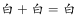

# 图形推理-样式规律-黑白运算

考点：[[20-考点/判断推理/图形推理/图形推理-样式规律-黑白运算|图形推理 / 图形推理-样式规律-黑白运算]]

**问法模型**：九宫格问'填入问号处使之呈现一定的规律性'，且每行图形外部轮廓与分割线相同、仅内部黑白填充不同 → 用黑白运算：第一行同位叠加定规则，第二行验证，第三行应用逐区域排除

## 推理链
1. 第1步：观察九宫格，每行三个图形外部轮廓相同、内部黑色区域与白色区域位置不同，元素组成相似，排除位置类和数量类，锁定样式类黑白运算
2. 第2步：将第一行图1与图2在同一分割区域上的颜色逐位叠加，对照图3同位置颜色，归纳出黑+黑、白+白、黑+白、白+黑四种组合的运算规则
3. 第3步：用第二行三个图形做同位置叠加验证，运算规则与前一致，确认规律成立
4. 第4步：第三行图1与图2逐区域应用该规则求图3：先算左上角，运算结果与A、B、D一致而C不符，排除C项
5. 第5步：再算右下角，运算结果与A、B、C一致而D不符，排除D项
6. 第6步：最后算右上角，运算结果与A、C、D一致而B不符，排除B项，剩余A项全区域均满足规则，故选A

**最快解法**：⚡ 排除法+黑白运算：不做全图运算，只计算选项之间的差异区域——第三行左上角叠加排除C、右下角叠加排除D、右上角叠加排除B，三次即可锁定A

## 易错点
- ⚠ 把黑白区域数量或面积变化当作规律（数量类），忽略'轮廓相同、颜色不同'是黑白运算的典型特征
- ⚠ 未按'同位置'对应叠加，区域错位比较导致运算结果错、排除错选项
- ⚠ 第一行定规则后不经验证就套用，或因各行内部分割线形状不同而误以为每行规则不同，其实运算逻辑一致、只是逐行独立取色

## 母题抽象
> 🧩 当九宫格（或两组）图形外部轮廓与内部分割线完全相同、仅黑白填充分布不同时，用黑白运算：第一行同位叠加定规则→第二行验证→第三行应用，并优先只算选项间差异区域即可快速排除

**同类特征**：九宫格、外部轮廓相同、内部黑白颜色分布不同、元素组成相似、黑色区域位置叠加、逐区域排除选项

## 相关题
- [[10-真题/判断推理/图形推理/10204610 样式规律-加减同异（去同存异），九宫格列规律|10204610]]（辽宁 2024，相关度2）
- [[10-真题/判断推理/图形推理/10297349 样式规律-黑白运算|10297349]]（浙江 2025，相关度2）
- [[10-真题/判断推理/图形推理/10297407 样式规律-黑白运算（定义叠加）|10297407]]（四川 2025，相关度2）
- [[10-真题/判断推理/图形推理/12019768 样式规律-加减同异（求同）与位置旋转的复合规律|12019768]]（浙江 2026，相关度2）
- [[10-真题/判断推理/图形推理/12101004 样式规律-黑白运算（九宫格逐位置叠加）|12101004]]（江苏 2025，相关度2）

---

### 题干

从所给的四个选项中，选出最合适的一个填入问号处，使之呈现一定的规律性。

### 选项
- A. A　✅
- B. B
- C. C
- D. D

### 官方解析

观察图形，元素组成相似，外部轮廓相同，但内部黑白颜色不同，考虑黑白运算。第一行：、、、；第二行验证此规律成立；第三行应用此规律，左上角：，排除C项；第三行右下角：，排除D项；第三行右上角，，排除B项。

故正确答案为A。

### 给定材料
（无）
