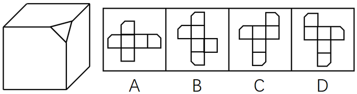
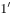
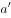

# 空间重构-六面体折叠（切角纸盒展开图-公共边重合与缺角顶点验证）

考点：[[20-考点/判断推理/图形推理/空间重构-六面体折叠（切角纸盒展开图-公共边重合与缺角顶点验证）|图形推理 / 空间重构-六面体折叠（切角纸盒展开图-公共边重合与缺角顶点验证）]]

**问法模型**：题干问'下列哪一项不是由它展开而成'（立体展开选非题）→ 采用折叠验证模型：定位切角产生的缺口边，验证三个缺角折叠后能否重合于同一顶点，不能重合者即为答案。

## 推理链
1. 第1步：题干纸盒'削掉一个角'，切角处在原顶点处新增一个三角形截面，与该顶点相连的三个面各缺一角（各有一条缺口边），折叠后三条缺口边必须两两重合、共同围成该三角形。
2. 第2步：使用公共边（重合边）规则——六面体中一个顶点发出且只发出三条边，展开图中以直角相邻的两条直角边折叠后是同一条公共边，公共边两侧'缺口/完整'特征必须一致。
3. 第3步：对C项作顶点追踪：边a与另一条直角边是重合边，故绿色点与蓝色点实为同一个顶点，从该点发出的应为a、b、c三条线。
4. 第4步：边1折叠后只能与b或c重合；而b两侧的面已经确定，b不可能与1重合，所以缺口边1只能与完整边c重合。
5. 第5步：C项出现'缺口边1与完整边相邻且重合'的情形，三个缺角无法重合围成三角形，与题干切角盒结构矛盾。
6. 第6步：A、B、D三项中三个缺角折叠后均可两两重合于同一顶点，可以由题干展开；本题为选非题，故选C。

**最快解法**：⚡ 公共边特征法：在展开图中找以直角相邻的重合边，检查缺口边两侧特征是否一致——C项中缺口边1与之重合的是一条完整边（三个缺角不重合），直接锁定C，其余三项缺角均能重合排除。

## 易错点
- ⚠ 忽略'选非题'问法，误选能正确折叠的A/B/D
- ⚠ 只核对缺角数量为3，不验证三个缺角折叠后是否重合于同一顶点
- ⚠ 忽略公共边两侧特征必须一致，误以为缺口边与完整边相邻/重合也可接受

## 母题抽象
> 🧩 当题干给出'切角/挖缺的立体图形'及其展开图并要求选非时，用重合边特征验证法：锁定切角产生的特征边（缺口边），逐项检查每对重合边两侧特征是否一致、特征边是否汇聚于同一顶点，出现特征边与完整边重合的选项即为不能展开的一项。

**同类特征**：削掉一个角的纸盒、三个面缺角、三个缺角必须重合、选非题（不是由它展开而成）、六面体展开图、重合边特征一致性验证

## 相关题
- [[10-真题/判断推理/图形推理/1791646 空间重构-六面体折叠（公共点法+相对面排除）|1791646]]（江苏 2016，相关度1）
- [[10-真题/判断推理/图形推理/19181439 空间重构-六面体折叠（相邻面公共边-公共点特征验证）|19181439]]（吉林 2024，相关度1）
- [[10-真题/判断推理/图形推理/2042730 空间重构-六面体折叠（画边法-相邻面公共边）|2042730]]（江苏 2017，相关度1）
- [[10-真题/判断推理/图形推理/2097180 空间重构-六面体折叠（相对面排除+画边法验证相邻面）|2097180]]（四川 2017，相关度1）
- [[10-真题/判断推理/图形推理/2188065 空间重构-六面体折叠（相对面排除+相邻面公共边特征验证）|2188065]]（选调 2018，相关度1）

---

### 题干

左边给定的是削掉一个角的纸盒，下列哪一项不是由它展开而成？

### 选项
- A. A
- B. B
- C. C　✅
- D. D

### 官方解析

题干图形切去了一个角，出现三个面缺角，三个缺角要重合，如上图所示，C项中1和是重合边，但没有缺角，即三个缺角不重合，所以C选项错误。

本题为选非题，故正确答案为C。

C项详解：

必备知识：首先要知道，六面体中一个顶点发射且只发射出三条边

①图中a和是直角边，是同一条边，因此绿色的点和蓝色的点是同一个点；

②从蓝色点发出的a、b、三条线，因此绿色的点发出的应该也是a、b、三条线（原理见上面的必备知识）；

③那现在知道a和是同一条，因此剩下边1要么就是b，要么是。但是b已经不可能了（因为b这条边两边的面已经是确定的了），所以1只能是这条边，因此它俩折叠完后是重合的。

而题干缺角的三条边应该是互相挨着的，不可能出现C中一条缺口的边1和一条完整的边挨着，所以C错。

本题为选非题，故正确答案为C。

### 给定材料
（无）

> [!warning] 疑点（官方解析可能有误，待人工复核）
> 官方解析部分字符缺失（如'从蓝色点发出的a、b、□三条线'、'1要么就是b，要么是□'），系转录缺字而非逻辑错误；核心论证（重合边两侧特征一致、缺口边不得与完整边重合）成立，与答案C一致，不影响结论。
