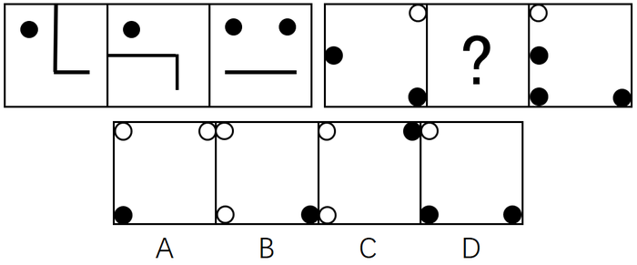

# 样式规律-去同求异 + 位置规律-旋转（复合规律）

考点：[[20-考点/判断推理/图形推理/样式规律-去同求异 + 位置规律-旋转（复合规律）|图形推理 / 样式规律-去同求异 + 位置规律-旋转（复合规律）]]

**问法模型**：两组图且问号位于第二组中间 → 先观察第一组'图1与图3如何运算得到图2'（去同求异后旋转），再将同一算子套用到第二组的图1与图3。

## 推理链
1. 第1步：观察第一组：图1含左上黑点、竖线、底部横线；图3含左上黑点、右上黑点、底部横线，两图元素相似但位置不同。
2. 第2步：确定运算方式为去同求异：删去两图共有的'左上黑点'和'底部横线'，保留仅出现一次的'竖线'和'右上黑点'，得到中间图①。
3. 第3步：将图①整体逆时针旋转90°（右上黑点转到左上，竖线转为横向线段），恰好得到第一组图2，规律验证成立。
4. 第4步：套用到第二组：图1含右上白圆、左中黑点、右下黑点；图3含左上白圆、左中黑点、左下黑点、右下黑点。
5. 第5步：去同求异：删去共有的'左中黑点'与'右下黑点'，保留仅出现一次的'右上白圆、左上白圆、左下黑点'，得到图②。
6. 第6步：将图②逆时针旋转90°：右上白圆→左上，左上白圆→左下，左下黑点→右下。
7. 第7步：问号处应为'左上白圆+左下白圆+右下黑点'，逐项对照，与B项完全一致。

**最快解法**：⚡ 算子迁移法（去同求异+逆时针旋转90°）：第一组先验证'图1⊕图3再逆时针转90°=图2'，第二组对图1、图3直接做去同求异，把所得图形整体逆时针转90°，秒选B。

## 易错点
- ⚠ 只做去同求异而漏掉旋转步骤，误选未旋转的图形
- ⚠ 旋转方向搞反（顺时针与逆时针混淆），导致黑白圆位置对应错误
- ⚠ 忽略'问号在第二组中间'的提示，误按图1→图2→图3的顺序顺推规律

## 母题抽象
> 🧩 当两组图元素相似且问号居中时，先从第一组两端图形反推中间图的生成算子（样式运算+位置变化），再将同一算子原样迁移到第二组两端图形验证选项。

**同类特征**：两组图、问号在第二组中间、元素组成相似（黑白圆+简单线条）、去同求异运算、逆时针旋转90°、黑白圆位置一一对应

## 相关题
（暂无）

---

### 题干

从所给的四个选项中，选择最合适的一个填入问号处，使之呈现一定的规律性：

### 选项
- A. A
- B. B　✅
- C. C
- D. D

### 官方解析

图形元素组成相似，优先考虑样式规律。因为第二组图中问号在中间，所以优先观察第一组图中第一个图形和第三个图形是如何得到第二个图形的。第一个图形与第三个图形去同求异得到图①，然后再逆时针旋转得到第二个图形，第二组满足同样的规律，第一个图形与第三个图形去同求异得到图②，再逆时针旋转得到的图形与B项相同。

故正确答案为B。

### 给定材料
（无）
