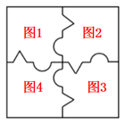

# 图形拼合（凹凸互补、旋转后拼成完整正方形）

考点：[[20-考点/判断推理/图形推理/图形拼合（凹凸互补、旋转后拼成完整正方形）|图形推理 / 图形拼合（凹凸互补、旋转后拼成完整正方形）]]

**问法模型**：题干为带凹凸边缘的近似方块、问号处补一块使之呈现规律 → 采用凹凸拼合模型：将已知图形旋转后两两拼接，剩余缺口的凹形即所补图形的凸形

## 推理链
1. 第1步：题干图1、图2、图3均为近似正方形的缺角块，边缘有明显凹凸元素——三角尖、V形凹口、半圆凸起、半圆凹口，无数量、位置等常规规律可循
2. 第2步：按官方解析考虑图形拼合：图2逆时针旋转90°后拼接在图1的右边，图3顺时针旋转90°后拼接在图2的下边，拼接时凹凸互补（一图之凸对应邻图之凹）
3. 第3步：三块拼合后仍缺一角，观察缺口轮廓：缺口处存在两个向内凹的三角尖，故所补图形须'凸出两个尖'才能补成正方形
4. 第4步：逐项数凸尖——A、D仅有一个凸出的三角尖，C以V形凹口和半圆凹凸为主无两个凸尖，只有B项同时含两个凸出的三角尖，符合缺口形状

**最快解法**：⚡ 旋转拼合法＋数尖排除法：图2逆旋90°、图3顺旋90°拼到图1右侧和下方，缺口需两个凸尖，直接数各选项凸出的三角尖个数，仅B为两个尖，秒选B

## 易错点
- ⚠ 被常规数量/位置规律思维束缚，忽略'凹凸拼合成正方形'这一特征规律
- ⚠ 旋转方向看错（图2应逆时针、图3应顺时针），拼错相对位置导致缺口形状判断错误
- ⚠ 混淆'凸尖'与'半圆凸起'：缺口处缺的是两个三角形凸尖，半圆凸起补不上三角尖，易误选只带一个尖或带半圆凸的A、C、D

## 母题抽象
> 🧩 当题干图形均带明显凹凸边（三角尖、V形口、半圆凸/凹）且疑似可拼成规则整体（正方形/矩形）时，用旋转拼合法：先定旋转方向把已知块两两拼合，剩余缺口的凹形轮廓即答案的凸形，逐一对照选项找互补块

**同类特征**：图形为近似正方形的缺角拼图块、边缘含三角尖与V形凹口、含半圆凸起与半圆凹口、四宫格问号处补一块、拼接后呈完整正方形、拼合需旋转图形

## 相关题
（暂无）

---

### 题干

从所给的四个选项中，选出一个最合适的填入问号处，使之呈现一定的规律：

### 选项
- A. A
- B. B　✅
- C. C
- D. D

### 官方解析

题干图形间有明显的凹进和凸出部分，考虑图形拼合。如下图所示，题干图2逆时针旋转90度之后拼接在图1的右边，图3顺时针旋转90度后拼接在图2的下边，很明显，还缺一幅凸出两个尖的图形，最后就可拼成一个完整的正方形，观察选项，只有B项凸出两个尖。

故正确答案为B。

### 给定材料
（无）
