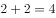
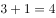

# 功能元素-小黑点标记面的数量（数量规律-行内相加）

考点：[[20-考点/判断推理/图形推理/功能元素-小黑点标记面的数量（数量规律-行内相加）|图形推理 / 功能元素-小黑点标记面的数量（数量规律-行内相加）]]

**问法模型**：九宫格'选择最合适的一个填入问号处'→ 识别每幅图共有的小黑点为功能元素，数其标记的封闭面数量，按行寻找数量运算规律

## 推理链
1. 第1步：九宫格中元素组成不同，但每幅图均出现小黑点，优先考虑小黑点的功能标记作用
2. 第2步：数第一行小黑点标记的封闭面数量：三角形分层面2个、斜线分圆2个、四角小方块4个，即2、2、4，满足'图1+图2=图3'
3. 第3步：第三行验证：吊灯形3个、笑脸形1个、分块圆形4个，即3、1、4，3+1=4，规律成立
4. 第4步：第二行：椭圆交叠图标记2个面、鱼形图标记3个面，由2+？=3得问号处图形应只有1个被小黑点标记的面
5. 第5步：逐项数选项：A项小黑点仅落在顶部半圆内1个面；B项两点分属2个面；C项多点分布于多个面；D项两点分属2个面
6. 第6步：只有A项标记面数量为1，与'？=1'吻合，故选A

**最快解法**：⚡ 功能元素数面法：只数小黑点所在封闭面的个数，发现每行'图1+图2=图3'，问号处需标记面数为1；B、D均为2个面直接排除，秒选A

## 易错点
- ⚠ 把'点标记的面数量'误数成点的总个数或图形的全部封闭面数，如第一行第三图只数外框大正方形
- ⚠ 误用'每行标记面总数恒为8'（2+2+4=8、3+1+4=8）推得?=3而错选C；官方规律是行内前两图之和等于第三图（?=1）
- ⚠ 忽略小黑点必须落入封闭面内才计数，漏数或多数未被点标记的面

## 母题抽象
> 🧩 当九宫格每幅图都出现同一小元素（如小黑点）时，优先考虑功能元素，数其标记的对象（面/区域/线/角）数量，再按行或列找数量运算规律（如前两图之和=第三图）

**同类特征**：九宫格、每幅图均含小黑点、元素组成不同、功能元素标记封闭面、行内数量相加规律、问号处求特定数量图形

## 相关题
- [[10-真题/判断推理/图形推理/11367791 属性类-对称性（对称轴方向与条数、轴对称+中心对称）＋数量类-面数量（九宫格横行复合规律）|11367791]]（江苏 2025，相关度2）
- [[10-真题/判断推理/图形推理/11881082 属性规律-对称性（对称轴方向）|11881082]]（黑龙江 2024，相关度2）
- [[10-真题/判断推理/图形推理/12881896 属性规律-曲直性（九宫格横行遍历）|12881896]]（新疆 2025，相关度2）
- [[10-真题/判断推理/图形推理/14993416 数量规律-点数量（黑点个数按行求和恒值）|14993416]]（选调 2024，相关度2）
- [[10-真题/判断推理/图形推理/17097275 图形间关系-点相交（点接触 vs 线接触）|17097275]]（山西 2024，相关度2）

---

### 题干

从所给的四个选项中，选择最合适的一个填入问号处，使之呈现一定的规律性：

### 选项
- A. A　✅
- B. B
- C. C
- D. D

### 官方解析

元素组成不同，题干每幅图均出现小黑点，优先考虑功能元素。观察发现，第一行图形中，功能元素标记的面数量分别为2、2、4，，第三行图形中，功能元素标记的面数量分别为3、1、4，，第二行图形中，功能元素标记的面数量分别为2、？、3，那么？处应为功能元素标记面数量为1的图形，只有A项符合。

故正确答案为A。

### 给定材料
（无）

> [!warning] 疑点（官方解析可能有误，待人工复核）
> 第一行2+2+4=8、第三行3+1+4=8，'每行标记面总数恒为8'与官方'行内前两图之和=第三图'两种规律对已给两行均成立，题面本身无法排除前者（若C项标记面数恰为3则会形成双解）；官方按行内相加规律取?=1，答案A不受影响，但存在规律唯一性不足的瑕疵
