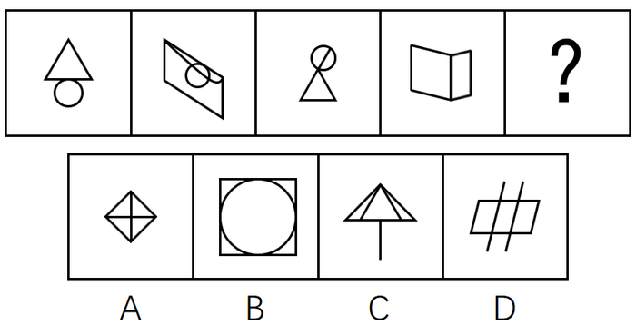

# 数量规律-一笔画（奇点数判定笔画数）

考点：[[20-考点/判断推理/图形推理/数量规律-一笔画（奇点数判定笔画数）|图形推理 / 数量规律-一笔画（奇点数判定笔画数）]]

**问法模型**：五宫格问号处填入规律延续图 → 元素组成不同先看属性、属性无规律转数量，识别'切圆/日字变形'等特征图后用'奇点数÷2'判定笔画数

## 推理链
1. 第1步：题干四幅图分别为'三角形下方切圆''四边形内含切圆''圆与三角形相切（人形）''日字变形（书本形）'，元素组成不同
2. 第2步：对称、曲直、封闭等属性规律不明显，转向数量规律；题干出现'切圆''日字变形'这类一笔画高频特征图，优先数奇点验证笔画数
3. 第3步：逐图数奇点：题干四幅图奇点数均为0或2且图形连通，全部为一笔画图形
4. 第4步：问号处应填一笔画图形，逐项数选项奇点
5. 第5步：A项菱形内十字交叉，四个顶点各连三条线均为奇点（4个奇点）→两笔画；B项圆内切于正方形，切点处线度数均为偶数，奇点数0且连通→一笔画；C项伞形，伞柄端点及线条交点产生奇点→两笔画；D项平行四边形被两条直线穿过，交点处产生4个奇点→两笔画
6. 第6步：只有B项为一笔画，与题干规律一致，故选B

**最快解法**：⚡ 一笔画特征图口诀法：见'切圆、日字变形、五角星'直接联想一笔画考点→数奇点（奇点数÷2=笔画数，奇点只能为0/2才是一笔画）→题干全一笔画，扫选项：A'田字变形'4个奇点两笔画，B切点无奇点一笔画，C、D均有穿越线产生奇点两笔画，锁定B

## 易错点
- ⚠ 把A项'田字变形'误认为一笔画：'田'字有4个奇点是典型两笔画图，'日'字变形才是一笔画特征图
- ⚠ 误以为B项圆与正方形是两个独立部分：相切处连通且无奇点，仍可一笔画成
- ⚠ C项伞形、D项穿线平行四边形中，线条端点与交叉点都是奇点，漏数端点会误判笔画数

## 母题抽象
> 🧩 当题干出现切圆、'日'字及其变形、'田'字变形等特征图且属性规律不通时，用'数奇点÷2'判定笔画数，问号处选择与题干相同笔画数的图形

**同类特征**：切圆、日字变形、田字变形（选项出现）、元素组成不同且属性无规律、一笔画、奇点数

## 相关题
- [[10-真题/判断推理/图形推理/5690249 数量规律-笔画数（一笔画判定）|5690249]]（上海 2017，相关度3）
- [[10-真题/判断推理/图形推理/2280971 图形推理-数量规律-笔画数（一笔画与奇点数）|2280971]]（四川 2018，相关度2）
- [[10-真题/判断推理/图形推理/2423322 数量规律-一笔画（奇点数）|2423322]]（甘肃 2019，相关度2）
- [[10-真题/判断推理/图形推理/2448537 数量规律-一笔画（笔画数-奇点计数）|2448537]]（国考 2020，相关度2）
- [[10-真题/判断推理/图形推理/2742162 数量规律-笔画数（一笔画判定）|2742162]]（江苏 2021，相关度2）

---

### 题干

从所给的四个选项中，选择最合适的一个填入问号处，使之呈现一定的规律性：

### 选项
- A. A
- B. B　✅
- C. C
- D. D

### 官方解析
图形元素组成不同，且无明显属性规律，考虑数量规律。观察题干发现第一幅图是切圆，第四幅图是“日”字的变形，选项当中有“田”字的变形和切圆，考虑数笔画数，进一步观察，题干中都是一笔画图形，故问号处也应是一笔画图形。选项A是两笔画，B是一笔画，C是两笔画，D是两笔画。
故正确答案为B。

### 给定材料
（无）
