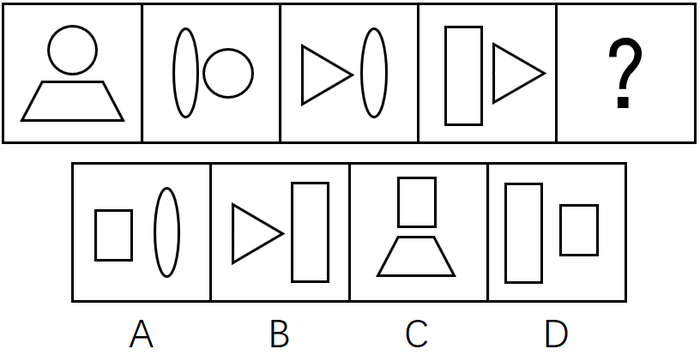

# 样式规律-相邻求同（相同元素遍历-传递）

考点：[[20-考点/判断推理/图形推理/样式规律-相邻求同（相同元素遍历-传递）|图形推理 / 样式规律-相邻求同（相同元素遍历/传递）]]

**问法模型**：五图连排选问号处图形 → 元素组成相似且相同元素重复出现，优先用'相邻两图求同（元素传递链）'模型

## 推理链
1. 第1步：题干各图均由两个独立小元素构成：图1{圆、梯形}、图2{椭圆、圆}、图3{三角形、椭圆}、图4{长方形、三角形}，元素组成相似且同元素反复出现，锁定样式类规律。
2. 第2步：逐一对比相邻两图的共有元素：图1与图2共有'圆'，图2与图3共有'椭圆'，图3与图4共有'三角形'，归纳出规律——相邻两图之间有且只有一个相同元素（上一图新出现的元素传递到下一图）。
3. 第3步：据此图4传递下去的新元素是'长方形'，故问号处图形必须与图4{长方形、三角形}只共有'长方形'这一个元素。
4. 第4步：对照选项：A{正方形、椭圆}与图4无相同元素（正方形≠长方形），排除；B{三角形、长方形}与图4共有两个元素，违反'只有一个'，排除。
5. 第5步：C{正方形、梯形}与图4无相同元素，排除；D{长方形、正方形}与图4仅共有'长方形'，且引入新元素'正方形'，完全符合传递链：圆→椭圆→三角形→长方形→正方形。
6. 第6步：故正确答案为D，与官方答案一致。

**最快解法**：⚡ 相邻求同法（元素传递链）：快速写出相邻两图共有的元素序列'圆→椭圆→三角形→长方形'，锁定问号图必含'长方形'且不得再含'三角形'，直接排除B（含两个相同元素）与A、C（无相同元素），秒选D。

## 易错点
- ⚠ 误选B：B{三角形、长方形}与图4有两个相同元素，违反'有且只有一个相同元素'的限定
- ⚠ 形状辨析缺位：A、C、D中的'正方形'与图4的'竖长方形'是不同形状，误把A当作含'长方形'而纠结
- ⚠ 规律方向看错：误去数整体元素个数或看上下左右位置关系，漏掉'相邻两图求同'这一样式遍历规律

## 母题抽象
> 🧩 当一组图形元素组成相似、相同元素重复出现且每图由两个小元素拼成时，用'相邻两图求同'法，验证相邻图形是否'有且只有一个相同元素'，据此排除共有0个或2个相同元素的选项。

**同类特征**：元素组成相似、相同元素重复出现、每图由两个小元素构成、五图连排含问号、相邻图形求同、样式类-元素遍历/传递

## 相关题
- [[10-真题/判断推理/图形推理/19591586 样式规律-遍历（外框与内部图形的传递关系）|19591586]]（选调 2025，相关度2）
- [[10-真题/判断推理/图形推理/2453037 图形推理-样式规律（遍历）|2453037]]（上海 2020，相关度2）
- [[10-真题/判断推理/图形推理/4808801 样式规律-元素遍历（相邻图形求同-公共元素长方形）|4808801]]（湖北 2022，相关度2）
- [[10-真题/判断推理/图形推理/5676968 样式规律-遍历（外框与内部图形交叉换位）|5676968]]（上海 2018，相关度2）
- [[10-真题/判断推理/图形推理/10204610 样式规律-加减同异（去同存异），九宫格列规律|10204610]]（辽宁 2024，相关度1）

---

### 题干

从所给四个选项中，选择最合适的一个填入问号处，使之呈现一定的规律性：

### 选项
- A. A
- B. B
- C. C
- D. D　✅

### 官方解析
元素组成相似，且相同元素重复出现，优先考虑样式规律的遍历。观察发现题干相邻两图之间都有一个且只有一个相同的元素，只有D项符合。
故正确答案为D。

### 给定材料
（无）
