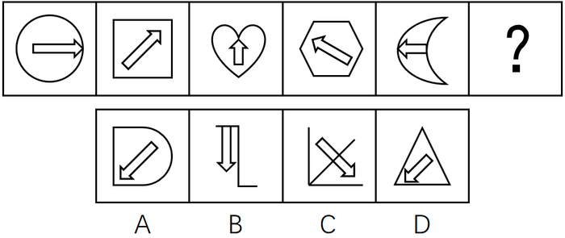

# 位置规律（箭头旋转）+属性规律（外框曲直性）复合考查

考点：[[20-考点/判断推理/图形推理/位置规律（箭头旋转）+属性规律（外框曲直性）复合考查|图形推理 / 位置规律（箭头旋转）+属性规律（外框曲直性）复合考查]]

**问法模型**：问号处填入最合适图形使之呈现规律 → 先找元素位置变化规律（箭头旋转方向），再找属性交替规律（外框曲直性），双规律逐一排除选项

## 推理链
1. 第1步：题干5幅图均由'外框+内部箭头'两元素构成，元素组成基本相同，优先考虑位置规律
2. 第2步：观察箭头方向依次为→、↗、↑、↖、←，每次逆时针旋转45°，问号处箭头应指向左下方（↙）
3. 第3步：逐项对照箭头方向：A项↙、B项↓、C项↘、D项↙，据此排除B、C两项
4. 第4步：继续观察外框曲直性：圆（全曲）、正方形（全直）、心形（全曲）、六边形（全直）、月亮（全曲），呈'全曲、全直'交替规律，问号处外框应为全直线图形
5. 第5步：A项外框为D形（曲+直混合），排除；D项外框为三角形（全直），且箭头指向↙，完全符合规律
6. 第6步：与选项对照得出结论，故正确答案为D

**最快解法**：⚡ 双规律排除法：第一步看箭头旋转——依次逆时针转45°，下一位应为↙，排除B（↓）、C（↘）；第二步看外框曲直交替——全曲、全直、全曲、全直、全曲、？应为全直，排除A（D形为曲直混合），锁定D

## 易错点
- ⚠ 只看箭头旋转规律忽略外框曲直性，A项箭头同为↙极易误选A
- ⚠ 旋转方向判断失误：若把→、↗、↑误看成顺时针规律，会误选C（↘）
- ⚠ 心形、月亮外框含尖角/外凸弧线，易误判其曲直属性，导致'全曲全直交替'规律识别不出

## 母题抽象
> 🧩 当题干图形元素组成基本相同且含箭头/指针类指向元素时，先用指向元素的旋转规律（方向+角度）排除一批选项，再用外框属性（曲直/开闭/对称）的交替规律排除剩余选项，双规律锁定答案

**同类特征**：元素组成基本相同、内外两元素（外框+箭头）、箭头方向依次逆时针旋转45°、外框全曲全直交替、位置规律与属性规律复合出题

## 相关题
- [[10-真题/判断推理/图形推理/11226890 位置规律（端点沿外框顺时针移动+交点沿内部路径逆时针移动的双轨迹平移）|11226890]]（上海 2025，相关度1）
- [[10-真题/判断推理/图形推理/11226914 图形推理-位置规律（交点沿轨迹移动：定点+动点分轨追踪）|11226914]]（上海 2025，相关度1）
- [[10-真题/判断推理/图形推理/13432277 位置规律（旋转）+数量规律（端点加线递增）复合考点|13432277]]（深圳市考 2025，相关度1）
- [[10-真题/判断推理/图形推理/15419024 位置规律-相邻比较（黑白三角形拼接图中相邻两图相同黑块数恒定）|15419024]]（湖北 2025，相关度1）
- [[10-真题/判断推理/图形推理/16095253 功能元素-小白圆标记线条的序号规律|16095253]]（江苏 2024，相关度1）

---

### 题干

从所给的四个选项中选择最合适的一个填入问号处，使之呈现一定的规律：

### 选项
- A. A
- B. B
- C. C
- D. D　✅

### 官方解析

元素组成基本相同，优先考虑位置规律。每幅图形中箭头的方向依次逆时针旋转，排除B、C两项；继续观察发现，题干图形的外框出现全曲线和全直线图形，考虑曲直性，题干图形外框的曲直性分别是全曲、全直、全曲、全直、全曲，故？处应该选择外框是全直线的图形，排除A项。

故正确答案为D。

### 给定材料
（无）
