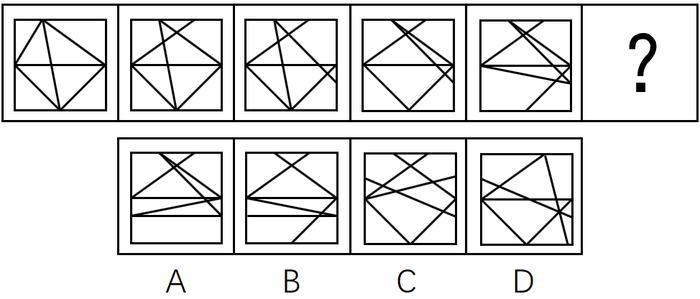

# 位置规律-相邻比较（相邻图形间仅一条直线位移）

考点：[[20-考点/判断推理/图形推理/位置规律-相邻比较（相邻图形间仅一条直线位移）|图形推理 / 位置规律-相邻比较（相邻图形间仅一条直线位移）]]

**问法模型**：'选择最合适的一个填入问号处使之呈现一定规律'且五幅图外框相同、线条仅微调 → 采用相邻比较法：逐对比较相邻图形的差异量，找出恒定的'变动规律'并延续到问号处

## 推理链
1. 第1步：题干五幅图外框一致，内部均由10条直线构成，整体高度相似，仅个别线段位置不同，优先考虑位置/样式微变类规律
2. 第2步：先数面，无明显规律；再数线，题干图形均由10条直线组成且选项也都由10条直线组成，数量规律失效，无法排除，转用'相邻比较'思维
3. 第3步：对比图1和图2，发现只有一条直线位置发生变化；图2到图3、图3到图4、图4到图5同理，每相邻两图均只有一条直线位置变化
4. 第4步：归纳规律：相邻图形间变动直线的数量恒为1，故问号处图形必须与图5仅有1条直线位置不同
5. 第5步：将A、B、C、D分别与图5叠加比对数变动线数：A、C、D与图5相比位置变动的直线均多于1条，不符合规律
6. 第6步：只有B项与图5恰好只有一条直线位置发生变化，满足'只动一条线'的规律，故选B

**最快解法**：⚡ 相邻比较法（口诀：只动一条线）：盯住图5（问号前一图），与四个选项逐一比对，数位置发生变动的直线数量，变动量恰为1条的即为答案，本题只有B符合

## 易错点
- ⚠ 卡死在数量规律：数面无规律、数线发现全是10条后未及时切换'相邻比较'思维，导致无思路
- ⚠ 被'两笔画/奇点'规律干扰：题干均为4个奇点、两笔画图形，选项中仅D是两笔画，易据此选D，而与官方倾向答案B冲突（本题争议来源）
- ⚠ 只判断'有没有变化'而不数'变动几条线'：误把差异多条线的选项也当作符合规律

## 母题抽象
> 🧩 当一组图形外框相同、线条总数相等且仅个别线条位置微调，点/面/线数量规律全部失效时，用'相邻比较法'验证相邻两图间的变动量（如仅一条线位移），问号处延续相同变动量

**同类特征**：外框相同、内部线条整体相似、每幅图恒为10条直线、线条仅位置微调、数面无规律、数线数量无差异、相邻图形仅一条线变动

## 相关题
- [[10-真题/判断推理/图形推理/2049860 数量规律-交点计数（分组分类）|2049860]]（山东 2017，相关度1）

---

### 题干

从所给的四个选项中选择最合适的一个填入问号处，使之呈现一定的规律：

### 选项
- A. A
- B. B　✅
- C. C
- D. D

### 官方解析
思路一：题干已知图形窟窿和线较多，先考虑数面，无明显规律，再考虑数线，图形均由10条直线组成，且选项也都是由10条直线组成，无法排除。无思路时，可以通过相邻比较的思维找规律，对比图1和图2，发现只有一条直线位置发生变化，图2到图3、图3到图4、图4到图5同理，也只有一条直线位置发生变化，故?处也应该与前一幅图只有一条直线位置发生变化，排除A、C、D。
故正确答案为B。
思路二：题干已知图形都有4个奇点，均为两笔画图形，选项中只有D项是两笔画。
故正确答案为D。

注：这道题不严谨，有争议，通过两笔画选到D项，这个思路没有问题，但是我们通过观察题干的出题形式以及图案排布，推测出题人可能更想考查的是相邻图形变动一条直线这个规律。
所以我们粉笔给出的倾向性答案是B项。

### 给定材料
（无）

> [!warning] 疑点（官方解析可能有误，待人工复核）
> 官方解析思路二指出题干图形均有4个奇点、均为两笔画，而选项中仅D为两笔画，按此硬规律应选D，与官方给定答案B直接冲突；官方（粉笔）自认本题不严谨，B仅为对出题人意图'相邻图形变动一条直线'的倾向性推测，并非无争议的排他规律
