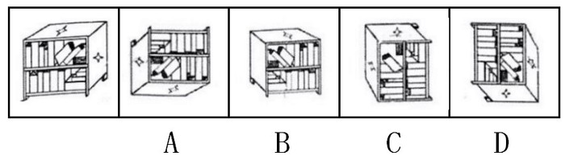

# 空间重构-立体图形旋转一致（面特征比对）

考点：[[20-考点/判断推理/图形推理/空间重构-立体图形旋转一致（面特征比对）|图形推理 / 空间重构-立体图形旋转一致（面特征比对）]]

**问法模型**：'选出和题干图形一样的'（实物立体图可旋转）→ 立体旋转识别模型：锁定各面特征与相对位置，逐项旋转验证排除

## 推理链
1. 第1步：从题干图形提取不变特征——书柜可见正面、右侧面、上面三个面，其中上面和右侧面各有一个四角星，正面柜内有两本倒下的书
2. 第2步：解题规则为空间旋转想象：图形整体旋转（如180°）后各面的图案形状、数量及'书倒向哪一面'等相对关系均不变
3. 第3步：验证A项——由原图旋转180度得到，四角星面位置、两本倒书及书的倒向关系全部对应，与题干图形一致
4. 第4步：排除B项——原图的书应倒向四角星的面，B项中书倒向的是空白面，相对关系不符
5. 第5步：排除C项——原图倒下的书有两本，C项只有一本，数量特征不符
6. 第6步：排除D项——虽可由原图顺时针旋转90度得到，但其侧面出现的是五角星，与原图的四角星不符
7. 第7步：逐项对照后仅A项与题干图形完全一致，故选A

**最快解法**：⚡ 排除法+特征比对：先盯'星形面'抓最刺眼差异——D侧面是五角星直接排除；再数倒书数量，C只有一本排除；再看书的倒向，B倒向空白面排除；最后验证A为整体旋转180°、特征全对应，锁定答案

## 易错点
- ⚠ 只看星形的位置不看形状细节，把五角星当成四角星而误留D
- ⚠ 忽略'书倒向哪一面'这一相对关系（倒向四角星面还是空白面），误选B
- ⚠ 只顾旋转角度匹配而漏数倒下书的数量（两本vs一本），误选C；或误认为旋转180°后图形会变而漏选A

## 母题抽象
> 🧩 当题干给出可旋转的立体实物图并要求选'一样的'时，先提取2~3个不变特征（面图案的形状、数量、倒向等相对关系），再对每项做旋转验证，特征对不上的逐一排除

**同类特征**：立体图形旋转一致、书柜三面可见（正面/侧面/顶面）、四角星面、倒下书的数量与倒向、旋转180°不变、排除法

## 相关题
- [[10-真题/资料分析/综合/2188651 多指标同比状态定性判断（增长方向核对+趋势类选项排除）|2188651]]（河南 2018，相关度1）
- [[10-真题/判断推理/类比推理/1791622 并列关系+功能对应（辨析种属关系）|1791622]]（江苏 2016，相关度1）
- [[10-真题/判断推理/图形推理/2452650 图形推理-位置规律（符号串同异位置模式对应）|2452650]]（江苏 2020，相关度1）
- [[10-真题/判断推理/逻辑判断/2719415 分析推理-排除法（条件匹配）|2719415]]（国考 2021，相关度1）
- [[10-真题/判断推理/类比推理/4662394 逻辑关系-复合考查（原材料与成品的对应关系+种属关系），需核对词项顺序|4662394]]（山东 2022，相关度1）

---

### 题干

请从所给四个选项中选出一项和题干给出的图形一样。

### 选项
- A. A　✅
- B. B
- C. C
- D. D

### 官方解析
原图是一个书柜，从题干的观察视角可以看到书柜的正面、右侧面和上面，并且上面和右侧面分别是一个四角星。
A项：由原图旋转180度得来的，和题干给出的图形是一样的，当选；
B项：通过观察书的方向，发现原图书倒向的面应该是四角星的面，但该项的图书倒向的面是空白面，和原图不符，排除；
C项：原图倒下的书有两本，而C项只有一本，不相符，排除；
D项：通过观察书的方向，是由原图顺时针旋转90度得到的，但是该选项的侧面出现了五角星，与原图不符，排除。
故正确答案为A。

### 给定材料
（无）
