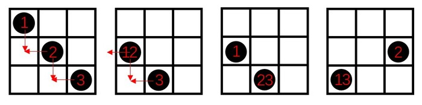

# 位置规律-平移（多黑点标号追踪+重合+循环移动）

考点：[[20-考点/判断推理/图形推理/位置规律-平移（多黑点标号追踪+重合+循环移动）|图形推理 / 位置规律-平移（多黑点标号追踪+重合+循环移动）]]

**问法模型**：题干给出3个九宫格图形求第4图、黑点个数由3变2 → 采用标号追踪法：给每个黑点编号，逐一追踪移动轨迹，用重合与循环移动解释数量变化

## 推理链
1. 第1步：图1黑点位于左上角、中心、右下角（对角线三连）；图2仅见2个黑点（左中、下中）；图3黑点位于右中、左下角——黑点个数3→2→2，元素组成相同但数量不等
2. 第2步：无数量规律、4图不便黑白运算，转向位置规律；黑点减少提示'可能重合'，对三个黑点按就近原则标号1（左上）、2（中心）、3（右下）分别追踪
3. 第3步：图1→图2：1向下移一格（左上→左中），3向左移一格（右下→下中），2向左或向下移一格——无论向左（与1重合于左中）还是向下（与3重合于下中），都能解释图2只见2个点
4. 第4步：图2→图3：1、3继续各移一格在左下角重合（1下移到左下、3左移到左下），而图3右边（右中）新出现小黑点，反推2的移动规律为'向左且循环移动'：中心→左中→右中（绕圈）
5. 第5步：将规律推进到问号处：1继续向下循环移动（左下→绕回左上角），2向左移动（右中→中心），3向左循环移动（左下→绕回右下角）
6. 第6步：对照选项：问号处应为左上角、中心、右下角三个黑点，只有A项符合

**最快解法**：⚡ 标号追踪法（就近原则）：给三个黑点编号，沿'下移/左移一格+循环绕圈'逐图推进，用图2、图3的重合点和新出现点（右中）反推2的移动方向，直接锁定A

## 易错点
- ⚠ 只数黑点个数（3→2→2）误判为数量规律而卡壳，忽略黑点可能重合
- ⚠ 图2中2的移动方向不唯一（向左或向下均可重合），未利用图3右中出现的新黑点反推出2是'向左循环移动'
- ⚠ 忽略循环（绕圈）移动：1从最下行使下移绕回最上行、3从最左列左移绕回最右列，漏掉循环则推不出A

## 母题抽象
> 🧩 当题干出现'多个小元素在网格中逐图移动、元素个数减少疑似重合'的特征时，用标号追踪法逐点假设移动方向，并用后续图形中的重合点与新出现点验证，同时注意循环绕圈移动

**同类特征**：3×3九宫格、黑点个数3→2→2递减、相邻两图黑点位置邻近（就近移动）、疑似黑点重合、求第4个图形、位置类平移规律

## 相关题
- [[10-真题/判断推理/图形推理/3522437 数量规律-面数量（行内加和递推-斐波那契数列）|3522437]]（青海 2021，相关度1）

---

### 题干

从所给的四个选项中，选择最合适的一个填入问号处，使之呈现一定的规律性。

### 选项
- A. A　✅
- B. B
- C. C
- D. D

### 官方解析

元素组成不同，但无数量规律，且题干为4个图形，不能考虑黑白运算，黑点可能存在重合情况，可以考虑位置规律。对黑点进行标号，如下图所示，根据就近原则，图1中，1向下移动一格，3向左移动一格，2向左或向下移动一格，可得到图2；图2到图3中，1和3继续移动，重合出现在左下角，但图3右边出现了小黑点，说明2的移动规律应该为向左移动，且为循环移动，依此规律，1继续向下循环移动，出现在左上角，2向左移动，出现在中心，3向左循环移动，出现在右下角，即问号处样式应为A。

故正确答案为A。

### 给定材料
（无）
