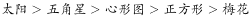

# 天平模型-重量传递排序（不等式串联）

考点：[[20-考点/判断推理/图形推理/天平模型-重量传递排序（不等式串联）|图形推理 / 天平模型-重量传递排序（不等式串联）]]

**问法模型**：题干为一组'倾斜直线+三角形支座+两端小图形'的天平图求延续规律 → 把倾斜方向读作两端物体重量不等式，串联成全序后逐项验证选项

## 推理链
1. 第1步：题干四幅图结构完全一致——一条倾斜直线、中间三角形作支点、直线两端各放一个小图形，即天平（跷跷板）模型；元素种类、个数均无数量规律
2. 第2步：按天平原理'低端一侧重、高端一侧轻'逐图写出不等式：图1五角星在低端→五角星＞心形
3. 第3步：图2心形在低端→心形＞正方形；图3正方形在低端→正方形＞梅花；图4太阳在低端→太阳＞五角星
4. 第4步：利用相邻图的共同元素传递串联：太阳＞五角星＞心形＞正方形＞梅花
5. 第5步：逐项验证选项倾斜方向：A图梅花低端→梅花＞五角星，与链矛盾；B图太阳低端→太阳＞正方形，与链一致
6. 第6步：C图心形低端→心形＞太阳、D图梅花低端→梅花＞正方形，均与链条矛盾，排除，只有B符合

**最快解法**：⚡ 天平法+传递链：'低端重、高端轻'，四图连写一条链'太阳＞五角星＞心形＞正方形＞梅花'，检查每个选项的倾斜方向是否与链一致，排除法秒选B

## 易错点
- ⚠ 把倾斜方向读反（误认为高端重），导致所有不等式反向、选项全错
- ⚠ 只逐图看不等式不做传递排序，无法验证不相邻元素的选项（如B的'太阳与正方形'）
- ⚠ 纠结图形元素种类和个数等常规数量规律，误入歧途；应先识别天平结构这一整体特征

## 母题抽象
> 🧩 当题干每幅图都是'倾斜直线+支点+两端不同元素'的天平结构时，按'低端一侧重'写出不等式并利用共同元素串联成全序，选择与该顺序不矛盾的选项

**同类特征**：每幅图=直线+三角形支座+两端小图形、直线倾斜且倾斜方向不一、元素种类多样但个数无规律、相邻图有共同元素可传递、天平/跷跷板造型、五幅图递进+问号

## 相关题
（暂无）

---

### 题干

从所给的四个选项中，选择最合适的一个填入问号处，使之呈现一定的规律性。

### 选项
- A. A
- B. B　✅
- C. C
- D. D

### 官方解析

每幅图均由三个图形一条直线组成，且直线与三角形位置不变。从元素的种类和个数上均无规律。把直线与三角形组成的图形当成一个天平，由此可得：五角星比心形图重，心形图比正方形重，正方形比梅花重，太阳比五角星重，所以重量从大到小依次为：，排除A、C、D三项。

故正确答案为B。

### 给定材料
（无）
