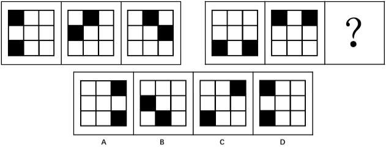

# 位置规律-黑块沿九宫格外圈顺时针循环移动（步长等差递增）

考点：[[20-考点/判断推理/图形推理/位置规律-黑块沿九宫格外圈顺时针循环移动（步长等差递增）|图形推理 / 位置规律-黑块沿九宫格外圈顺时针循环移动（步长等差递增）]]

**问法模型**：两组图、每幅图均为2黑块7白块（元素组成相同）→ 考虑位置规律，用临近假设法追踪黑块沿外圈循环移动的步长，再按等差规律外推问号处图形

## 推理链
1. 第1步：题干两组各三幅3×3九宫格图，每幅图均由2个黑块和7个白块组成，元素组成相同，优先考虑位置规律（黑块移动）而非样式规律。
2. 第2步：将九宫格外圈8格按顺时针编号：左上(1,1)→上中(1,2)→右上(1,3)→右中(2,3)→右下(3,3)→下中(3,2)→左下(3,1)→左中(2,1)，用临近假设法追踪黑块轨迹。
3. 第3步：第一组验证：图1黑块在左上(1,1)和左下(3,1)，各顺时针移1格得图2黑块（上中(1,2)、左中(2,1)）；图2黑块再各顺时针移2格得图3黑块（上中(1,2)、右中(2,3)），步长呈+1、+2递增。
4. 第4步：第二组：图1黑块在左下(3,1)和右下(3,3)，各顺时针移4格后位置对调，得图2黑块（左上(1,1)、右上(1,3)），与图2完全吻合，优先采用与第一组一致的顺时针方向。
5. 第5步：延续第一组'组内步长依次加1'的等差规律，第二组第二步取顺时针+5（若取+8则回到原位与图2相同，选项中无该图形，排除）。
6. 第6步：将图2黑块左上(1,1)和右上(1,3)各顺时针移5格：左上→下中(3,2)，右上→左中(2,1)。
7. 第7步：对照选项，仅B项黑块位于左中(2,1)和下中(3,2)，故选B。

**最快解法**：⚡ 临近假设法（黑块沿外圈追踪）+等差外推：先在第一组数出顺时针+1、+2的步长，第二组图1到图2顺时针+4（两黑块对调），按步长递增1直接把图2两个黑块各顺时针移5格——左上到下中、右上到左中，秒选B。

## 易错点
- ⚠ 方向误判：第二组图1到图2也可读作'逆时针移2格'（与顺时针4格等价），方向不统一会导致后续步长算错，应优先沿用第一组的顺时针方向。
- ⚠ 步长规律误判：若取'顺时针+4、+8'，+8回到原位应与图2相同，而选项中不存在该图形，须按组内步长递增1的等差规律改取+5。
- ⚠ 只盯单个黑块轨迹，忽略两个黑块同步移动且移4格时位置对调（左下与右下路径交叉互换），易漏掉正确解。

## 母题抽象
> 🧩 当图形元素组成相同（黑白块个数不变）且黑块沿九宫格外圈变换位置时，用临近假设法顺时针追踪黑块确定各组步长，组内步长成等差则向下一组外推，并排除'步长满8回原位'的无选项解。

**同类特征**：两组三图式图形推理、3×3九宫格黑白块、每图均为2黑7白（元素组成相同）、黑块位置沿外圈循环变化、问号位于第二组第三图、步长递增规律

## 相关题
- [[10-真题/判断推理/图形推理/2395208 样式规律-黑白运算（黑白叠加）|2395208]]（上海 2018，相关度1）

---

### 题干

从所给四个选项中，选择最合适的一个填入问号处，使之呈现一定的规律性：

### 选项
- A. A
- B. B　✅
- C. C
- D. D

### 官方解析

题干中每幅图形均由2黑块和7白块组成，元素组成相同，考虑位置规律。观察第一组图形，利用临近假设法，第一组图形中第一图中的黑块顺时针移动一个单位得到第二图，第二图中的黑块顺时针移动两个单位得到第三图。

第二组图形中，第一图中的黑块顺时针移动四个单位得到第二图，？处的图形应该是第二图中的黑块顺时针移动五个单位得到第三图，即为B选项。

故正确答案为B。

注意：

①第一组图形中黑块分别移动一个单位和两个单位，第二组图形中黑块可移动四个单位和五个单位，亦可移动四个单位和八个单位，优先考虑等差规律，同时移动八个单位应该与第二组图形相同，而选项中没有该图形，说明上述解析思路与出题人思路不一致。

②第二组图形第一图中的黑块亦可逆时针移动四个单位得到第二图，在做题过程中优先应用与第一组图形相同的移动规律，即顺时针移动，而后再考虑逆时针移动规律。

补充解析：第一组图1和图2进行黑白运算后再顺时针旋转，同理，第二组图形图1和图2进行黑白运算后再顺时针旋转。

### 给定材料
（无）

> [!note] 复核版本状态
> 原题不可计分（underdetermined；来源记录的答案键/竞争项：B）；仅当前明确标注的编辑版按答案B计分。
> 详细原题疑点、修订题面、解析和证据见下方独立复核记录。

<!-- CODEX-ANSWER-REVIEW:BEGIN -->
### 本次独立复核

**复核结论：** `resolved`（答案与解析已核定）

**原题计分状态：** 不计分（`underdetermined`：原题证据不足以唯一判定）。来源中记录的答案键/竞争项：B；这些记录不代表原题已核准答案。

**原题疑点与处理：**

深圳市考 2017 〔20-考点/判断推理/图形推理/位置规律-黑块沿九宫格外圈顺时针循环移动（步长等差递增）〕 — 本题规律并非严格唯一：第二组图1→图2可作'逆时针+2'解读，图2→问号也可取'顺时针+4、+8'（+8回到图2自身但选项中无对应图形），且两组步长序列1、2、…

**当前计分版本：** 明确标注的编辑版；未列出的题干、材料或选项沿用固定题源。答案不回填为原题答案。

**计分答案：** B（可计分）

**复核解析：**

原题可对黑块运动方向和边界回绕作不同假设。修订版明确按顺时针、每步格数递增1且第二组第一步4格，因此图2后应顺时针移动5格。固定图按外圈逐格计数，符合选项B。

**修订题干：**

【编辑修订】只追踪外围的两个黑格，并按顺时针移动。每组中连续两次移动的格数相差1；第二组第一步（图1到图2）为4格。选择图2之后再顺时针移动5格的图形。

**相关信息：**

图形推理—九宫格外围循环移动；方向、起始步长及边界规则都应由题干或数据明确。

**核对依据与来源边界：**

- 固定题源：[原题文件](https://github.com/Mentat-Uran/kaogongzhentizhengliu/blob/84ab93d4b64b61d897bece8a1c0a5bab06b4feb2/10-%E7%9C%9F%E9%A2%98/%E5%88%A4%E6%96%AD%E6%8E%A8%E7%90%86/%E5%9B%BE%E5%BD%A2%E6%8E%A8%E7%90%86/2060634%20%E4%BD%8D%E7%BD%AE%E8%A7%84%E5%BE%8B-%E9%BB%91%E5%9D%97%E6%B2%BF%E4%B9%9D%E5%AE%AB%E6%A0%BC%E5%A4%96%E5%9C%88%E9%A1%BA%E6%97%B6%E9%92%88%E5%BE%AA%E7%8E%AF%E7%A7%BB%E5%8A%A8%EF%BC%88%E6%AD%A5%E9%95%BF%E7%AD%89%E5%B7%AE%E9%80%92%E5%A2%9E%EF%BC%89.md)；内容版本 `84ab93d4b64b61d897bece8a1c0a5bab06b4feb2`，源 Markdown blob `198c0306f34b66511dc697504a4a9b65ee222410`.
- **核心依据：** 固定图逐格追踪两个黑块；按修订规则由4格步长递增至5格，选B。
- 固定题图/公式图：`90-图片/题目图/15c90a14f236968.jpg`, `90-图片/公式图/formula-d49189d80272a7c6.png`.

<!-- CODEX-ANSWER-REVIEW:END -->
