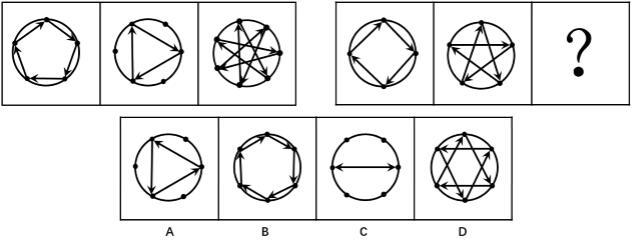

# 图形推理-数量规律+位置规律复合（黑点数量递增+箭头时针方向）

考点：[[20-考点/判断推理/图形推理/图形推理-数量规律+位置规律复合（黑点数量递增+箭头时针方向）|图形推理 / 图形推理-数量规律+位置规律复合（黑点数量递增+箭头时针方向）]]

**问法模型**：两组图各三幅、求第三幅 → 先找元素数量规律（点数等差递增），数量无法排除选项时再叠加位置/方向规律（箭头时针方向）作二级辨析

## 推理链
1. 第1步：题干每幅图均由圆周上的黑点和箭头组成，第一组黑点数目依次为5、6、7，呈等差递增规律
2. 第2步：第二组前两幅黑点数为4、5，按等差规律问号处应为6个黑点；但四个选项黑点数均为6，数量规律失效，需找第二重规律
3. 第3步：观察第一组箭头，任意两个箭头所环绕构成的时针方向均为顺时针
4. 第4步：验证第二组前两图，任意两个箭头环绕的时针方向也均为顺时针，故问号处图形应满足'任意两个箭头环绕方向全为顺时针'
5. 第5步：逐项对照——A项箭头环绕时针方向为逆时针，排除；C项两箭头水平相对、不构成环绕时针方向，排除；D项既存在顺时针又存在逆时针，排除
6. 第6步：B项黑点数为6且任意两个箭头环绕的时针方向均为顺时针，与题干规律完全吻合，故选B

**最快解法**：⚡ 双重规律排除法：先数黑点（4、5→6，选项点数全为6无法排除），立即转向箭头方向——检查每个选项中任意两箭头构成的时针方向，'全顺时针'的只有B

## 易错点
- ⚠ 只盯着黑点数量找规律，发现四个选项点数均为6后陷入僵局，遗漏'箭头时针方向'这第二重规律
- ⚠ D项中顺时针与逆时针混合存在，若只抽查个别箭头方向易误判为符合规律
- ⚠ C项两箭头水平对指不构成任何环绕时针方向，易误当作顺时针而误选

## 母题抽象
> 🧩 当题干图形由'点+箭头（连线）'构成、且各选项在数量上无法区分时，先定数量规律，再用箭头的时针方向（全顺/全逆/混合/无环绕）作二级辨析验证答案

**同类特征**：两组图各三幅求第三幅、黑点数量呈等差递增、圆内箭头连线构成多边形/星形、选项元素数量相同需二次辨析、箭头两两环绕时针方向、全顺时针规律

## 相关题
（暂无）

---

### 题干

从所给四个选项中，选择最合适的一个填入问号处，使之呈现一定的规律性：

### 选项
- A. A
- B. B　✅
- C. C
- D. D

### 官方解析
观察题干，每幅图均由数量若干的黑点和箭头组成。首先可观察黑点数目，第一组图中黑点数目依次为5、6、7，第二组图形中黑点数目为4、5、？，？处的图形黑点数目应为6，而四个选项中黑点数目均为6。观察题干中的箭头，第一组图中任意两个箭头所环绕的时针方向均为顺时针，第二组前两图中任意两个箭头所环绕的时针方向也为顺时针，在选项中寻找任意两个箭头环绕的时针方向仅为顺时针方向的图形。
A选项箭头环绕的时针方向为逆时针，B选项箭头环绕的时针方向为顺时针，C选项不存在时针方向，D选项中箭头环绕的时针方向既存在顺时针也存在逆时针。
故正确答案为B。

### 给定材料
（无）
