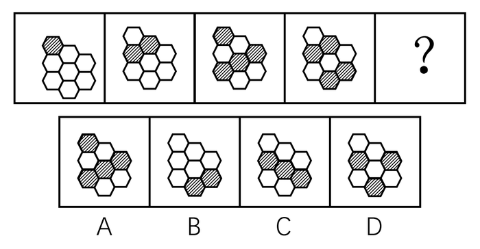

# 图形推理-位置规律（阴影移动路径+相邻图阴影不重合）

考点：[[20-考点/判断推理/图形推理/图形推理-位置规律（阴影移动路径+相邻图阴影不重合）|图形推理 / 图形推理-位置规律（阴影移动路径+相邻图阴影不重合）]]

**问法模型**：“选择最合适的一个填入问号处，使之呈现一定的规律性”且四幅图轮廓完全相同→阴影数量无规律时转向阴影位置规律，先用强特征排除、再验证移动路径

## 推理链
1. 第1步：四幅题干图形轮廓完全相同（均为同一蜂窝状六边形组合），仅内部阴影位置不同；阴影数量（1、2、3、3）没有明显规律，故由数量类转向位置规律。
2. 第2步：观察阴影分布：题干所有阴影均落在同一条蓝线上，或隔着一条蓝线的两条蓝线上，即阴影沿固定斜线分布。
3. 第3步：追踪移动路径：阴影从图1开始每次整体向右下移动一格，且当阴影移动到第三条蓝线处就会出现一个新阴影，据此可先排除C、D两项。
4. 第4步：再取另一强特征验证：题干中相邻两幅图的阴影部分位置均不重合，因此问号处图形的阴影位置必须与图4完全不重合。
5. 第5步：逐项对照：B、C、D三项的阴影位置均与图4的阴影位置出现重合，违反“相邻图阴影不重合”规律，B、C、D全部排除。
6. 第6步：A项阴影位置与图4完全不重合，且符合“同一蓝线分布+逐次向右下移动+到第三条蓝线补新阴影”的完整路径，故正确答案为A。

**最快解法**：⚡ 排除法（邻图不重合秒杀）：只需将四个选项与图4逐一比对阴影位置——题干相邻两图阴影从不重合，而B、C、D均与图4重合，十秒内排除三项，直接锁定A，无需推完整个移动路径

## 易错点
- ⚠ 死磕阴影数量（1、2、3、3无固定规律）走不出来，忽略“轮廓完全相同→优先看位置规律”的常规转换
- ⚠ 只验证“阴影在同一条蓝线上”这一层规律就选答案，误选C或D，漏掉“向右下逐格移动+移到第三条蓝线补新阴影”的叠加验证
- ⚠ 忽略“相邻两图阴影位置不重合”这一隐蔽强特征，与图4比对不仔细而误选B/C/D

## 母题抽象
> 🧩 当题干出现“多幅图形轮廓完全相同、内部阴影（或小元素）数量无明显规律”时，转看位置规律：先用“相邻图阴影不重合”等强特征做排除，再用“沿固定方向逐格移动+按条件补充新元素”的路径规律验证答案

**同类特征**：四幅图轮廓完全相同（蜂窝状六边形组合）、阴影数量无明显规律、阴影均落在同一条蓝线（或隔一条蓝线的两条蓝线）上、阴影逐图向右下移动、相邻两图阴影位置不重合、移到第三条蓝线处补出新阴影

## 相关题
（暂无）

---

### 题干

从所给四个选项中，选择最合适的一个填入问号处，使之呈现一定的规律性：

### 选项
- A. A　✅
- B. B
- C. C
- D. D

### 官方解析

解法一：

题干图形轮廓都相同，但阴影部分数量没有明显规律，考虑位置规律。观察发现，题干中相邻两幅图的阴影部分的位置均不重合，B、C、D项阴影部分的位置均与图4出现重合，只有A项符合此规律。

解法二：

题干图形轮廓都相同，但阴影部分数量没有明显规律，考虑位置规律。观察题干中阴影部分发现，所有阴影部分均出现在同一条蓝线（或隔着一条蓝线的两条蓝线上，如下图所示），排除C、D两项，且阴影从第一幅图开始每次向右下列移动，移动到第三条蓝线处就会出现新的阴影，排除B项。

故正确答案为A。

### 给定材料
（无）
