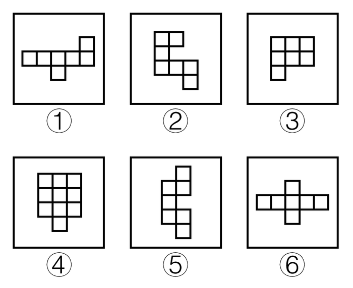
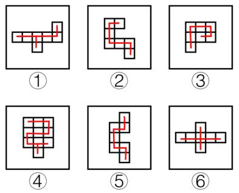

# 一笔画规律（小正方形的连通遍历：一笔-两笔连接所有方块）

考点：[[20-考点/判断推理/图形推理/一笔画规律（小正方形的连通遍历：一笔-两笔连接所有方块）|图形推理 / 一笔画规律（小正方形的连通遍历：一笔/两笔连接所有方块）]]

**问法模型**：六个图形分成两类、各自有共同规律 → 元素组成相同时先排除位置规律，转向'一笔画连通'属性分类

## 推理链
1. 第1步：六个图形均由若干小正方形拼接而成，元素组成基本相同，对称、旋转等位置规律不明显
2. 第2步：转换视角，把相邻（有公共边）的小正方形视为可连通通过的通道，考察能否用一笔不间断地连接（穿过）所有小正方形
3. 第3步：逐图试画——图②③⑤的方块呈链状/蛇形连通，可一笔画依次连接所有小正方形
4. 第4步：图①④⑥存在'死路端点'或中心分叉结构（如图①上下突出的方块、图⑥十字中心），一笔无法遍历全部方块，需两笔才能连接
5. 第5步：按'一笔能连通'与'需两笔'分成两组：①④⑥一组，②③⑤一组，对应C项

**最快解法**：⚡ 一笔画试画法：用笔从任一方块出发，沿公共边相邻方块移动、每个方块只经过一次，试画全程；能一笔穿完所有方块的归为一类（②③⑤），中途被迫断开需另起一笔的归为另一类（①④⑥），直接锁定C

## 易错点
- ⚠ 误用线条一笔画的'奇点数'规则来判断，本题考的是小正方形（面）的连通一笔画，不是线段交点的一笔画
- ⚠ 看到元素组成相同就优先找旋转、翻转、平移等位置规律，方向跑偏浪费时间
- ⚠ 只数小正方形个数、看对称性等表面数量特征，忽略'能否一笔连通遍历'这一本质规律

## 母题抽象
> 🧩 当分组题中六个图形均由小方块拼接且数量、位置规律均失效时，改用'一笔画能否连接所有小方块'来分类：链状无分叉的可一笔，出现死路端点或十字分叉的需两笔

**同类特征**：六个图形均由小正方形拼接组成、元素组成基本相同但无明显位置规律、要求分成两类、每类有共同规律、方块呈链状、十字状等不同连通形态、考查一笔画/多笔画连通遍历

## 相关题
（暂无）

---

### 题干

把下面六个图形分成两类，使每一类图形都有各自共同的规律或特征，分类正确的一项是：

### 选项
- A. ①②③，④⑤⑥
- B. ①②④，③⑤⑥
- C. ①④⑥，②③⑤　✅
- D. ①④⑤，②③⑥

### 官方解析

元素组成基本相同，但无明显位置规律。观察发现，图②③⑤均能由一笔画连接所有小正方形，图①④⑥均需要两笔才能连接所有小正方形（如下图所示），故①④⑥为一组，②③⑤为一组。

故正确答案为C。

### 给定材料
（无）
