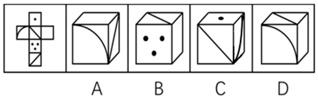

# 空间重构-六面体折叠（相对面排除+画边法验证相邻面）

考点：[[20-考点/判断推理/图形推理/空间重构-六面体折叠（相对面排除+画边法验证相邻面）|图形推理 / 空间重构-六面体折叠（相对面排除+画边法验证相邻面）]]

**问法模型**：“左边给定纸盒外表面，哪一项能由它折叠而成”→ 空间重构题，先用相对面排除，再用画边法/公共边法验证相邻面位置

## 推理链
1. 第1步：从展开图提取信息——六个面分别带有点（单点、三点）、对角线（三角形）、弧线（四分之一圆）等图案及空白面，官方已标注a、b、c、d等面
2. 第2步：应用相对面规则——展开图中同行且中间隔一个面的两个面互为相对面，相对面在立体图中不能同时出现
3. 第3步：定位面b与面d在展开图中同行、中间隔一个面，二者为相对面
4. 第4步：对照A项——弧线面b与对角线面d同时出现（相邻呈现），违反相对面规则，排除
5. 第5步：对照D项——同样同时出现面b与面d，违反相对面规则，排除
6. 第6步：对照C项应用画边法——对题干和选项的面b均顺时针画边1-4，题干面b的第1条边邻接面a，而C项面b的第3条边才邻接面a，相邻面位置错位，排除
7. 第7步：B项三个可见面的图案及其相邻位置关系均与展开图一致，故正确答案为B

**最快解法**：⚡ 排除法两步走：①一眼锁定“同行隔一个”的面b与面d为相对面，直接秒杀同时出现二者的A、D；②对剩余C项以面b为基准顺时针画边1-4，比对公共边所邻面（题干第1条边邻a、选项第3条边邻a），排除C，锁定B

## 易错点
- ⚠ 相对面判定失误：只记“同行隔一个”，漏掉“Z字形两端”也是相对面，或误把展开图相邻关系直接搬到立体图
- ⚠ 画边法时针方向不统一：题干与选项必须以同一面、同一顶点、同一时针方向编号，否则公共边对应关系会判错
- ⚠ 只验证相邻面却忽略面内图案（点、弧线、对角线）的方向，导致图案朝向不一致的选项漏排

## 母题抽象
> 🧩 当题干为“六面体展开图+四个立体图选项”的折叠题时，先找“同行隔一/Z两端”的相对面排除选项，剩余选项用画边法（以带图案的特征面为起点顺时针标边1-4）比对相邻面顺序验证

**同类特征**：纸盒外表面折叠、六面体展开图、相对面不能同时出现、同行隔一个面、画边法比对公共边、带图案面（点/弧/对角线）

## 相关题
- [[10-真题/判断推理/图形推理/12019707 空间折叠（六面体折纸盒）——相对面排除＋公共边画边法-公共点引线法|12019707]]（广东 2026，相关度1）
- [[10-真题/判断推理/图形推理/12561915 空间重构-六面体折叠（相对面排除+公共点法）|12561915]]（浙江 2024，相关度1）
- [[10-真题/判断推理/图形推理/16070182 空间重构-六面体展开图折叠（相对面排除＋相邻面数字方向验证）|16070182]]（湖北 2026，相关度1）
- [[10-真题/判断推理/图形推理/1746880 空间重构-六面体折叠（相对面排除+画边法）|1746880]]（国考 2016，相关度1）
- [[10-真题/判断推理/图形推理/1791646 空间重构-六面体折叠（公共点法+相对面排除）|1791646]]（江苏 2016，相关度1）

---

### 题干

左边给定的是纸盒的外表面，下列哪一项能由它折叠而成？

### 选项
- A. A
- B. B　✅
- C. C
- D. D

### 官方解析

本题为空间重构题目，用排除法解题，题干图形标号如下图。

 

A项：面b和面d在展开图中同行中间隔一个，属于相对面，相对面不能同时出现，排除；

B项：与题干一致，当选；

C项：如上图所示，同时对题干和选项的 b面进行顺时针画边，选项的第三条边对应着a面，题干的第一条边对应着a面，选项和题干不一致，排除；

D项：面b和面d在展开图中同行中间隔一个，属于相对面，相对面不能同时出现，排除。

故正确答案为B。

### 给定材料
（无）
