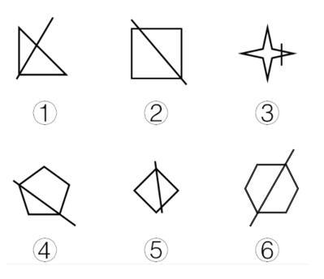

# 属性规律-对称轴与附加直线的位置关系（分组分类，辅以点线数量验证）

考点：[[20-考点/判断推理/图形推理/属性规律-对称轴与附加直线的位置关系（分组分类，辅以点线数量验证）|图形推理 / 属性规律-对称轴与附加直线的位置关系（分组分类，辅以点线数量验证）]]

**问法模型**：'把六个图形分为两类，使每一类都有各自的共同特征'→ 分组分类模型：先找六图共同结构（轴对称图形+一条附加直线），以该直线为切入点比较其与对称轴的位置关系

## 推理链
1. 第1步：六图结构统一，均为'一个轴对称图形（三角形、正方形、四角星、五边形、菱形、六边形）+ 一条穿越图形的直线'，直线是天然切入点
2. 第2步：逐一画出各图形的对称轴，检验对称轴与这条附加直线的位置关系是否垂直
3. 第3步：③四角星的横向对称轴与图中竖直短线垂直，④正五边形、⑥正六边形也各存在一条与所画直线垂直的对称轴，故③④⑥为一组
4. 第4步：①②⑤中不存在与附加直线垂直的对称轴（②中直线仅接近平行于对角线方向，与任一对称轴均不垂直），故①②⑤为一组
5. 第5步：数量规律复核——数直线依次为4、5、9、6、5、7，数交点依次为4、5、10、5、5、6：①②⑤点数=线数，③④⑥点数与线数相差1，分组结果与对称规律完全一致
6. 第6步：两种规律均指向①②⑤一组、③④⑥一组，对照选项仅C符合，故选C

**最快解法**：⚡ 对称轴垂直法：识别出每图都是'轴对称图形+一条直线'后，直接检验该直线是否与某条对称轴垂直——垂直的③④⑥一组，不垂直的①②⑤一组，秒选C；若对称位置看不准，可用'交点数与直线数是否相等'的计数口诀复核（①②⑤相等、③④⑥差1）

## 易错点
- ⚠ 只判断'是否轴对称/对称轴有几条'，漏看对称轴与附加直线的相对位置（垂直与否）这一真正分组依据
- ⚠ ②中直线方向接近正方形对角线，易误认为与另一对角线（对称轴）垂直，把②错分入③④⑥组
- ⚠ 用数点验证时漏数直线与图形边线的交叉点，导致点线数量关系算错而动摇分组

## 母题抽象
> 🧩 当六个图形都呈现'轴对称图形+一条附加直线'的组合特征时，以附加直线为切入点，按'是否与某条对称轴垂直'分组，并用'交点数与直线数相等/相差1'做二次验证

**同类特征**：图形分类分组题（6图分2类）、每图=多边形/星形+一条附加直线、图形均为轴对称图形、直线穿越图形、线条交叉明显、对称轴与直线的垂直关系、点线数量可计数复核

## 相关题
（暂无）

---

### 题干

把下面的六个图形分为两类，使每一类图形都有各自的共同特征或规律，分类正确的一项是：

### 选项
- A. ①②③，④⑤⑥
- B. ①③④，②⑤⑥
- C. ①②⑤，③④⑥　✅
- D. ①④⑥，②③⑤

### 官方解析
解法一：题干图形均有为一个图形与一条直线组成，以此条直线为切入点，经过观察可发现③④⑥图形中的一条对称轴与直线为垂直关系，而①②⑤的对称轴与该直线不垂直。
故正确答案为C。
解法二：元素组成不同，且无明显属性规律，考虑数量规律。观察发现，题干全部为直线，并且出现多边形，考虑数直线，直线数依次为4、5、9、6、5、7,无明显规律，继续观察发现，题干线条交叉明显，考虑数点，点数量依次为4、5、10、5、5、6，那么图①②⑤点数量与线数量相等，为一组，图③④⑥点数量和线数量相差1，为一组。
故正确答案为C。

### 给定材料
（无）
