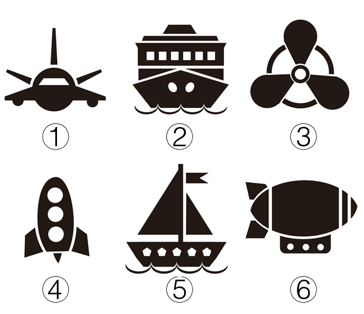

# 数量规律-部分数（黑色连通部分数）

考点：[[20-考点/判断推理/图形推理/数量规律-部分数（黑色连通部分数）|图形推理 / 数量规律-部分数（黑色连通部分数）]]

**问法模型**：题干要求把六个图形分为两类、每类各有共同特征 → 元素组成不同且属性规律不明显时，数黑色图形的连通部分数，按数值一致的两两分组。

## 推理链
1. 第1步：六个图形均为黑色粗线条的生活化剪影（①飞机、②轮船、③风扇、④火箭、⑤帆船、⑥飞艇），元素组成不同，对称、曲直等属性规律无法分成两类。
2. 第2步：转向数量规律，粗线条剪影优先数'部分数'（互不相连的黑色连通块个数）；图中白色镂空（④的三个圆形舷窗、②的方形窗、⑤的星形窗）是挖空，不计为部分。
3. 第3步：清点①④⑤：①由带机翼的机身、竖立尾翼、左右两个起落架轮共4个不相连黑色块组成；④由箭形机身、左右侧翼、底部小三角共4部分（白色舷窗不算）；⑤中桅杆下端与船体相连算1部分，连同桅顶旗、大三角帆、小三角帆、底部波浪线，共4部分。
4. 第4步：清点②③⑥：②由船体、船身横条、舱顶结构、甲板线条、上下多段波浪线等共7个黑色块；③由三个叶片、中心圆环、被叶片截断成多段的外圈圆弧共7部分；⑥由艇身、左右尾翼、吊舱、圆点、条纹等共7部分。
5. 第5步：按部分数分组：①④⑤均为4个部分，②③⑥均为7个部分。
6. 第6步：对照选项，只有D（①④⑤，②③⑥）满足两组各自数值一致，故选D。

**最快解法**：⚡ 数黑块法（部分数）：逐图清点不相连的黑色连通块个数，①④⑤都是4块、②③⑥都是7块，直接锁定D；白色镂空不计、相连黑块算1块。

## 易错点
- ⚠ 把白色镂空（火箭圆形舷窗、船上的白窗、五角星窗）当作独立部分或误数成'面'的数量，走错到面规律。
- ⚠ 把相邻但实际断开的黑块数错：⑤的桅杆与船体相连应算1个部分，③的外圈圆弧被叶片截断成多段应分开数。
- ⚠ 生活化剪影图形易诱导先找对称、曲直等属性规律，浪费时间后才发现应数部分数。

## 母题抽象
> 🧩 当题干出现黑色粗线条生活化剪影、元素组成不同且对称/曲直等属性规律分不出两类时，用'数黑色连通部分数'的方法分组，验证两组数值各自一致且唯一对应一个选项。

**同类特征**：黑色粗线条剪影、生活化实物图形（飞机/轮船/风扇/火箭/帆船/飞艇）、元素组成不同、无明显属性规律、白色镂空细节、部分数4与7分组

## 相关题
- [[10-真题/判断推理/图形推理/10204454 数量规律-部分数（黑白球连通区域数做和）|10204454]]（甘肃 2024，相关度2）
- [[10-真题/判断推理/图形推理/10297050 数量规律-特殊计数（线条穿过小白球的数量）|10297050]]（天津 2025，相关度2）
- [[10-真题/判断推理/图形推理/10297262 数量规律-面的形状种类（封闭面种类数分组）|10297262]]（浙江 2025，相关度2）
- [[10-真题/判断推理/图形推理/10297314 数量规律-交点数（曲直交点）|10297314]]（浙江 2025，相关度2）
- [[10-真题/判断推理/图形推理/11454020 数量规律-小元素按行排布（每行个数自上而下递增1）|11454020]]（选调 2024，相关度2）

---

### 题干

把下面的六个图形分为两类，使每一类图形都有各自的共同特征或规律，分类正确的一项是：

### 选项
- A. ①③④，②⑤⑥
- B. ①②⑤，③④⑥
- C. ①⑤⑥，②③④
- D. ①④⑤，②③⑥　✅

### 官方解析
元素组成不同，且无明显属性规律，优先考虑数量规律。题干图形均有黑色粗线条组成，考虑部分数，观察可发现①④⑤均为四个部分组成，②③⑥均为七个部分组成。
故正确答案为D。

### 给定材料
（无）
