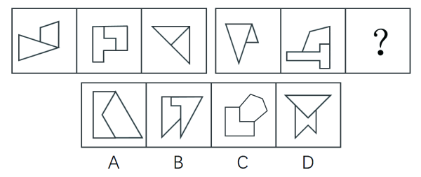
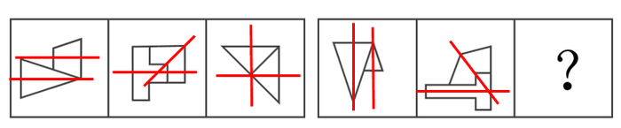

# 对称性-两子图形对称轴位置关系（平行-相交及夹角变化）

考点：[[20-考点/判断推理/图形推理/对称性-两子图形对称轴位置关系（平行-相交及夹角变化）|图形推理 / 对称性-两子图形对称轴位置关系（平行/相交及夹角变化）]]

**问法模型**：两组式'选出最合适的一个填入问号处'且每幅图由两个轴对称子图形拼合 → 分别画出两子图形的对称轴，考查两轴位置关系（平行还是相交）的组内规律

## 推理链
1. 第1步：题为两组式图形推理，第一组3幅图，第二组前2幅图＋问号，每幅图都由两个子图形组成，且分开看两子图形均为轴对称图形（出现等腰三角形、等腰梯形等对称特征图）。
2. 第2步：对每幅图的两个子图形分别画出对称轴，比较'两轴位置关系'这一分组规律。
3. 第3步：第一组：图1两子图形对称轴互相平行（夹角0°）；图2两对称轴相交成夹角；图3两对称轴相交成夹角，规律为'平行、相交、相交'。
4. 第4步：第二组：图1两对称轴平行（夹角0°）；图2两对称轴相交成夹角；按'平行、相交、？'规律，问号处应为两子图形对称轴相交成夹角的图形。
5. 第5步：逐项验证：A、B、C中两子图形的对称轴呈平行（或共线）关系，不符合'相交成夹角'；D项两子图形（三角形与下方带缺口图形）的对称轴相交成夹角，符合规律。
6. 第6步：故正确答案为D。（注：解析二'交点数6+4=10、5+11→？=6'指向A，属干扰性次规律，命题方倾向对称性规律，因本卷已考过点数量且对称性为国考高频考点。）

**最快解法**：⚡ 画轴法＋排除法：识别'每图由两个轴对称子图形拼合'的特征 → 给两子图形分别画对称轴 → 第一组'平行、相交、相交'，第二组'平行、相交、？'→ 锁定问号处两轴应相交 → 只有D满足，秒选D。

## 易错点
- ⚠ 只把每幅图当整体看对称性，漏掉'分开看两个子图形均为轴对称图形'的分层要求，导致找不到规律入口。
- ⚠ 被解析二的'交点数量'规律（6+4=10，5+11→6）带偏选A，未结合'本卷已考点数量、对称性为国考高频'的命题频度判断主规律。
- ⚠ 画对称轴时粗心，把平行误判为相交（或忽略夹角关系），尤其是图形拼合后整体不对称时误用整体对称轴。

## 母题抽象
> 🧩 当每幅图由两个子图形拼合、且出现等腰三角形/等腰梯形等轴对称特征图时，分别画出两子图形的对称轴，考'两轴平行还是相交（及夹角）'的组内一致规律。

**同类特征**：两组式图形推理（3+3，末图问号）、每幅图由两个子图形拼合而成、子图形均为轴对称图形、出现等腰三角形、等腰梯形等对称特征图、对称轴位置关系：平行/相交夹角、对称性考法的创新变形

## 相关题
（暂无）

---

### 题干

从所给的四个选项中，选出最合适的一个填入问号处，使之呈现一定的规律性：

### 选项
- A. A
- B. B
- C. C
- D. D　✅

### 官方解析

解析一：观察图形发现，每幅图都由两个图形组成，且分开看两图形均为轴对称图形。如下图所示，将所有图形的对称轴分别画出来后发现，第一组图的对称轴分别是平行（形成夹角为）、相交形成夹角、相交形成夹角；第二组图也分别是平行（形成夹角为）、相交形成夹角、？，故？处应选择一个两图对称轴相交形成夹角的图形，只有D项符合。

故正确答案为D。

解析二：元素组成不同考虑数量规律，第一组图形交点数量依次为6、10、4，6+4=10；第二组图形交点数依次为5、11、？，因此？处填一个6个交点数的图形，只有A项符合。

本题粉笔倾向于解析一，考查对称性。因为从图形特征上来看，数点特征不明显，此次国考图形题中已有题目考察点数量，再考点数量可能性不大。而对称性是国考高频考点，且图形中出现了等腰三角形、等腰梯形，存在对称性的特征图，本题也是对称性这一考点的创新考法，同学需重点注意。

### 给定材料
（无）

> [!note] 复核版本状态
> 原题不可计分（underdetermined；来源记录的答案键/竞争项：A、D）；仅当前明确标注的编辑版按答案D计分。
> 详细原题疑点、修订题面、解析和证据见下方独立复核记录。

<!-- CODEX-ANSWER-REVIEW:BEGIN -->
### 本次独立复核

**复核结论：** `resolved`（答案与解析已核定）

**原题计分状态：** 不计分（`underdetermined`：原题证据不足以唯一判定）。来源中记录的答案键/竞争项：A、D；这些记录不代表原题已核准答案。

**原题疑点与处理：**

国考 2018 〔20-考点/判断推理/图形推理/对称性-两子图形对称轴位置关系（平行-相交及夹角变化）〕 — 官方解析一中对称轴夹角的具体度数在文字中缺失（'平行（形成夹角为）、相交形成夹角'处疑为丢失°数值）；另解析二的交点数规律（第二组应为6个交点）指向A，与正确答…

**当前计分版本：** 明确标注的编辑版；未列出的题干、材料或选项沿用固定题源。答案不回填为原题答案。

**计分答案：** D（可计分）

**复核解析：**

固定提交中公式图可恢复，分别表示0°、45°、90°。第一组依次呈平行（0°）、相交45°、相交90°；第二组前两图同样为0°、45°，因此问号处需为90°。D的两子图形对称轴夹角为90°，符合修订版条件。原题另有交点数规则指向A，现已明确指定只按对称轴夹角判断。

**修订题干：**

【编辑修订版】只依据每幅图两个子图形各自对称轴之间的夹角，按0°、45°、90°的顺序补全；选择问号处图形。

**相关信息：**

图形推理—复合图形的子图对称轴夹角。交点数量规则与对称轴夹角是不同判据，原题修订版显式限定其一。

**核对依据与来源边界：**

- 固定题源：[原题文件](https://github.com/Mentat-Uran/kaogongzhentizhengliu/blob/84ab93d4b64b61d897bece8a1c0a5bab06b4feb2/10-%E7%9C%9F%E9%A2%98/%E5%88%A4%E6%96%AD%E6%8E%A8%E7%90%86/%E5%9B%BE%E5%BD%A2%E6%8E%A8%E7%90%86/2133630%20%E5%AF%B9%E7%A7%B0%E6%80%A7-%E4%B8%A4%E5%AD%90%E5%9B%BE%E5%BD%A2%E5%AF%B9%E7%A7%B0%E8%BD%B4%E4%BD%8D%E7%BD%AE%E5%85%B3%E7%B3%BB%EF%BC%88%E5%B9%B3%E8%A1%8C-%E7%9B%B8%E4%BA%A4%E5%8F%8A%E5%A4%B9%E8%A7%92%E5%8F%98%E5%8C%96%EF%BC%89.md)；内容版本 `84ab93d4b64b61d897bece8a1c0a5bab06b4feb2`，源 Markdown blob `b4db89d959dd3e8faedc5762df386dcbc784f54e`.
- **核心依据：** 恢复题图及度数公式图，明确为0°、45°、90°；按对称轴夹角规则唯一选D。
- 固定题图/公式图：`90-图片/题目图/181c7204558e2bb.png`, `90-图片/公式图/formula-7faaf32849bdc330.png`, `90-图片/公式图/formula-74e1ecb0e0308bb7.png`, `90-图片/公式图/formula-d49189d80272a7c6.png`, `90-图片/题目图/1603f2a818dcb8f.png`.

<!-- CODEX-ANSWER-REVIEW:END -->
