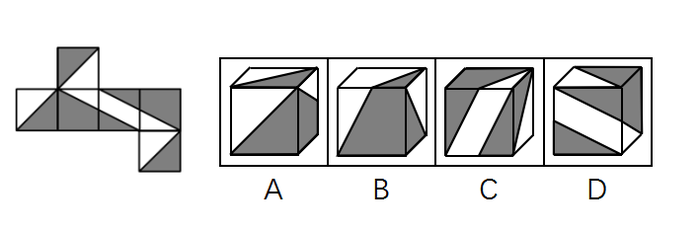
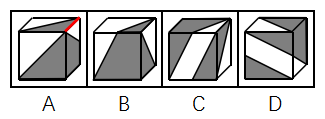

# 空间重构-六面体折叠（特征边定位+相邻关系验证）

考点：[[20-考点/判断推理/图形推理/空间重构-六面体折叠（特征边定位+相邻关系验证）|图形推理 / 空间重构-六面体折叠（特征边定位+相邻关系验证）]]

**问法模型**：左图为正方体展开图，问哪一项能由它折叠而成 → 先按图案给六面分类编号，再以三角形长直角边作'指针边'，逐项比对折叠后相邻边的贴合图案

## 推理链
1. 第1步：将展开图六个面标记为a–f，按图案归类：面a、b、f三个面相同（黑白对角分割面），面c、e两个面相同（含小白三角形的面），面d为含两个黑三角形的面。
2. 第2步：所用规则——特征边描边法：每个面上的三角形有长短直角边之分，折叠后'哪条边挨着哪个面的哪种图案'是唯一确定的，以此检验选项相邻关系。
3. 第3步：A项侧面是面c或面e：选项中小白三角形的长直角边挨着黑色三角形，而展开图中无论取哪个位置，面c/e的小白三角形长直角边都挨着白色三角形，相邻关系不一致，排除。
4. 第4步：B项顶面的图案在展开图六个面中根本不存在（出现新面），面型缺失，直接排除。
5. 第5步：C项正面是面d：选项中面d右侧黑色小三角形的长直角边挨着黑色大三角形，而展开图中面d两个黑三角形的长直角边（无论取边1还是边2）都没有挨着黑色大三角形，相邻关系不一致，排除。
6. 第6步：D项既可由面a、面d、面e组合而成，也可由面c、面d、面f组合而成，两种组合的相邻贴合关系均与展开图一致，当选。

**最快解法**：⚡ 特征边描边法+排除法：第一步先扫选项找'不存在的面'秒排B；第二步给三角形长直角边描边当指针，A项小白三角长直角边应贴白三角却贴了黑三角、C项面d长直角边不应贴黑色大三角形却贴了，均排；D项两组面组合（a/d/e或c/d/f）均吻合，选D。

## 易错点
- ⚠ 只看'面上有三角形'而不区分长短直角边，误以为A、C与展开图图案一致而漏排
- ⚠ B项顶面是新图案，容易被相似三角形面迷惑，误当成展开图中的某个面而漏排
- ⚠ D项存在两组可行的面组合（面a、d、e 或 面 c、d、f），只验证其中一组就下结论，可能误判'另一个顶面方向不对'

## 母题抽象
> 🧩 当折纸盒题干出现'多个面图案相同、图形由带长短直角边的三角形构成'时，先给相同面编号归类，再用三角形长直角边作指针逐项验证相邻边贴合图案，先排'选项出现图中不存在的面'，再排'特征边指向不符'。

**同类特征**：正方体外表面展开图折纸盒、三个面图案完全相同（面a/b/f）、两个面图案完全相同（面c/e）、图案含可区分长短直角边的三角形、选项为三个可视面的立体图、问'哪一项能由它折叠而成'

## 相关题
- [[10-真题/判断推理/图形推理/1805286 空间重构-立体折叠（五棱柱展开图，相邻面黑白关系排除）|1805286]]（上海 2016，相关度1）
- [[10-真题/判断推理/图形推理/2042116 空间重构-四面体折叠（相邻面公共边+箭头法）|2042116]]（江苏 2017，相关度1）
- [[10-真题/判断推理/图形推理/2043634 空间重构-六面体折叠（相对面排除＋时针法＋公共点法）|2043634]]（江苏 2017，相关度1）
- [[10-真题/判断推理/图形推理/2172154 空间重构-六面体折纸盒（相对面排除＋公共点法）|2172154]]（广州市考 2018，相关度1）
- [[10-真题/判断推理/图形推理/2367814 空间重构-四面体折叠（相邻面公共边与特征线-箭头指向检验）|2367814]]（江苏 2019，相关度1）

---

### 题干

左图给定的是正方体纸盒的外表面，下面哪一项能由它折叠而成？

### 选项
- A. A
- B. B
- C. C
- D. D　✅

### 官方解析

本题属于空间重构类，将六个面分别标记a-f，其中面a、b、f相同，面c、e相同。

逐一分析选项： 

A项：

选项侧面是面c或面e。在选项中，侧面中小白三角形长直角边挨着的是黑色三角形，但如上图所示，无论是哪一种情况，展开图中面c或面e的小白三角形的长直角边都挨着白色三角形，相邻关系不一致，排除；

B项：选项上方的面在展开图中没有出现，排除；

C项：

选项正面是面d，如上图所示，选项中面d右侧的黑色小三角形的长直角边挨着黑色大三角形，而展开图中面d的两个黑三角形的长直角边，无论是边1还是边2（如上图所示），都没挨着黑色大三角形，相邻关系不一致，排除。

D项：可以由面a、面d和面e组成，也可以由面c、面d和面f组成，两种情况都可以，当选。

故正确答案为D。

### 给定材料
（无）
