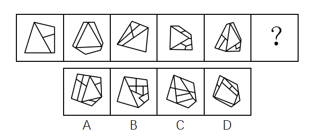

# 数量规律-数面（封闭区域数）＋最大面形状二级辨析

考点：[[20-考点/判断推理/图形推理/数量规律-数面（封闭区域数）＋最大面形状二级辨析|图形推理 / 数量规律-数面（封闭区域数）＋最大面形状二级辨析]]

**问法模型**：'选择最合适的一个填入问号处，使之呈现一定的规律性' → 先数封闭区域（面）数量找递增规律，再用最大面形状等二级属性筛选同数选项

## 推理链
1. 第1步：题干五幅图元素组成不同，且每幅图均被内部线条分隔为多个封闭区域，符合数面题的典型特征，优先考虑数面
2. 第2步：依次数题干各图面数量，依次为3、4、5、6、7，构成公差为1的等差递增规律，故问号处图形应有8个面
3. 第3步：数选项面数量：A项为9个面，不符合8个面的要求，排除A；B、C、D均为8个面，一级规律无法唯一确定答案
4. 第4步：回看题干寻找二级规律：五幅图中面积最大的面均为一个三角形面
5. 第5步：用'最大面为三角形'对照B、C、D：只有B项中面积最大的面是三角形，C、D项最大面形状不是三角形
6. 第6步：同时满足'8个面'与'最大面为三角形'的只有B项，故正确答案为B

**最快解法**：⚡ 数面法＋最大面属性筛选：先数面得3、4、5、6、7递增，锁定应为8个面，排除A（9个面）；B/C/D同为8个面时，用'题干最大面均为三角形'这一步二级验证，一眼锁定B

## 易错点
- ⚠ 只做一级数面规律，发现B、C、D面数相同后未做二级辨析，随意误选C或D
- ⚠ 把二级属性记成'图中有三角形面'而非'面积最大的面是三角形'——C、D中也可能存在三角形小面，但最大面不是三角形，导致错选
- ⚠ 数面时漏数或重复数被公共边分隔的小区域，如把A项9个面误数为8个面而带入二级比较

## 母题抽象
> 🧩 当题干图形元素组成不同且被线条分隔为多个封闭区域时，先数面找数量规律（等差递增/常数/周期）；若剩余多个选项面数相同，则叠加'最大面形状、面的形状种类、面与外框的关系'等二级属性完成筛选

**同类特征**：元素组成不同、图形被内部分隔线划分为多个区域、面数量呈3→7等差递增、最大面均为三角形、多个选项面数相同需二级辨析

## 相关题
- [[10-真题/判断推理/图形推理/10204454 数量规律-部分数（黑白球连通区域数做和）|10204454]]（甘肃 2024，相关度1）
- [[10-真题/判断推理/图形推理/10204604 数量规律-线数量（汉字横线数）|10204604]]（辽宁 2024，相关度1）
- [[10-真题/判断推理/图形推理/10297050 数量规律-特殊计数（线条穿过小白球的数量）|10297050]]（天津 2025，相关度1）
- [[10-真题/判断推理/图形推理/10297127 图形间关系-相交图形中不相交边数量（黑白图形相交）|10297127]]（天津 2025，相关度1）
- [[10-真题/判断推理/图形推理/10297148 数量规律-线的细化（端点连线穿过线条数；备选：平行线组数）|10297148]]（天津 2025，相关度1）

---

### 题干

从所给的四个选项中，选择最合适的一个填入问号处，使之呈现一定的规律性：

### 选项
- A. A
- B. B　✅
- C. C
- D. D

### 官方解析
观察图形发现，元素组成不同且图形被分隔为多个区域，优先考虑数面。题干图形面数量分别为3、4、5、6、7，呈递增规律，故？处应选择一个面数量为8的图形。观察选项发现，A项9个面，B项8个面，C项8个面，D项8个面，排除A选项。进一步观察发现，题干所有图形中，面积最大的面均为一个三角形的面，只有B选项符合。
故正确答案为B。

### 给定材料
（无）
