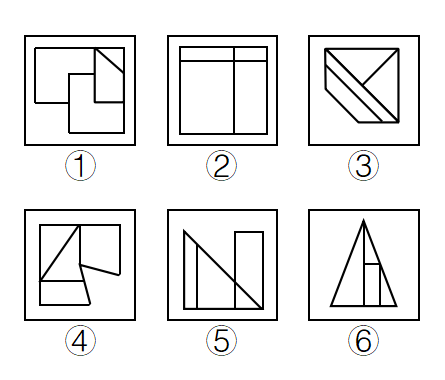

# 数量规律-面数量相同时看面的形状特征（是否存在完全相同的面）

考点：[[20-考点/判断推理/图形推理/数量规律-面数量相同时看面的形状特征（是否存在完全相同的面）|图形推理 / 数量规律-面数量相同时看面的形状特征（是否存在完全相同的面）]]

**问法模型**：'六个图形分为两类，每类有各自共同特征' → 分组分类题：先数面数量，数量一致时升级比较面的形状特征进行分组

## 推理链
1. 第1步：观察六个图形，均由内部线条把外框分隔为若干封闭区域，逐个数面，①②③④⑤⑥的面数量均为4个，面数量无法分组
2. 第2步：依据'数量相同看形状'的升级思路，转而比较每个图形内部各面的形状特征，聚焦'是否存在两个完全相同的面'
3. 第3步：图①中两个面形状大小完全相同；图③中两条平行斜线与外框夹出两个完全相同的三角形面；图⑥中大三角形内部存在两个完全相同的小三角形面，故①③⑥同组
4. 第4步：图②的四个面（上部横条、左侧大矩形、右侧竖格等）形状各不相同；图④四个面互不相同；图⑤的三角形与矩形组合各面也互不相同，即②④⑤均不存在两个完全相同的面
5. 第5步：按'①③⑥存在两个完全相同的面，②④⑤各面互不相同'分组，对照选项只有C（①③⑥，②④⑤）符合

**最快解法**：⚡ 面数量退化法：先数面发现均为4个→立即升级看面的形状→快速扫每个图形找'两个一模一样的面'，①③⑥有、②④⑤无，直接锁定C

## 易错点
- ⚠ 面数量全部相同（均4个）后陷入僵局，未想到一级数量规律失效时升级观察面的形状特征
- ⚠ 把'形状相近'误判为'完全相同'，如④⑤中某些面貌似相似但大小或边数不同，误归入①③⑥组
- ⚠ 图③受平行斜线条纹干扰，未识别出两个完全相同的三角形面而漏判

## 母题抽象
> 🧩 当分组分类题中各图形的面数量（或点、线数量）完全一致时，立即升级观察面的二级特征——是否存在完全相同的面、最大/最小面的形状，据此分组验证

**同类特征**：分组分类题、封闭区域明显、面数量均为4、面的形状特征、完全相同的面、一级规律失效升级二级规律

## 相关题
- [[10-真题/判断推理/图形推理/12019817 数量规律-面的细化（面的形状：所有面均为四边形）|12019817]]（浙江 2026，相关度1）
- [[10-真题/判断推理/图形推理/12561860 数量规律-面数量与属性规律-对称轴数量的复合对应规律|12561860]]（浙江 2024，相关度1）
- [[10-真题/判断推理/图形推理/12561867 数量规律-相同元素的位置关系（对角相对-边邻相邻）分组分类|12561867]]（浙江 2024，相关度1）
- [[10-真题/判断推理/图形推理/12561900 数量规律-面与外框的位置关系（面是否有公共边-悬空面）|12561900]]（浙江 2024，相关度1）
- [[10-真题/判断推理/图形推理/17058596 图形推理-数量规律-面数量（封闭区域数·常数规律）|17058596]]（选调 2023，相关度1）

---

### 题干

把下面的六个图形分为两类，使每一类图形都有各自的共同特征或规律，分类正确的一项是：

### 选项
- A. ①②④，③⑤⑥
- B. ①④⑤，②③⑥
- C. ①③⑥，②④⑤　✅
- D. ①⑤⑥，②③④

### 官方解析
本题为分组分类题。观察图形发现，题干中图形均被分隔为不同的封闭区域，考虑面数量。但题干图形面数量均为4个，可考虑面的特征。观察发现，题干中有的图形中存在两个完全相同的面，有的图形中几个面均不相同，即图①③⑥中均存在两个完全相同的面，图②④⑤中不存在两个完全相同的面，因此可将图形分为①③⑥一组，②④⑤一组。
故正确答案为C。

### 给定材料
（无）
