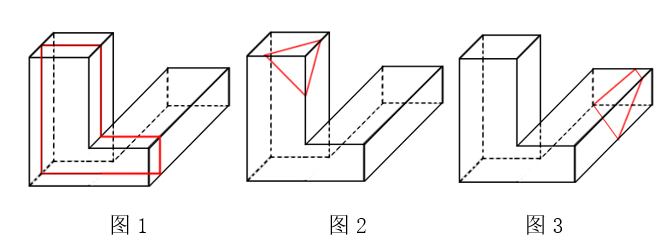

# 截面图-立体图形截面（选非）

考点：[[20-考点/判断推理/图形推理/截面图-立体图形截面（选非）|图形推理 / 截面图-立体图形截面（选非）]]

**问法模型**：“哪一项不可能是该立体图形的截面”→ 选非题，对每项设想一个切割平面（刀切构造法），无法构造出的形状即答案

## 推理链
1. 第1步：题干立体为L形柱体，由竖直矩形柱与底部水平矩形柱拼接而成，所有表面均为矩形平面、面面夹角均为直角
2. 第2步：截面题通用方法——设想切割平面的位置与方向：平行于某面切、从棱切到面、从面切到面；截面边数=平面所交到的面数
3. 第3步：A项为L形：在图形前面的L形部分平行于前面竖直向下切，截面与前面轮廓全等，可切出
4. 第4步：B项为倒三角形：在L形拐角处斜着‘从棱切到面’，平面只与三个面相交，可切出倒置三角形
5. 第5步：C项为直角三角形：要切出三角形须只交三个面，而斜切平面与直角面相交所得的角只能是锐角或钝角，无法同时保留直角，官方判定‘无法切出直角三角形'
6. 第6步：D项为等腰梯形：斜着‘从面切到面’，平面与四个面相交且交到一对平行面，可切出梯形
7. 第7步：本题为选非题，A、B、D均可构造截出，唯C无法切出，故选C

**最快解法**：⚡ 刀切构造法+排除：先易后难——A沿前面平行竖切即得L形；D面到面斜切四个面得梯形；B拐角处棱到面斜切得倒三角形；剩下C的直角三角形无法由直角面斜切构造，直接锁定C

## 易错点
- ⚠ 忽略‘选非题’问法，误把能切出的A/B/D当答案
- ⚠ 误以为‘斜切就能切出直角三角形’，忽略直角来自面与面的垂直关系，斜截面上的角一般变为锐角或钝角
- ⚠ 忽略截面边数=切割平面所交面数这一限制，三角形只能由平面恰好交三个面切出

## 母题抽象
> 🧩 当题干为‘给定立体图形+选择不可能的截面’时，用刀切构造法：平行切得同形/矩形、棱到面斜切得三角形、面到面斜切得四边形（含梯形），逐项排除可构造项，剩下的即为答案

**同类特征**：给定立体图形求截面、选非问法（‘不可能’）、L形拼接柱体、表面全为矩形、选项含L形/三角形/梯形、区分平行切、棱到面切、面到面切

## 相关题
（暂无）

---

### 题干

左图是给定的立体图形，将其从任一面剖开，下面哪一项不可能是该立体图形的截面？

### 选项
- A. A
- B. B
- C. C　✅
- D. D

### 官方解析

A项：在图形前面的L形部分，竖直向下可以切出，如图1所示；

B项：在图形的一角斜着从棱切到面，可以切出，如图2所示；

C项：无法切出直角三角形；

D项：在图形的一角斜着从面切到面，可以切出，如图3所示。

本题为选非题，故正确答案为C。

### 给定材料
（无）
